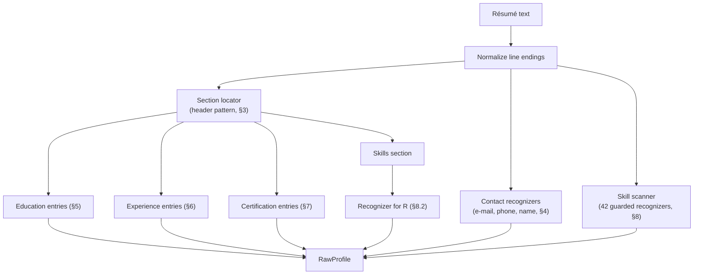
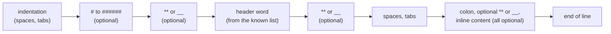

# Regular Expressions — Formal Design (Stage 1: Extraction)

The first component of ResumeLens detects, in the plain text of a résumé, the elements that later stages use to evaluate a
candidate: contact information, programming languages, frameworks and libraries, databases, academic qualifications, professional
experience, tools and technologies, and other qualifications relevant to the supported profiles. The model used is **regular
expressions**, implemented with Python's `re` module (`src/core/extraction/content_extractor.py`).

For each type of information this document gives (a) the regular expression, exactly as it is written in the code, and (b) the
language, or textual pattern, that the expression recognizes. All examples and counts were obtained by running the extractor.

| Information type | Section | Fields of the output |
|---|---|---|
| Contact information | §4 | `ContactInfo.name`, `.email`, `.phone` |
| Academic qualifications | §5 | `RawProfile.education` |
| Professional experience | §6 | `RawProfile.experience` |
| Other qualifications: certifications | §7 | `RawProfile.certifications` |
| Programming languages | §8.2 | `RawProfile.raw_skills` |
| Frameworks and libraries | §8.3 | `RawProfile.raw_skills` |
| Databases | §8.4 | `RawProfile.raw_skills` |
| Tools and technologies | §8.5 | `RawProfile.raw_skills` |
| Other qualifications relevant to the profiles | §8.6 | `RawProfile.raw_skills` |

## 1. Formal background

### 1.1 Regular expressions and regular languages

Let $\Sigma$ be the alphabet of the résumé text (the Unicode characters of the document). The **regular expressions** over $\Sigma$ are
defined inductively:

- $\varepsilon$ (the empty word) and every symbol $a \in \Sigma$ are regular expressions;
- if $r$ and $s$ are regular expressions, so are the union $(r \mid s)$, the concatenation $(rs)$ and the star $(r^{*})$.

The language $L(r) \subseteq \Sigma^{*}$ denoted by a regular expression is

$$L(\varepsilon) = \{\varepsilon\},\quad L(a) = \{a\},\quad L(r \mid s) = L(r) \cup L(s),\quad L(rs) = L(r)\,L(s),\quad L(r^{*}) = L(r)^{*}.$$

Derived forms used by the extractor: $r^{+} = r\,r^{*}$, $r? = (r \mid \varepsilon)$, $r\{m,n\}$ (between $m$ and $n$ repetitions), and
character classes $[c_1 \dots c_k] = (c_1 \mid \dots \mid c_k)$. By Kleene's theorem, the languages denoted by regular expressions are
exactly the languages accepted by finite automata (regular languages). This is the theoretical reason for using them in the first stage:
locating strings of a fixed, finite shape needs no memory beyond a finite number of states.

### 1.2 Python syntax and formal operators

| Python syntax | Formal meaning | Use in the extractor |
|---|---|---|
| `a\|b` | union | alternative spellings of a skill |
| `ab` | concatenation | every pattern |
| `a*`, `a+`, `a?`, `a{m,n}` | star, plus, optional, bounded repetition | separators, e-mail parts, `#{1,6}` in headers |
| `[abc]`, `[^abc]` | class, complement of a class | `[\s-]`, `[A-Z0-9]`, `[^\W\d_]` |
| `\w`, `\d`, `\s` | classes: word characters (Unicode letters, digits, `_`), digits, whitespace | boundaries and separators |
| `.` | any character except a line break | inline content after a header |
| `(?:r)` | grouping | every alternation |
| `^`, `$` (multiline) | start and end of a line | header lines, names, bullets |
| `re.IGNORECASE` | case-insensitive language $L_i(r)$ | all skill recognizers |
| `(?-i:r)` | exact-case sub-expression | `Node`, `Excel`, `ML`, `REST` |
| `(?<!c)`, `(?!c)` | **guards**: condition on the character before or after the match | token boundaries (§1.4) |
| `(?P<n>r)` | capture; does not change the language | header text and inline content |

### 1.3 Constructs in use

All the 50 patterns of the extractor (43 skill recognizers, the section-header pattern and six contact, name and bullet patterns)
were parsed and scanned:

| Construct | Patterns using it |
|---|---|
| Alternation, optional parts, classes, grouping, repetition, anchors, wildcard | all those that need them |
| Negative look-behind and look-ahead of **one character** | 44 (the 43 skill recognizers and the phone pattern) |
| Back-references (non-regular) | **none** |
| Lazy quantifiers | **none** |
| Positive look-arounds | **none** |
| Repetition nested inside another unbounded repetition | 2: `_EMAIL_RE` `(?:\.[\w-]+)+` and `_DATE_RANGE_RE` `(?:\d{4}\s*[-–.]\s*)+\d{4}` |

Both nested repetitions are unambiguous: every iteration starts with a mandatory literal (`.` in the e-mail, a separator in the date range)
that the inner repetition cannot consume, so a backtracking engine has a single way to match and the cost stays linear in the text.
Because there are no back-references, every pattern denotes a regular language.

### 1.4 Guarded recognizers

A skill must not be recognized inside a longer word (`SQL` inside `PostgreSQL`) or inside a different token (`JS` inside `Node.js`). This is a
condition on the *neighbours* of the match, not on the match itself. Add two end-markers $\vdash$ and $\dashv$ to the text $t = t_1 \dots t_n$
($t_0 = \vdash$, $t_{n+1} = \dashv$). A **guarded recognizer** is a triple $G = (r, B, A)$: a body $r$, a set $B \subseteq \Sigma$ of forbidden
predecessors and a set $A \subseteq \Sigma$ of forbidden successors. Its matches in $t$ are

$$M_G(t) = \{\, (i, j) \;:\; t_i \dots t_j \in L(r),\ t_{i-1} \notin B,\ t_{j+1} \notin A \,\}.$$

The set of texts that contain at least one match is the language
$\Sigma^{*}\,\bigl((\Sigma \setminus B) \cup \{\vdash\}\bigr)\,L(r)\,\bigl((\Sigma \setminus A) \cup \{\dashv\}\bigr)\,\Sigma^{*}$, a concatenation of regular
languages, hence **regular**. A one-character look-around is therefore only a notation for restricting the neighbouring symbol, and does not
leave the class of regular languages.

For the 42 recognizers written with `_p(...)` (all but `R`), with $W$ the set of word characters:

$$B = W \cup \{\texttt{.},\ \texttt{+},\ \texttt{\#},\ \texttt{-}\},\qquad A = W \cup \{\texttt{+},\ \texttt{\#}\}.$$

Under `re.IGNORECASE` the body denotes $L_i(r)$, the words obtainable from $L(r)$ by changing the case of letters; $L_i(r)$ is regular as well.
A sub-expression `(?-i:r)` keeps its exact case; it is marked **†** in the tables of §8.

### 1.5 Finite languages

Excluding the version suffix of `PYTHON` and the single letter `R`, the body of every skill recognizer denotes a **finite** language: 41 of the
43 bodies were expanded automatically (§8). Whitespace is shown as `␣` (any whitespace character, class `\s`), and every form is shown in lower
case unless it is exact-case (†).

## 2. How Stage 1 is built in code

`ContentExtractor` is stateless. Its patterns are module-level constants, compiled once, and its methods are pure functions of the text.



| Piece | Where | Role |
|---|---|---|
| `_header_pattern(headers)` | `content_extractor.py` | builds the header-line pattern from a set of header words |
| `*_HEADERS` constants | same | header vocabulary per section (English and Spanish) |
| `_EMAIL_RE`, `_PHONE_RE`, `_DATE_RANGE_RE`, `_NAME_LABEL_RE`, `_NAME_RE` | same | contact recognizers |
| `_BULLET_RE` | same | bullet marker removed from entries |
| `_p(name, body)` and `_SKILL_PATTERNS` | same | the 43 skill recognizers, each with its guards |
| `find_section`, `extract_*` | `ContentExtractor` | public operations; `extract` assembles the `RawProfile` |

The skill recognizers are built by one function, which adds the guards of §1.4 to a body:

```python
def _p(name, body, *, section_only=False):
    regex = re.compile(rf"(?<![\w.+#-])(?:{body})(?![\w+#])", re.IGNORECASE)
    return _SkillPattern(name, regex, section_only)
```

The output of the stage is two immutable records: `ContactInfo(name, email, phone)` and
`RawProfile(contact, education, experience, certifications, raw_skills)`. Missing data is `""` or `()`; the extractor never raises on an
absent field. Skills are returned as **surface forms**, exactly as written; mapping them to canonical tokens is the work of Stage 2
(`1-transducer_formalization.md`).

## 3. Shared machinery: section headers and entries

### 3.1 Header lines

A *header line* is a line that contains only a known header word, with optional Markdown decoration and optional inline content. For a set of
header words $H$ the pattern is built as the alternation of the (escaped) words, longest first:

```text
^[ \t]*(?:\#{1,6}[ \t]*)?(?:\*\*|__)?(?P<h>h1|h2|…)(?:\*\*|__)?[ \t]*(?::(?:\*\*|__)?[ \t]*(?P<rest>.*))?$
```

compiled with `re.IGNORECASE | re.MULTILINE`. The language of one header line, writing $\sqcup$ for a space or tab, is

$$\sqcup^{*}\ (\texttt{\#}\{1,6\}\ \sqcup^{*})?\ (\texttt{**} \mid \texttt{\_\_})?\ h\ (\texttt{**} \mid \texttt{\_\_})?\ \sqcup^{*}\ \bigl(\texttt{:}\ (\texttt{**} \mid \texttt{\_\_})?\ \sqcup^{*}\ \Sigma_{\neq \text{newline}}^{*}\bigr)?\quad (h \in H,\ \text{any letter case}).$$



**Why only whole lines.** The pattern is anchored at both ends of the line. A header word inside a sentence (`Experience with Python`) is not a header, because
after the word the pattern allows only decoration, an optional colon, or the end of the line.

**Known headers.** The extractor knows 55 header words: the headers it extracts and the headers it only uses as delimiters.

| Family | Words | Count |
|---|---|---|
| Education | `education`, `academic background`, `academic qualifications`, `educación`, `educacion`, `formación académica`, `formacion academica`, `formación`, `estudios` | 9 |
| Experience | `experience`, `work experience`, `professional experience`, `employment history`, `work history`, `experiencia`, `experiencia profesional`, `experiencia laboral` | 8 |
| Certifications | `certifications`, `certificates`, `licenses & certifications`, `licenses and certifications`, `certificaciones`, `certificados` | 6 |
| Skills | `technical skills`, `skills`, `skills & tools`, `core competencies`, `technologies`, `tech stack`, `habilidades`, `habilidades técnicas`, `competencias técnicas`, `competencias`, `tecnologías` | 11 |
| Delimiters only | `summary`, `professional summary`, `profile`, `objective`, `projects`, `languages`, `interests`, `references`, `contact`, `awards`, `publications`, `volunteering`, `volunteer experience`, `perfil`, `resumen`, `proyectos`, `idiomas`, `intereses`, `referencias`, `contacto`, `premios` | 21 |

### 3.2 Section body

`find_section(header, text)` finds the first header line whose word is `header` and returns everything up to (but excluding) the next header line of **any**
known word, together with the inline content written after a colon. If the section does not exist it returns `""`. The requested word is added to the
set of delimiters even if it is not in the list. Line endings are normalized first (`\r\n` and `\r` become `\n`).

### 3.3 Entries

A section body is split into **entries**: one per line, after removing a bullet marker and dropping lines without any word character (blank lines and rules such as `-----`).

```text
_BULLET_RE   ^\s*(?:[-*•·▪‣●◦○■]|\d+[.)])\s+
```

The marker is one symbol of the set `- * • · ▪ ‣ ● ◦ ○ ■`, or a number followed by `.` or `)`, and at least one whitespace character after it.

**Examples** (results returned by the extractor):

`⏎` marks a line break.

| Text | Operation | Result |
|---|---|---|
| `Education:⏎MIT` | `find_section('Education')` | `MIT` |
| `## Education⏎MIT` | `find_section('Education')` | `MIT` |
| `**Education:**⏎MIT` | `find_section('Education')` | `MIT` |
| `EDUCATION⏎MIT` | `find_section('Education')` | `MIT` |
| `Skills: Python, SQL⏎` | `find_section('Skills')` | `Python, SQL` |
| `Educación⏎Universidad Nacional` | `extract_education` | `('Universidad Nacional',)` |
| `Experience with Python⏎Education⏎MIT` | `find_section('Experience')` | `""` (not a header) |
| `Education⏎- B.Sc. CS, UNAL, 2020⏎2) Diploma, SENA, 2018⏎------⏎` | `extract_education` | `('B.Sc. CS, UNAL, 2020', 'Diploma, SENA, 2018')` |

## 4. Contact information

### 4.1 E-mail

```text
_EMAIL_RE   [\w.+-]+@[\w-]+(?:\.[\w-]+)+
```

With $W$ the word characters, $L_1 = W \cup \{\texttt{.}, \texttt{+}, \texttt{-}\}$ and $L_2 = W \cup \{\texttt{-}\}$, the language is

$$L_1^{+}\ \texttt{@}\ L_2^{+}\ (\texttt{.}\ L_2^{+})^{+}.$$

That is: a local part of one or more characters from $L_1$, an `@`, and a domain made of two or more labels separated by dots. The **first** occurrence in
the text is returned. No check is made on the length or the content of the last label.

### 4.2 Phone number

```text
_PHONE_RE       (?<![\w@])\+?\(?\d[\d \t().-]{7,}\d(?!\w)
_DATE_RANGE_RE  (?:\d{4}\s*[-–.]\s*)+\d{4}
digit count     9 <= number of digits <= 15
```

A candidate is an optional `+`, an optional `(`, a digit, **seven or more** digits or separators (`␣`, tab, `(`, `)`, `.`, `-`), and a final digit, not preceded by a
word character or `@` and not followed by a word character. With $D$ the digits and $S = D \cup \{\sqcup, \texttt{(}, \texttt{)}, \texttt{.}, \texttt{-}\}$:

$$(\texttt{+})?\,(\texttt{(})?\,D\,S^{\{7,\}}\,D.$$

Two conditions that are also regular but are checked after matching, as a filter: the candidate has between **9 and 15 digits**, and it is not entirely a year range
(a candidate that fully matches `_DATE_RANGE_RE` is discarded, so `2018 - 2021` is never a phone number). The first candidate that passes is returned.

### 4.3 Name

```text
_NAME_LABEL_RE  ^(?:name|nombre)\s*:\s*(?P<n>.+)$        (case-insensitive)
_NAME_RE        ^[^\W\d_]+(?:[ '’.-]+[^\W\d_]+){0,4}$
```

The name is searched in the **first 10 non-empty lines**. First, a line of the form `Name: …` or `Nombre: …` gives the name directly. Otherwise, the first line whose text, after removing
Markdown decoration (`#`, `*`, `_`), is one to five words made only of letters (`[^\W\d_]` is "a word character that is neither a digit nor `_`", i.e. a Unicode letter), separated by
spaces, apostrophes, dots or hyphens. Lines equal to a title (`Resume`, `CV`, `Curriculum Vitae`, …) and header lines are skipped. This is a heuristic: it recognizes the *shape* of a personal
name, not the fact that a text is a name.

**Examples** (results returned by the extractor):

| Field | Text | Result |
|---|---|---|
| e-mail | `Contact: jane.doe@example.com` | `jane.doe@example.com` |
| e-mail | `a+b.c@sub.dom-ain.org` | `a+b.c@sub.dom-ain.org` |
| e-mail | `josé@correo.co` | `josé@correo.co` |
| e-mail | `jane@` | `""` |
| e-mail | `@example.com` | `""` |
| phone | `Tel: +57 300 123 4567` | `+57 300 123 4567` |
| phone | `Tel: (300) 123-4567` | `(300) 123-4567` |
| phone | `Tel: +1 (415) 555-2671` | `+1 (415) 555-2671` |
| phone | `Tel: 300.123.4567` | `300.123.4567` |
| phone | `2018 - 2021` | `""` |
| phone | `Tel: 12345678` | `""` |
| phone | `Tel: 1234567890123456` | `""` |
| name | `Jane Doe⏎Tel: 1` | `Jane Doe` |
| name | `Name: María Pérez⏎` | `María Pérez` |
| name | `# José Núñez⏎` | `José Núñez` |
| name | `Resume⏎Summary⏎Ada Lovelace⏎` | `Ada Lovelace` |

## 5. Academic qualifications

Academic qualifications are recognized **structurally**: by the section that contains them (§3).

```text
Header words (9)   education, academic background, academic qualifications, educación, educacion,
                   formación académica, formacion academica, formación, estudios
Entries            one per non-empty line of the section, without bullet marker (§3.3)
```

The language recognized is the set of lines between an education header (case-insensitive, with Markdown decoration, §3.1) and the next known header. The expression does not look
inside the lines: degree names, institutions or years are returned together, as written. Output: `RawProfile.education`, a tuple of strings.

## 6. Professional experience

```text
Header words (8)   experience, work experience, professional experience, employment history, work history,
                   experiencia, experiencia profesional, experiencia laboral
Entries            one per non-empty line of the section, without bullet marker (§3.3)
```

Same structure as §5: the lines between an experience header and the next known header, one entry per role line or bullet. Roles, employers and date ranges are not parsed. Output:
`RawProfile.experience`.

## 7. Other qualifications: certifications

```text
Header words (6)   certifications, certificates, licenses & certifications, licenses and certifications,
                   certificaciones, certificados
Entries            one per non-empty line of the section, without bullet marker (§3.3)
```

Same structure as §5. Output: `RawProfile.certifications`. Certifications that a candidate lists inside the skills section are not separated; they are recognized only if they mention a skill of §8.

## 8. Technical skills

### 8.1 Template and conventions

Every recognizer of this section is a guarded recognizer (§1.4) with body $r$ written in the code. The language of $r$ is shown as the set of **forms** the recognizer accepts:

- forms are lower case because matching is case-insensitive (`JS`, `js` and `Js` are all recognized), except those marked **†**, which are exact-case;
- `␣` stands for any whitespace character, `.` and `-` are literal;
- the *Not matched* column gives one input, checked against the extractor, that contains the skill's letters but is **not** recognized because of a guard (a word boundary or exact case), and what the extractor returns for it.

For the whole text, the recognized forms are collected by all recognizers together (§9).

### 8.2 Programming languages

Each language is recognized as a single word. `JAVASCRIPT` accepts the abbreviation `js` and `ecmascript`; the `js` of `Node.js` or `React.js` is excluded by the look-behind on `.`. `PYTHON` accepts an optional version suffix. `R` is a single letter, too ambiguous for the whole text: it is **exact-case**, has its own guards (it is also rejected next to `&`, `'` and `-`, as in `R&D`) and is only searched inside the skills section.

Regular expressions (bodies, case-insensitive; the guards of §1.4 are added by `_p`):

```text
JAVASCRIPT       java[\s-]?script|js|ecmascript
TYPESCRIPT       type[\s-]?script
PYTHON           python(?:[\s-]?3(?:\.\d+)?)?
R                (?<![\w.&+#'-])R(?![\w+#&'-])
```

| Token | Language recognized (forms) | Not matched (verified) |
|---|---|---|
| `JAVASCRIPT` | `ecmascript`, `java-script`, `javascript`, `java␣script`, `js` | `Node.js` → only `Node.js` |
| `TYPESCRIPT` | `type-script`, `typescript`, `type␣script` | `typescripting` → no skill |
| `PYTHON` | `python`; and `python3`, `python␣3`, `python-3`, each optionally followed by `.` and one or more digits (`python3.11`). Infinite language because of the digit suffix. | `Pythonic style` → no skill |
| `R` | `R`† (exact case), only inside the skills section | `Skills⏎Worked on R&D⏎` → no skill |

### 8.3 Frameworks and libraries

Front-end frameworks accept the `js` suffix with an optional separator (`React.js`, `ReactJS`, `React-js`). `NODE_JS` accepts `Node.js` and the bare exact-case word `Node`. Libraries accept the common spellings with an optional separator (`scikit-learn`, `sklearn`).

Regular expressions (bodies, case-insensitive; the guards of §1.4 are added by `_p`):

```text
REACT            react(?:[\s.-]?js)?
ANGULAR          angular(?:[\s.-]?js)?
VUE              vue(?:[\s.-]?js)?
NODE_JS          node[\s.-]?js|(?-i:Node)
DJANGO           django
SPRING_BOOT      spring[\s-]?boot
PANDAS           pandas
NUMPY            num[\s-]?py
SCIKIT_LEARN     scikit[\s-]?learn|sklearn
TENSORFLOW       tensor[\s-]?flow
PYTORCH          py[\s-]?torch
```

| Token | Language recognized (forms) | Not matched (verified) |
|---|---|---|
| `REACT` | `react`, `react-js`, `react.js`, `reactjs`, `react␣js` | `reactive programming` → no skill |
| `ANGULAR` | `angular`, `angular-js`, `angular.js`, `angularjs`, `angular␣js` | `triangular` → no skill |
| `VUE` | `vue`, `vue-js`, `vue.js`, `vuejs`, `vue␣js` | `revue` → no skill |
| `NODE_JS` | `node-js`, `node.js`, `nodejs`, `node␣js`, `Node`† | `the node failed` → no skill |
| `DJANGO` | `django` | `djangos` → no skill |
| `SPRING_BOOT` | `spring-boot`, `springboot`, `spring␣boot` | `Spring` → no skill |
| `PANDAS` | `pandas` | `pandashop` → no skill |
| `NUMPY` | `num-py`, `numpy`, `num␣py` | `numpyro` → no skill |
| `SCIKIT_LEARN` | `scikit-learn`, `scikitlearn`, `scikit␣learn`, `sklearn` | `scikit` → no skill |
| `TENSORFLOW` | `tensor-flow`, `tensorflow`, `tensor␣flow` | `tensorflowjs` → no skill |
| `PYTORCH` | `py-torch`, `pytorch`, `py␣torch` | `pytorchlightning` → no skill |

### 8.4 Databases

`SQL` is a word of its own: the guard rejects it inside `PostgreSQL`, `MySQL`, `NoSQL` and `T-SQL`. Each database accepts its usual spellings (`Postgres`, `PostgreSQL`, `Mongo`, `MongoDB`, `Oracle DB`) and, for `CASSANDRA`, the frequent spelling error `Casandra`.

Regular expressions (bodies, case-insensitive; the guards of §1.4 are added by `_p`):

```text
SQL              sql
NOSQL            no[\s-]?sql
POSTGRESQL       postgres(?:ql)?|postgre[\s-]?sql
MYSQL            my[\s-]?sql
MONGODB          mongo(?:[\s-]?db)?
ORACLE           oracle(?:[\s-]?db)?
REDIS            redis
CASSANDRA        cass?andra
```

| Token | Language recognized (forms) | Not matched (verified) |
|---|---|---|
| `SQL` | `sql` | `PostgreSQL` → only `PostgreSQL` |
| `NOSQL` | `no-sql`, `nosql`, `no␣sql` | `nosqlx` → no skill |
| `POSTGRESQL` | `postgre-sql`, `postgres`, `postgresql`, `postgre␣sql` | `postgresql13` → no skill |
| `MYSQL` | `my-sql`, `mysql`, `my␣sql` | `MySQLi` → no skill |
| `MONGODB` | `mongo`, `mongo-db`, `mongodb`, `mongo␣db` | `Mongoose` → no skill |
| `ORACLE` | `oracle`, `oracle-db`, `oracledb`, `oracle␣db` | `Oraclecorp` → no skill |
| `REDIS` | `redis` | `redistribution` → no skill |
| `CASSANDRA` | `casandra`, `cassandra` | `cassandras` → no skill |

### 8.5 Tools and technologies

Cloud providers accept the abbreviation and the full name (`AWS`, `Amazon Web Services`). Compound products accept an optional separator (`GitHub Actions`, `CloudFormation`). `GIT` is rejected inside `GitHub`, `GitLab` and `digit` by the guards. Office and BI tools accept the product name; `EXCEL` accepts `Excel` and `EXCEL` only in exact case, so the verb *excel* is not recognized.

Regular expressions (bodies, case-insensitive; the guards of §1.4 are added by `_p`):

```text
GIT              git
DOCKER           docker
KUBERNETES       kubernetes|k8s
ANSIBLE          ansible
TERRAFORM        terraform
CLOUDFORMATION   cloud[\s-]?formation
JENKINS          jenkins
GITHUB_ACTIONS   github[\s-]?actions
GITLAB           gitlab(?:[\s-]?ci(?:/cd)?)?
LINUX            linux
AWS              aws|amazon[\s-]web[\s-]services
AZURE            azure
GCP              gcp|google[\s-]cloud(?:[\s-]platform)?
EXCEL            (?:ms|microsoft)[\s-]excel|(?-i:Excel|EXCEL)
POWER_BI         power[\s-]?bi
TABLEAU          tableau
LOOKER           looker
```

| Token | Language recognized (forms) | Not matched (verified) |
|---|---|---|
| `GIT` | `git` | `GitHub` → no skill |
| `DOCKER` | `docker` | `Dockerfile` → no skill |
| `KUBERNETES` | `k8s`, `kubernetes` | `kubernetesx` → no skill |
| `ANSIBLE` | `ansible` | `unansible` → no skill |
| `TERRAFORM` | `terraform` | `terraforming` → no skill |
| `CLOUDFORMATION` | `cloud-formation`, `cloudformation`, `cloud␣formation` | `cloudformations` → no skill |
| `JENKINS` | `jenkins` | `Jenkinsfile` → no skill |
| `GITHUB_ACTIONS` | `github-actions`, `githubactions`, `github␣actions` | `GitHub` → no skill |
| `GITLAB` | `gitlab`, `gitlab-ci`, `gitlab-ci/cd`, `gitlabci`, `gitlabci/cd`, `gitlab␣ci`, `gitlab␣ci/cd` | `gitlabs` → no skill |
| `LINUX` | `linux` | `Linuxes` → no skill |
| `AWS` | `amazon-web-services`, `amazon-web␣services`, `amazon␣web-services`, `amazon␣web␣services`, `aws` | `laws` → no skill |
| `AZURE` | `azure` | `azurite` → no skill |
| `GCP` | `gcp`, `google-cloud`, `google-cloud-platform`, `google-cloud␣platform`, `google␣cloud`, `google␣cloud-platform`, `google␣cloud␣platform` | `gcpr` → no skill |
| `EXCEL` | `microsoft-excel`, `microsoft␣excel`, `ms-excel`, `ms␣excel`, `EXCEL`†, `Excel`† | `Excellent` → no skill |
| `POWER_BI` | `power-bi`, `powerbi`, `power␣bi` | `empowerbi` → no skill |
| `TABLEAU` | `tableau` | `tableaux` → no skill |
| `LOOKER` | `looker` | `Lookers` → no skill |

### 8.6 Other qualifications relevant to the profiles

`REST_API` accepts `REST API(s)`, `RESTful API(s)` with an optional separator, and the bare exact-case words `REST` and `RESTful`. `MACHINE_LEARNING` accepts `machine learning` (the separator is required) and the exact-case abbreviation `ML`. `STATISTICS` accepts `statistics` and `statistical analysis`.

Regular expressions (bodies, case-insensitive; the guards of §1.4 are added by `_p`):

```text
REST_API         rest(?:ful)?[\s-]?apis?|(?-i:REST|RESTful)
MACHINE_LEARNING machine[\s-]learning|(?-i:ML)
STATISTICS       statistics|statistical[\s-]analysis
```

| Token | Language recognized (forms) | Not matched (verified) |
|---|---|---|
| `REST_API` | `rest-api`, `rest-apis`, `restapi`, `restapis`, `restful-api`, `restful-apis`, `restfulapi`, `restfulapis`, `restful␣api`, `restful␣apis`, `rest␣api`, `rest␣apis`, `REST`†, `RESTful`† | `the rest of the team` → no skill |
| `MACHINE_LEARNING` | `machine-learning`, `machine␣learning`, `ML`† | `ml pipelines` → no skill |
| `STATISTICS` | `statistical-analysis`, `statistical␣analysis`, `statistics` | `statistical` → no skill |

## 9. Combining the recognizers

`extract_skills(text)` combines the 43 recognizers as follows:

1. Normalize line endings. Run each of the 42 recognizers other than `R` over the **whole** text (skills also appear in experience bullets).
2. Sort all matches by start position and, for equal starts, by decreasing length; keep a match only if it starts at or after the end of the last kept one. When two recognizers
   overlap, the earlier and longer match wins: for `Postgre SQL`, `POSTGRESQL` matches the whole text and `SQL` matches only its tail, so the result is `("Postgre SQL",)`.
3. Locate the skills section (§3, `SKILL_HEADERS`) and run the recognizer of `R` **only inside it**; its matches are appended after the others.
4. Remove duplicates, comparing forms after deleting whitespace, `.`, `_`, `-` and ignoring case: `React.js` and `ReactJS` are the same entry, `React` and `React.js` are not.
5. Return the forms as written, in order of first appearance.

Each recognizer scans the text once, so the cost is 42 scans plus one scan of the skills section.

## 10. Coverage and consistency with Stage 2

**Coverage.** There are 43 skill recognizers and 43 canonical tokens in the vocabulary of Stage 2; they are the same set, and it is exactly the union of the tokens of the four
profiles. Every token of every profile has a recognizer:

| Profile | Tokens | Tokens with a recognizer |
|---|---|---|
| Full Stack Developer | 18 | 18 |
| Machine Learning Engineer | 12 | 12 |
| Cloud Engineer | 13 | 13 |
| Data Analyst | 12 | 12 |

**Closure.** Every form that Stage 1 can return must be normalized by Stage 2, otherwise the skill would end up as *unrecognized*. All the 133 forms of the 41 finite
languages of §8 were put through Tiers 0 and 1 (separators collapsed to one space, upper case; `1-transducer_formalization.md`, §§3–4) and each one is a spelling of **its own token** in the vocabulary
(133 of 133). The two remaining recognizers were checked on representative forms: `R` gives `R`, and `PYTHON` gives `PYTHON` for `python`, `python3`, `python 3`, `python-3` and for all 60 forms
`python3.N`, `python 3.N` and `python-3.N` with N from 0 to 19.

**Exception.** A minor version of 20 or more (`python3.25`) is returned by Stage 1 and is **not** in the vocabulary (checked for 20, 25 and 100), so it would be reported as unrecognized. Also, `1-transducer_formalization.md` specifies for `PYTHON`
only the bare word `python`, while the code accepts the version spellings; the two documents differ on purpose in this point.

## 11. Known limitations

- **Surface forms only.** A skill is recognized wherever its word appears, with no notion of context or negation: `I have no experience with Docker` returns `Docker`.
- **Homonyms and exact-case words.** `Oracle`, `React`, `Pandas` and `Git` are recognized as written, even in ordinary prose. In the other direction, the words restricted to exact case
  (`Node`, `Excel`, `ML`, `REST`, `R`) are missed when written in lower case: `Skills⏎node, react` returns only `react`.
- **Qualifications are structural.** Education, experience and certifications are the lines of a section. Degrees, institutions, employers, roles and dates are not parsed.
- **Only known headers delimit a section.** A header word that is not in the list of §3.1 does not end the previous section: `Education⏎MIT⏎Hobbies⏎Chess` returns the education entries
  `MIT`, `Hobbies` and `Chess`.
- **Heuristic contact data.** The name is the first line that has the *shape* of a name: `Software Engineer⏎Jane Doe` returns `Software Engineer`. Only the first e-mail and the first valid phone number
  are returned, and a phone number needs 9 to 15 digits.
- **Unicode e-mail.** `\w` includes accented letters, so `josé@correo.co` is returned by Stage 1. The e-mail terminal of the DSL grammar accepts only ASCII (`4-dsl_formalization.md`, §8), so a document built with this
  address would be rejected by the validator.
- **`PYTHON` versions.** The recognizer accepts version suffixes of any length; the vocabulary of Stage 2 covers 3.0 to 3.19 (§10).
- **No formal bound on the running time.** The engine of `re` is a backtracking engine. The patterns have no ambiguity (§1.3), so linear behaviour is expected, but the engine does not guarantee it.
