# Finite State Transducers — Formal Design

Every transducer in this document is a finite state transducer with output on
the transitions (Mealy type), formally a 7-tuple:

$$M = (Q, \Sigma, \Gamma, \delta, \omega, q_0, F)$$

- $Q$ is the finite set of **states**.
- $\Sigma$ is the **input alphabet** and $\Gamma$ the **output alphabet**.
- $\delta \subseteq Q \times \Sigma \times Q$ is the **transition relation**: $(q, c, q') \in \delta$
  means that in state $q$, reading $c$, the machine can move to $q'$.
- $\omega : \delta \to \Gamma^{*}$ is the **output relation**: it assigns to each
  transition the string it writes. The empty string is written $\varepsilon$.
  When $\delta$ is functional, $\omega(q, c)$ denotes the output of the
  transition leaving $q$ on $c$.
- $q_0 \in Q$ is the **initial state** and $F \subseteq Q$ the set of
  **accepting states**.

A run reads an input word symbol by symbol, following transitions; its output is
the concatenation of the outputs of the transitions taken. A word is *accepted*
when a run over all of it ends in $F$; the machine then defines the pairs
(input word, output word). All transducers in this document are
**deterministic**: for each state and input symbol there is at most one
transition, so $\delta$ is a partial function $Q \times \Sigma \rightharpoonup Q$.
Because outputs can be empty or longer than one symbol, $\omega$ maps into
$\Gamma^{*}$ rather than $\Gamma$ (a generalized Mealy machine).

Diagram conventions: `c / o` labels a transition that reads `c` and writes `o`;
`ε` is the empty output; `␣` stands for the space character; a double circle is an
accepting state; the arrow from `start` marks the initial state.

## 1. Methodology

Three tiers of transducers are applied in sequence:

$$\text{raw} \;\xrightarrow{\text{trim}}\; \xrightarrow{\ \text{Tier 0: stripping}\ } \xrightarrow{\ \text{Tier 1: case folding}\ } \xrightarrow{\ \text{Tier 2: token}\ } \text{canonical token}$$

`trim` is Python's `str.strip()`: it removes surrounding whitespace of any kind
(including tabs and line breaks, which are outside the alphabet of Tier 0)
before the first transducer runs.

**Tier 0 — stripping (shared).** Collapses every run of separator characters
(`space . - _ /`) into a single space and drops separators at both ends, so
`React.js`, `React-js` and `React js` reach the later tiers as the same string.

**Tier 1 — case folding (shared).** Turns every letter into its upper-case form.

**Tier 2 — token transducers (one per canonical skill).** Each canonical skill
(e.g. `REACT`, `AWS`) has its own transducer that recognizes a fixed, finite set
of accepted spellings and writes the canonical token. Because Tiers 0 and 1 have
already run, its input is upper case with single interior spaces, and the
spellings are written in that form: `scikit-learn` is the spelling `SCIKIT LEARN`
and `React.js` is `REACT JS`.

## 2. How the transducers are built in code

None of the machines below is written down as a static table in the program. They
are generated when the application starts, with `pyformlang.fst.FST`
(`src/core/normalization/transducers.py`). This section describes that
generation; §§3–6 give the formal specification of the machines it produces.

### 2.1 Shared transducers: character level

`StrippingTransducer` and `CaseFoldingTransducer` are built exactly as in §§3–4,
one transition per input character, in a loop. For case folding:

```python
fst = FST()
for letter in string.ascii_lowercase:
    fst.add_transition(0, letter, 0, [letter.upper()])
for letter in string.ascii_uppercase:
    fst.add_transition(0, letter, 0, [letter])
for symbol in string.digits + " ":
    fst.add_transition(0, symbol, 0, [symbol])
fst.add_start_state(0)
fst.add_final_state(0)
```

`apply(text)` calls `fst.translate(list(text))` and joins the first result; if
there is none, the text contains a character outside Σ and `ValueError` is raised.

### 2.2 Token transducers: whole spellings as symbols

For each canonical skill, `build_token_fst(canonical, spellings)` creates a machine
with two states whose input symbols are **complete spellings**, not characters:

```python
def build_token_fst(canonical, spellings):
    fst = FST()
    for spelling in spellings:
        fst.add_transition("0", spelling, "1", [canonical])
    fst.add_start_state("0")
    fst.add_final_state("1")
    return fst
```

Formally, for a token $T$ with spelling set $S_T$ this is the tuple

$$M^{\text{code}}_T = (\{q_0, q_1\},\ S_T,\ \{T\},\ \delta,\ \omega,\ q_0,\ \{q_1\}),\qquad
\delta(q_0, s) = q_1,\quad \omega(q_0, s) = T \quad (s \in S_T).$$

For `JAVASCRIPT` (spellings `JAVASCRIPT`, `JAVA SCRIPT`, `JS`, `ECMASCRIPT`):

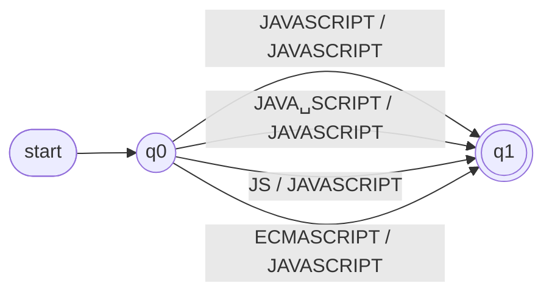

### 2.3 The vocabulary transducer

`build_vocabulary_fst(entries)` builds one machine per skill and joins them with
the union operator of `pyformlang` (`acc | fst`), producing a single transducer
that behaves as exactly one of the 43 token transducers. Before building,
it checks that no spelling is listed under two skills; otherwise it raises
`ValueError`. That check is what keeps the union a function: an input can belong to
at most one token.

### 2.4 Normalizing one skill

`SkillNormalizer.normalize(raw)` composes the tiers:

```python
cleaned = raw.strip()                       # trim
cleaned = stripper.apply(cleaned)           # Tier 0
cleaned = case_folder.apply(cleaned)        # Tier 1
results = list(vocabulary.translate([cleaned]))   # Tier 2: ONE symbol, the whole string
return results[0][0] if results else None
```

For example `React.js` becomes `React js` (Tier 0), then `REACT JS` (Tier 1), and the
vocabulary transducer writes `REACT`.

### 2.5 Code versus formal specification

The program and this document describe the same relation, at two levels of detail:

| | Code (`pyformlang`) | Formal specification (§5) |
|---|---|---|
| Input symbols | whole spellings (`REACT JS` is one symbol) | single characters (`R`, `E`, `A`, …) |
| States per skill | 2 | one per distinct prefix of a spelling |
| Output | the canonical token | the canonical token, written on the first transition |
| Accepted input | $s \in S_T$ | the word $s \in S_T$, spelled character by character |

For every skill $T$ other than `PYTHON` (see §8) both machines map each $s \in S_T$ to
$T$ and reject everything else, so they define the same relation $R_T = \{(s, T) : s \in S_T\}$. The code uses
the two-state form because it is simpler and answers with one lookup. The per-skill
machines of §6 use the character-level form because it shows the structure of the
accepted language and is the standard way to specify a finite-state machine.

## 3. Tier 0 — `StrippingTransducer` (shared)

Applied to every raw skill string, after `trim` and before case folding.

- $Q = \{q_s, q_w, q_p\}$ — *start* (nothing emitted yet), *word* (the last emitted
  character is not a space) and *pending* (a separator run follows a word and its
  space has not been emitted yet)
- $\Sigma = L \cup D \cup S$, where $L$ is the uppercase and lowercase Latin letters,
  $D$ the digits `0`–`9` and $S = \{\text{space}, \texttt{.}, \texttt{-}, \texttt{\_}, \texttt{/}\}$
  the separators
- $\Gamma = L \cup D \cup \{\text{space}\}$
- $q_0 = q_s$
- $F = Q$

**Output function.** This transducer must emit nothing for some inputs and two
symbols for another, so $\omega$ maps into strings, $\omega: Q \times \Sigma \to \Gamma^{*}$.

| State | Input | $\delta$ (next state) | $\omega$ (output) |
|---|---|---|---|
| $q_s$ | $s \in S$ | $q_s$ | $\varepsilon$ |
| $q_s$ | $c \in L \cup D$ | $q_w$ | $c$ |
| $q_w$ | $s \in S$ | $q_p$ | $\varepsilon$ |
| $q_w$ | $c \in L \cup D$ | $q_w$ | $c$ |
| $q_p$ | $s \in S$ | $q_p$ | $\varepsilon$ |
| $q_p$ | $c \in L \cup D$ | $q_w$ | space, then $c$ |

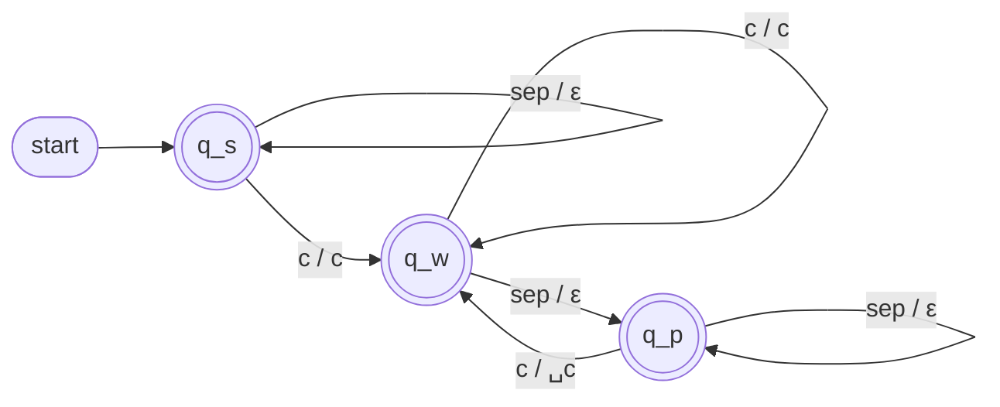

Here `sep` stands for any of `␣ . - _ /` (5 characters) and `c` for any letter or
digit (62 characters): each label compresses several transitions. In total the
machine has 3 × 67 = 201 transitions.

The space is emitted lazily, on the transition from $q_p$ back to $q_w$. That is what
removes separators at the end of the text without a second pass: a trailing run
leaves the machine in $q_p$, where nothing is pending to print.

**Example trace** for `React.js`:

| Read | R | e | a | c | t | `.` | j | s |
|---|---|---|---|---|---|---|---|---|
| State after | $q_w$ | $q_w$ | $q_w$ | $q_w$ | $q_w$ | $q_p$ | $q_w$ | $q_w$ |
| Output | `R` | `e` | `a` | `c` | `t` | $\varepsilon$ | ` j` | `s` |

Result: `React js`.

**Properties.**
- Deterministic and total on $\Sigma$; since $F = Q$ it never rejects a string over $\Sigma$.
- The output has no leading or trailing space and never two consecutive spaces.
- Idempotent: applying it to its own output changes nothing.
- It does not change letter case; that is Tier 1's job.
- A character outside $\Sigma$ (e.g. `+`, `#`, `@`, `&`, accented letters) has no
  transition, so the machine is undefined on it. The implementation surfaces this
  as an explicit `ValueError`, same as Tier 1.

## 4. Tier 1 — `CaseFoldingTransducer` (shared)

Applied to every raw skill string after Tier 0 and before any token transducer runs.

- $Q = \{q_0\}$
- $\Sigma$ = uppercase and lowercase Latin letters, digits `0`–`9`, and the space
  character (63 symbols)
- $\Gamma$ = uppercase Latin letters, digits `0`–`9`, and the space character (37 symbols)
- $\delta(q_0, c) = q_0$ for every $c \in \Sigma$ (single state, total function)
- $\omega(q_0, c) = \text{upper}(c)$ for letters; $\omega(q_0, c) = c$ for digits and
  space (passed through unchanged)
- $q_0 = q_0$
- $F = \{q_0\}$

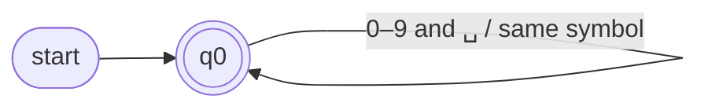

Each label compresses several transitions (26 + 26 + 11 = 63 in total).

This transducer never rejects a string over $\Sigma$; it only maps every character to
its canonical form. A character outside $\Sigma$ (e.g. `#`, `+`) has no defined
transition, so the transducer is undefined on it — the implementation surfaces this
as an explicit error rather than silently ignoring the character. Separators such as
`.` never reach this tier in the default pipeline, because Tier 0 already turned
them into spaces; they do reach it when the normalizer is built without a stripper.

## 5. Tier 2 — construction of a token transducer

Let $T$ be a canonical token and $S_T$ its finite, non-empty set of accepted
spellings, each already in post-cleaning form (upper case, single spaces).
$\text{Pref}(S_T)$ is the set of all prefixes of the spellings, including the empty
word $\varepsilon$. The transducer $M_T$ is the **prefix tree** of $S_T$:

- $Q_T = \text{Pref}(S_T)$. State $x$ means "the characters read so far are $x$".
- $\Sigma_T$ = the set of characters that occur in $S_T$.
- $\Gamma_T = \{T\}$: a single output symbol, the canonical token.
- $\delta_T(x, c) = xc$ if $xc \in Q_T$, and undefined otherwise.
- $\omega_T(x, c) = T$ if $x = \varepsilon$ (the transition leaves the initial state),
  and $\varepsilon$ otherwise.
- $q_0 = \varepsilon$.
- $F_T = S_T$: the states reached after reading a complete spelling.

**Accepted language and output.** $M_T$ accepts exactly $S_T$, and every accepted word
produces exactly one symbol $T$: $R_T = \{(s, T) : s \in S_T\}$.

**Why the token is written on the first transition.** All spellings of a skill map to
the same token, so the token can be written as soon as the first character is read.
This keeps the machine a plain Mealy machine, with no output attached to final
states, even when one spelling is a prefix of another. For `REACT`, the spelling
`REACT` is a prefix of `REACTJS` and `REACT JS`: the state reached after `REACT` is
accepting and also has outgoing transitions. Writing the token every time an accepting
state is reached would produce it twice for `REACTJS` (after `REACT` and again after
`REACTJS`); writing it on the first transition produces it once.

**Properties.**
- Deterministic: two spellings that share a prefix share the corresponding path.
- $\lvert Q_T\rvert$ is the number of distinct prefixes, at most $1 + \sum_{s \in S_T} \lvert s\rvert$,
  with equality when no two spellings share a first character.
- Spelling sets of different skills are disjoint (checked when the vocabulary is
  built), so the union of all $M_T$ maps every input to at most one token.
- The machines are small: each has $\lvert Q_T\rvert - 1$ transitions, one per edge
  of the prefix tree.

**Example.** `REACT JS` read by $M_{\text{REACT}}$:

| Read | `R` | `E` | `A` | `C` | `T` | `␣` | `J` | `S` |
|---|---|---|---|---|---|---|---|---|
| State after | q1 | q2 | q3 | q4 | q5 | q6 | q8 | q10 |
| Output | `REACT` | ε | ε | ε | ε | ε | ε | ε |

## 6. Tier 2 — the 43 token transducers

One transducer per canonical token: exactly the tokens used by the four profiles
(Full Stack Developer, Machine Learning Engineer, Cloud Engineer and Data Analyst).
The 94 accepted spellings cover the variants that the extraction stage
(`ContentExtractor.extract_skills`) returns, except spellings that include a Python
version number: for `PYTHON` this specification covers only the bare word. Each section below gives the
complete 7-tuple of the machine, its transition table and its diagram. All of it
follows from the spelling list of the skill by the construction of §5. The spellings
come from `src/core/normalization/vocabulary.py`; the only difference is `PYTHON`
(see §8).

### Summary

| Canonical token | Spellings | $\lvert Q\rvert$ | $\lvert F\rvert$ | Transitions |
|---|---|---|---|---|
| `JAVASCRIPT` | 4 | 29 | 4 | 28 |
| `TYPESCRIPT` | 2 | 18 | 2 | 17 |
| `PYTHON` | 1 | 7 | 1 | 6 |
| `REACT` | 3 | 11 | 3 | 10 |
| `ANGULAR` | 3 | 13 | 3 | 12 |
| `VUE` | 3 | 9 | 3 | 8 |
| `NODE_JS` | 3 | 10 | 3 | 9 |
| `DJANGO` | 1 | 7 | 1 | 6 |
| `SPRING_BOOT` | 2 | 16 | 2 | 15 |
| `REST_API` | 10 | 26 | 10 | 25 |
| `SQL` | 1 | 4 | 1 | 3 |
| `NOSQL` | 2 | 10 | 2 | 9 |
| `POSTGRESQL` | 3 | 15 | 3 | 14 |
| `MYSQL` | 2 | 10 | 2 | 9 |
| `MONGODB` | 3 | 11 | 3 | 10 |
| `ORACLE` | 3 | 12 | 3 | 11 |
| `REDIS` | 1 | 6 | 1 | 5 |
| `CASSANDRA` | 2 | 15 | 2 | 14 |
| `PANDAS` | 1 | 7 | 1 | 6 |
| `NUMPY` | 2 | 9 | 2 | 8 |
| `SCIKIT_LEARN` | 3 | 24 | 3 | 23 |
| `TENSORFLOW` | 2 | 16 | 2 | 15 |
| `PYTORCH` | 2 | 14 | 2 | 13 |
| `MACHINE_LEARNING` | 2 | 18 | 2 | 17 |
| `STATISTICS` | 2 | 22 | 2 | 21 |
| `AWS` | 2 | 22 | 2 | 21 |
| `AZURE` | 1 | 6 | 1 | 5 |
| `GCP` | 3 | 24 | 3 | 23 |
| `DOCKER` | 1 | 7 | 1 | 6 |
| `KUBERNETES` | 2 | 13 | 2 | 12 |
| `ANSIBLE` | 1 | 8 | 1 | 7 |
| `TERRAFORM` | 1 | 10 | 1 | 9 |
| `CLOUDFORMATION` | 2 | 25 | 2 | 24 |
| `JENKINS` | 1 | 8 | 1 | 7 |
| `GITHUB_ACTIONS` | 2 | 22 | 2 | 21 |
| `GITLAB` | 5 | 18 | 5 | 17 |
| `LINUX` | 1 | 6 | 1 | 5 |
| `GIT` | 1 | 4 | 1 | 3 |
| `EXCEL` | 3 | 28 | 3 | 27 |
| `POWER_BI` | 2 | 11 | 2 | 10 |
| `TABLEAU` | 1 | 8 | 1 | 7 |
| `LOOKER` | 1 | 7 | 1 | 6 |
| `R` | 1 | 2 | 1 | 1 |

### Languages

#### `JAVASCRIPT`

Accepted spellings: `JAVASCRIPT`, `JAVA␣SCRIPT`, `JS`, `ECMASCRIPT`.

$$M_{\text{JAVASCRIPT}} = (Q, \Sigma, \Gamma, \delta, \omega, q_0, F)$$

- **Q** (states): $\{q_0, q_1, \dots, q_{28}\}$, so $\lvert Q\rvert = 29$. Each state stands for a prefix of an accepted spelling (second column of the table below).
- **Σ** (input alphabet): {`␣`, `A`, `C`, `E`, `I`, `J`, `M`, `P`, `R`, `S`, `T`, `V`}, the 12 distinct characters of the spellings.
- **Γ** (output alphabet): {`JAVASCRIPT`}, a single symbol: the canonical token.
- **δ** (transition relation): one transition per edge of the prefix tree, given by the table below. It is functional (at most one next state per state and character); where a character is not listed, δ is undefined and the input is rejected.
- **ω** (output relation): ω(q₀, c) = `JAVASCRIPT` for every transition leaving q₀; ω(q, c) = ε for every other transition. Every accepted input therefore produces exactly one `JAVASCRIPT`.
- **q₀** (initial state): q0, the empty prefix.
- **F** (accepting states): {q5, q25, q27, q28}, the states reached after reading a complete spelling.

| State | Prefix read | Transitions δ | Accepting |
|---|---|---|---|
| q0 (initial) | `ε` | `E` → q1, `J` → q2 | no |
| q1 | `E` | `C` → q3 | no |
| q2 | `J` | `A` → q4, `S` → q5 | no |
| q3 | `EC` | `M` → q6 | no |
| q4 | `JA` | `V` → q7 | no |
| q5 | `JS` | — | yes |
| q6 | `ECM` | `A` → q8 | no |
| q7 | `JAV` | `A` → q9 | no |
| q8 | `ECMA` | `S` → q10 | no |
| q9 | `JAVA` | `␣` → q11, `S` → q12 | no |
| q10 | `ECMAS` | `C` → q13 | no |
| q11 | `JAVA␣` | `S` → q14 | no |
| q12 | `JAVAS` | `C` → q15 | no |
| q13 | `ECMASC` | `R` → q16 | no |
| q14 | `JAVA␣S` | `C` → q17 | no |
| q15 | `JAVASC` | `R` → q18 | no |
| q16 | `ECMASCR` | `I` → q19 | no |
| q17 | `JAVA␣SC` | `R` → q20 | no |
| q18 | `JAVASCR` | `I` → q21 | no |
| q19 | `ECMASCRI` | `P` → q22 | no |
| q20 | `JAVA␣SCR` | `I` → q23 | no |
| q21 | `JAVASCRI` | `P` → q24 | no |
| q22 | `ECMASCRIP` | `T` → q25 | no |
| q23 | `JAVA␣SCRI` | `P` → q26 | no |
| q24 | `JAVASCRIP` | `T` → q27 | no |
| q25 | `ECMASCRIPT` | — | yes |
| q26 | `JAVA␣SCRIP` | `T` → q28 | no |
| q27 | `JAVASCRIPT` | — | yes |
| q28 | `JAVA␣SCRIPT` | — | yes |

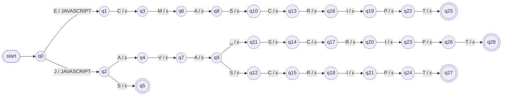

#### `TYPESCRIPT`

Accepted spellings: `TYPESCRIPT`, `TYPE␣SCRIPT`.

$$M_{\text{TYPESCRIPT}} = (Q, \Sigma, \Gamma, \delta, \omega, q_0, F)$$

- **Q** (states): $\{q_0, q_1, \dots, q_{17}\}$, so $\lvert Q\rvert = 18$. Each state stands for a prefix of an accepted spelling (second column of the table below).
- **Σ** (input alphabet): {`␣`, `C`, `E`, `I`, `P`, `R`, `S`, `T`, `Y`}, the 9 distinct characters of the spellings.
- **Γ** (output alphabet): {`TYPESCRIPT`}, a single symbol: the canonical token.
- **δ** (transition relation): one transition per edge of the prefix tree, given by the table below. It is functional (at most one next state per state and character); where a character is not listed, δ is undefined and the input is rejected.
- **ω** (output relation): ω(q₀, c) = `TYPESCRIPT` for every transition leaving q₀; ω(q, c) = ε for every other transition. Every accepted input therefore produces exactly one `TYPESCRIPT`.
- **q₀** (initial state): q0, the empty prefix.
- **F** (accepting states): {q16, q17}, the states reached after reading a complete spelling.

| State | Prefix read | Transitions δ | Accepting |
|---|---|---|---|
| q0 (initial) | `ε` | `T` → q1 | no |
| q1 | `T` | `Y` → q2 | no |
| q2 | `TY` | `P` → q3 | no |
| q3 | `TYP` | `E` → q4 | no |
| q4 | `TYPE` | `␣` → q5, `S` → q6 | no |
| q5 | `TYPE␣` | `S` → q7 | no |
| q6 | `TYPES` | `C` → q8 | no |
| q7 | `TYPE␣S` | `C` → q9 | no |
| q8 | `TYPESC` | `R` → q10 | no |
| q9 | `TYPE␣SC` | `R` → q11 | no |
| q10 | `TYPESCR` | `I` → q12 | no |
| q11 | `TYPE␣SCR` | `I` → q13 | no |
| q12 | `TYPESCRI` | `P` → q14 | no |
| q13 | `TYPE␣SCRI` | `P` → q15 | no |
| q14 | `TYPESCRIP` | `T` → q16 | no |
| q15 | `TYPE␣SCRIP` | `T` → q17 | no |
| q16 | `TYPESCRIPT` | — | yes |
| q17 | `TYPE␣SCRIPT` | — | yes |

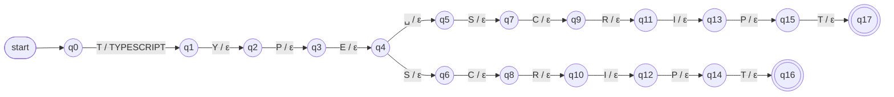

#### `PYTHON`

Accepted spellings: `PYTHON`.

$$M_{\text{PYTHON}} = (Q, \Sigma, \Gamma, \delta, \omega, q_0, F)$$

- **Q** (states): $\{q_0, q_1, \dots, q_{6}\}$, so $\lvert Q\rvert = 7$. Each state stands for a prefix of an accepted spelling (second column of the table below).
- **Σ** (input alphabet): {`H`, `N`, `O`, `P`, `T`, `Y`}, the 6 distinct characters of the spellings.
- **Γ** (output alphabet): {`PYTHON`}, a single symbol: the canonical token.
- **δ** (transition relation): one transition per edge of the prefix tree, given by the table below. It is functional (at most one next state per state and character); where a character is not listed, δ is undefined and the input is rejected.
- **ω** (output relation): ω(q₀, c) = `PYTHON` for every transition leaving q₀; ω(q, c) = ε for every other transition. Every accepted input therefore produces exactly one `PYTHON`.
- **q₀** (initial state): q0, the empty prefix.
- **F** (accepting states): {q6}, the states reached after reading a complete spelling.

| State | Prefix read | Transitions δ | Accepting |
|---|---|---|---|
| q0 (initial) | `ε` | `P` → q1 | no |
| q1 | `P` | `Y` → q2 | no |
| q2 | `PY` | `T` → q3 | no |
| q3 | `PYT` | `H` → q4 | no |
| q4 | `PYTH` | `O` → q5 | no |
| q5 | `PYTHO` | `N` → q6 | no |
| q6 | `PYTHON` | — | yes |

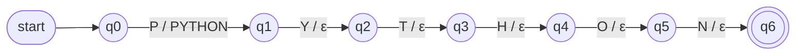

### Front end

#### `REACT`

Accepted spellings: `REACT`, `REACTJS`, `REACT␣JS`.

$$M_{\text{REACT}} = (Q, \Sigma, \Gamma, \delta, \omega, q_0, F)$$

- **Q** (states): $\{q_0, q_1, \dots, q_{10}\}$, so $\lvert Q\rvert = 11$. Each state stands for a prefix of an accepted spelling (second column of the table below).
- **Σ** (input alphabet): {`␣`, `A`, `C`, `E`, `J`, `R`, `S`, `T`}, the 8 distinct characters of the spellings.
- **Γ** (output alphabet): {`REACT`}, a single symbol: the canonical token.
- **δ** (transition relation): one transition per edge of the prefix tree, given by the table below. It is functional (at most one next state per state and character); where a character is not listed, δ is undefined and the input is rejected.
- **ω** (output relation): ω(q₀, c) = `REACT` for every transition leaving q₀; ω(q, c) = ε for every other transition. Every accepted input therefore produces exactly one `REACT`.
- **q₀** (initial state): q0, the empty prefix.
- **F** (accepting states): {q5, q9, q10}, the states reached after reading a complete spelling.

| State | Prefix read | Transitions δ | Accepting |
|---|---|---|---|
| q0 (initial) | `ε` | `R` → q1 | no |
| q1 | `R` | `E` → q2 | no |
| q2 | `RE` | `A` → q3 | no |
| q3 | `REA` | `C` → q4 | no |
| q4 | `REAC` | `T` → q5 | no |
| q5 | `REACT` | `␣` → q6, `J` → q7 | yes |
| q6 | `REACT␣` | `J` → q8 | no |
| q7 | `REACTJ` | `S` → q9 | no |
| q8 | `REACT␣J` | `S` → q10 | no |
| q9 | `REACTJS` | — | yes |
| q10 | `REACT␣JS` | — | yes |

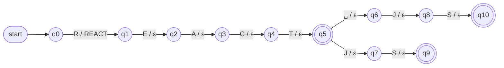

#### `ANGULAR`

Accepted spellings: `ANGULAR`, `ANGULARJS`, `ANGULAR␣JS`.

$$M_{\text{ANGULAR}} = (Q, \Sigma, \Gamma, \delta, \omega, q_0, F)$$

- **Q** (states): $\{q_0, q_1, \dots, q_{12}\}$, so $\lvert Q\rvert = 13$. Each state stands for a prefix of an accepted spelling (second column of the table below).
- **Σ** (input alphabet): {`␣`, `A`, `G`, `J`, `L`, `N`, `R`, `S`, `U`}, the 9 distinct characters of the spellings.
- **Γ** (output alphabet): {`ANGULAR`}, a single symbol: the canonical token.
- **δ** (transition relation): one transition per edge of the prefix tree, given by the table below. It is functional (at most one next state per state and character); where a character is not listed, δ is undefined and the input is rejected.
- **ω** (output relation): ω(q₀, c) = `ANGULAR` for every transition leaving q₀; ω(q, c) = ε for every other transition. Every accepted input therefore produces exactly one `ANGULAR`.
- **q₀** (initial state): q0, the empty prefix.
- **F** (accepting states): {q7, q11, q12}, the states reached after reading a complete spelling.

| State | Prefix read | Transitions δ | Accepting |
|---|---|---|---|
| q0 (initial) | `ε` | `A` → q1 | no |
| q1 | `A` | `N` → q2 | no |
| q2 | `AN` | `G` → q3 | no |
| q3 | `ANG` | `U` → q4 | no |
| q4 | `ANGU` | `L` → q5 | no |
| q5 | `ANGUL` | `A` → q6 | no |
| q6 | `ANGULA` | `R` → q7 | no |
| q7 | `ANGULAR` | `␣` → q8, `J` → q9 | yes |
| q8 | `ANGULAR␣` | `J` → q10 | no |
| q9 | `ANGULARJ` | `S` → q11 | no |
| q10 | `ANGULAR␣J` | `S` → q12 | no |
| q11 | `ANGULARJS` | — | yes |
| q12 | `ANGULAR␣JS` | — | yes |

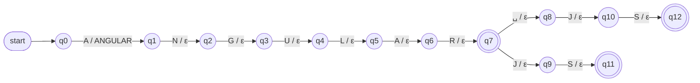

#### `VUE`

Accepted spellings: `VUE`, `VUEJS`, `VUE␣JS`.

$$M_{\text{VUE}} = (Q, \Sigma, \Gamma, \delta, \omega, q_0, F)$$

- **Q** (states): $\{q_0, q_1, \dots, q_{8}\}$, so $\lvert Q\rvert = 9$. Each state stands for a prefix of an accepted spelling (second column of the table below).
- **Σ** (input alphabet): {`␣`, `E`, `J`, `S`, `U`, `V`}, the 6 distinct characters of the spellings.
- **Γ** (output alphabet): {`VUE`}, a single symbol: the canonical token.
- **δ** (transition relation): one transition per edge of the prefix tree, given by the table below. It is functional (at most one next state per state and character); where a character is not listed, δ is undefined and the input is rejected.
- **ω** (output relation): ω(q₀, c) = `VUE` for every transition leaving q₀; ω(q, c) = ε for every other transition. Every accepted input therefore produces exactly one `VUE`.
- **q₀** (initial state): q0, the empty prefix.
- **F** (accepting states): {q3, q7, q8}, the states reached after reading a complete spelling.

| State | Prefix read | Transitions δ | Accepting |
|---|---|---|---|
| q0 (initial) | `ε` | `V` → q1 | no |
| q1 | `V` | `U` → q2 | no |
| q2 | `VU` | `E` → q3 | no |
| q3 | `VUE` | `␣` → q4, `J` → q5 | yes |
| q4 | `VUE␣` | `J` → q6 | no |
| q5 | `VUEJ` | `S` → q7 | no |
| q6 | `VUE␣J` | `S` → q8 | no |
| q7 | `VUEJS` | — | yes |
| q8 | `VUE␣JS` | — | yes |

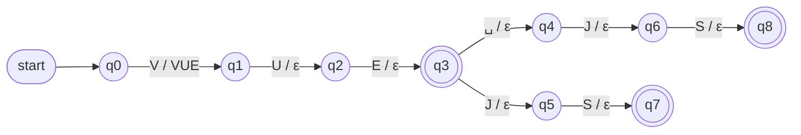

### Back end

#### `NODE_JS`

Accepted spellings: `NODE`, `NODEJS`, `NODE␣JS`.

$$M_{\text{NODE\_JS}} = (Q, \Sigma, \Gamma, \delta, \omega, q_0, F)$$

- **Q** (states): $\{q_0, q_1, \dots, q_{9}\}$, so $\lvert Q\rvert = 10$. Each state stands for a prefix of an accepted spelling (second column of the table below).
- **Σ** (input alphabet): {`␣`, `D`, `E`, `J`, `N`, `O`, `S`}, the 7 distinct characters of the spellings.
- **Γ** (output alphabet): {`NODE_JS`}, a single symbol: the canonical token.
- **δ** (transition relation): one transition per edge of the prefix tree, given by the table below. It is functional (at most one next state per state and character); where a character is not listed, δ is undefined and the input is rejected.
- **ω** (output relation): ω(q₀, c) = `NODE_JS` for every transition leaving q₀; ω(q, c) = ε for every other transition. Every accepted input therefore produces exactly one `NODE_JS`.
- **q₀** (initial state): q0, the empty prefix.
- **F** (accepting states): {q4, q8, q9}, the states reached after reading a complete spelling.

| State | Prefix read | Transitions δ | Accepting |
|---|---|---|---|
| q0 (initial) | `ε` | `N` → q1 | no |
| q1 | `N` | `O` → q2 | no |
| q2 | `NO` | `D` → q3 | no |
| q3 | `NOD` | `E` → q4 | no |
| q4 | `NODE` | `␣` → q5, `J` → q6 | yes |
| q5 | `NODE␣` | `J` → q7 | no |
| q6 | `NODEJ` | `S` → q8 | no |
| q7 | `NODE␣J` | `S` → q9 | no |
| q8 | `NODEJS` | — | yes |
| q9 | `NODE␣JS` | — | yes |

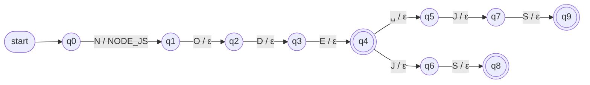

#### `DJANGO`

Accepted spellings: `DJANGO`.

$$M_{\text{DJANGO}} = (Q, \Sigma, \Gamma, \delta, \omega, q_0, F)$$

- **Q** (states): $\{q_0, q_1, \dots, q_{6}\}$, so $\lvert Q\rvert = 7$. Each state stands for a prefix of an accepted spelling (second column of the table below).
- **Σ** (input alphabet): {`A`, `D`, `G`, `J`, `N`, `O`}, the 6 distinct characters of the spellings.
- **Γ** (output alphabet): {`DJANGO`}, a single symbol: the canonical token.
- **δ** (transition relation): one transition per edge of the prefix tree, given by the table below. It is functional (at most one next state per state and character); where a character is not listed, δ is undefined and the input is rejected.
- **ω** (output relation): ω(q₀, c) = `DJANGO` for every transition leaving q₀; ω(q, c) = ε for every other transition. Every accepted input therefore produces exactly one `DJANGO`.
- **q₀** (initial state): q0, the empty prefix.
- **F** (accepting states): {q6}, the states reached after reading a complete spelling.

| State | Prefix read | Transitions δ | Accepting |
|---|---|---|---|
| q0 (initial) | `ε` | `D` → q1 | no |
| q1 | `D` | `J` → q2 | no |
| q2 | `DJ` | `A` → q3 | no |
| q3 | `DJA` | `N` → q4 | no |
| q4 | `DJAN` | `G` → q5 | no |
| q5 | `DJANG` | `O` → q6 | no |
| q6 | `DJANGO` | — | yes |

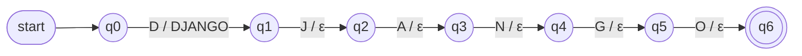

#### `SPRING_BOOT`

Accepted spellings: `SPRINGBOOT`, `SPRING␣BOOT`.

$$M_{\text{SPRING\_BOOT}} = (Q, \Sigma, \Gamma, \delta, \omega, q_0, F)$$

- **Q** (states): $\{q_0, q_1, \dots, q_{15}\}$, so $\lvert Q\rvert = 16$. Each state stands for a prefix of an accepted spelling (second column of the table below).
- **Σ** (input alphabet): {`␣`, `B`, `G`, `I`, `N`, `O`, `P`, `R`, `S`, `T`}, the 10 distinct characters of the spellings.
- **Γ** (output alphabet): {`SPRING_BOOT`}, a single symbol: the canonical token.
- **δ** (transition relation): one transition per edge of the prefix tree, given by the table below. It is functional (at most one next state per state and character); where a character is not listed, δ is undefined and the input is rejected.
- **ω** (output relation): ω(q₀, c) = `SPRING_BOOT` for every transition leaving q₀; ω(q, c) = ε for every other transition. Every accepted input therefore produces exactly one `SPRING_BOOT`.
- **q₀** (initial state): q0, the empty prefix.
- **F** (accepting states): {q14, q15}, the states reached after reading a complete spelling.

| State | Prefix read | Transitions δ | Accepting |
|---|---|---|---|
| q0 (initial) | `ε` | `S` → q1 | no |
| q1 | `S` | `P` → q2 | no |
| q2 | `SP` | `R` → q3 | no |
| q3 | `SPR` | `I` → q4 | no |
| q4 | `SPRI` | `N` → q5 | no |
| q5 | `SPRIN` | `G` → q6 | no |
| q6 | `SPRING` | `␣` → q7, `B` → q8 | no |
| q7 | `SPRING␣` | `B` → q9 | no |
| q8 | `SPRINGB` | `O` → q10 | no |
| q9 | `SPRING␣B` | `O` → q11 | no |
| q10 | `SPRINGBO` | `O` → q12 | no |
| q11 | `SPRING␣BO` | `O` → q13 | no |
| q12 | `SPRINGBOO` | `T` → q14 | no |
| q13 | `SPRING␣BOO` | `T` → q15 | no |
| q14 | `SPRINGBOOT` | — | yes |
| q15 | `SPRING␣BOOT` | — | yes |

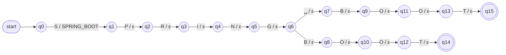

#### `REST_API`

Accepted spellings: `REST`, `RESTFUL`, `RESTAPI`, `RESTAPIS`, `REST␣API`, `REST␣APIS`, `RESTFULAPI`, `RESTFULAPIS`, `RESTFUL␣API`, `RESTFUL␣APIS`.

$$M_{\text{REST\_API}} = (Q, \Sigma, \Gamma, \delta, \omega, q_0, F)$$

- **Q** (states): $\{q_0, q_1, \dots, q_{25}\}$, so $\lvert Q\rvert = 26$. Each state stands for a prefix of an accepted spelling (second column of the table below).
- **Σ** (input alphabet): {`␣`, `A`, `E`, `F`, `I`, `L`, `P`, `R`, `S`, `T`, `U`}, the 11 distinct characters of the spellings.
- **Γ** (output alphabet): {`REST_API`}, a single symbol: the canonical token.
- **δ** (transition relation): one transition per edge of the prefix tree, given by the table below. It is functional (at most one next state per state and character); where a character is not listed, δ is undefined and the input is rejected.
- **ω** (output relation): ω(q₀, c) = `REST_API` for every transition leaving q₀; ω(q, c) = ε for every other transition. Every accepted input therefore produces exactly one `REST_API`.
- **q₀** (initial state): q0, the empty prefix.
- **F** (accepting states): {q4, q12, q13, q14, q15, q18, q22, q23, q24, q25}, the states reached after reading a complete spelling.

| State | Prefix read | Transitions δ | Accepting |
|---|---|---|---|
| q0 (initial) | `ε` | `R` → q1 | no |
| q1 | `R` | `E` → q2 | no |
| q2 | `RE` | `S` → q3 | no |
| q3 | `RES` | `T` → q4 | no |
| q4 | `REST` | `␣` → q5, `A` → q6, `F` → q7 | yes |
| q5 | `REST␣` | `A` → q8 | no |
| q6 | `RESTA` | `P` → q9 | no |
| q7 | `RESTF` | `U` → q10 | no |
| q8 | `REST␣A` | `P` → q11 | no |
| q9 | `RESTAP` | `I` → q12 | no |
| q10 | `RESTFU` | `L` → q13 | no |
| q11 | `REST␣AP` | `I` → q14 | no |
| q12 | `RESTAPI` | `S` → q15 | yes |
| q13 | `RESTFUL` | `␣` → q16, `A` → q17 | yes |
| q14 | `REST␣API` | `S` → q18 | yes |
| q15 | `RESTAPIS` | — | yes |
| q16 | `RESTFUL␣` | `A` → q19 | no |
| q17 | `RESTFULA` | `P` → q20 | no |
| q18 | `REST␣APIS` | — | yes |
| q19 | `RESTFUL␣A` | `P` → q21 | no |
| q20 | `RESTFULAP` | `I` → q22 | no |
| q21 | `RESTFUL␣AP` | `I` → q23 | no |
| q22 | `RESTFULAPI` | `S` → q24 | yes |
| q23 | `RESTFUL␣API` | `S` → q25 | yes |
| q24 | `RESTFULAPIS` | — | yes |
| q25 | `RESTFUL␣APIS` | — | yes |

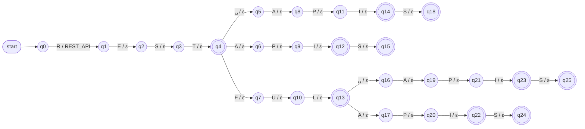

### Databases

#### `SQL`

Accepted spellings: `SQL`.

$$M_{\text{SQL}} = (Q, \Sigma, \Gamma, \delta, \omega, q_0, F)$$

- **Q** (states): $\{q_0, q_1, \dots, q_{3}\}$, so $\lvert Q\rvert = 4$. Each state stands for a prefix of an accepted spelling (second column of the table below).
- **Σ** (input alphabet): {`L`, `Q`, `S`}, the 3 distinct characters of the spellings.
- **Γ** (output alphabet): {`SQL`}, a single symbol: the canonical token.
- **δ** (transition relation): one transition per edge of the prefix tree, given by the table below. It is functional (at most one next state per state and character); where a character is not listed, δ is undefined and the input is rejected.
- **ω** (output relation): ω(q₀, c) = `SQL` for every transition leaving q₀; ω(q, c) = ε for every other transition. Every accepted input therefore produces exactly one `SQL`.
- **q₀** (initial state): q0, the empty prefix.
- **F** (accepting states): {q3}, the states reached after reading a complete spelling.

| State | Prefix read | Transitions δ | Accepting |
|---|---|---|---|
| q0 (initial) | `ε` | `S` → q1 | no |
| q1 | `S` | `Q` → q2 | no |
| q2 | `SQ` | `L` → q3 | no |
| q3 | `SQL` | — | yes |

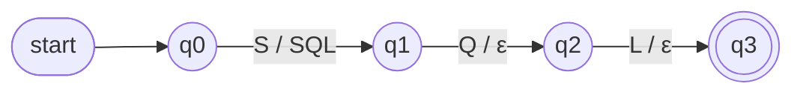

#### `NOSQL`

Accepted spellings: `NOSQL`, `NO␣SQL`.

$$M_{\text{NOSQL}} = (Q, \Sigma, \Gamma, \delta, \omega, q_0, F)$$

- **Q** (states): $\{q_0, q_1, \dots, q_{9}\}$, so $\lvert Q\rvert = 10$. Each state stands for a prefix of an accepted spelling (second column of the table below).
- **Σ** (input alphabet): {`␣`, `L`, `N`, `O`, `Q`, `S`}, the 6 distinct characters of the spellings.
- **Γ** (output alphabet): {`NOSQL`}, a single symbol: the canonical token.
- **δ** (transition relation): one transition per edge of the prefix tree, given by the table below. It is functional (at most one next state per state and character); where a character is not listed, δ is undefined and the input is rejected.
- **ω** (output relation): ω(q₀, c) = `NOSQL` for every transition leaving q₀; ω(q, c) = ε for every other transition. Every accepted input therefore produces exactly one `NOSQL`.
- **q₀** (initial state): q0, the empty prefix.
- **F** (accepting states): {q8, q9}, the states reached after reading a complete spelling.

| State | Prefix read | Transitions δ | Accepting |
|---|---|---|---|
| q0 (initial) | `ε` | `N` → q1 | no |
| q1 | `N` | `O` → q2 | no |
| q2 | `NO` | `␣` → q3, `S` → q4 | no |
| q3 | `NO␣` | `S` → q5 | no |
| q4 | `NOS` | `Q` → q6 | no |
| q5 | `NO␣S` | `Q` → q7 | no |
| q6 | `NOSQ` | `L` → q8 | no |
| q7 | `NO␣SQ` | `L` → q9 | no |
| q8 | `NOSQL` | — | yes |
| q9 | `NO␣SQL` | — | yes |


#### `POSTGRESQL`

Accepted spellings: `POSTGRES`, `POSTGRESQL`, `POSTGRE␣SQL`.

$$M_{\text{POSTGRESQL}} = (Q, \Sigma, \Gamma, \delta, \omega, q_0, F)$$

- **Q** (states): $\{q_0, q_1, \dots, q_{14}\}$, so $\lvert Q\rvert = 15$. Each state stands for a prefix of an accepted spelling (second column of the table below).
- **Σ** (input alphabet): {`␣`, `E`, `G`, `L`, `O`, `P`, `Q`, `R`, `S`, `T`}, the 10 distinct characters of the spellings.
- **Γ** (output alphabet): {`POSTGRESQL`}, a single symbol: the canonical token.
- **δ** (transition relation): one transition per edge of the prefix tree, given by the table below. It is functional (at most one next state per state and character); where a character is not listed, δ is undefined and the input is rejected.
- **ω** (output relation): ω(q₀, c) = `POSTGRESQL` for every transition leaving q₀; ω(q, c) = ε for every other transition. Every accepted input therefore produces exactly one `POSTGRESQL`.
- **q₀** (initial state): q0, the empty prefix.
- **F** (accepting states): {q9, q13, q14}, the states reached after reading a complete spelling.

| State | Prefix read | Transitions δ | Accepting |
|---|---|---|---|
| q0 (initial) | `ε` | `P` → q1 | no |
| q1 | `P` | `O` → q2 | no |
| q2 | `PO` | `S` → q3 | no |
| q3 | `POS` | `T` → q4 | no |
| q4 | `POST` | `G` → q5 | no |
| q5 | `POSTG` | `R` → q6 | no |
| q6 | `POSTGR` | `E` → q7 | no |
| q7 | `POSTGRE` | `␣` → q8, `S` → q9 | no |
| q8 | `POSTGRE␣` | `S` → q10 | no |
| q9 | `POSTGRES` | `Q` → q11 | yes |
| q10 | `POSTGRE␣S` | `Q` → q12 | no |
| q11 | `POSTGRESQ` | `L` → q13 | no |
| q12 | `POSTGRE␣SQ` | `L` → q14 | no |
| q13 | `POSTGRESQL` | — | yes |
| q14 | `POSTGRE␣SQL` | — | yes |

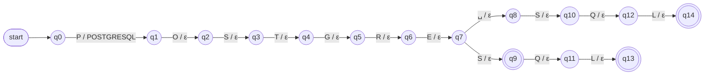

#### `MYSQL`

Accepted spellings: `MYSQL`, `MY␣SQL`.

$$M_{\text{MYSQL}} = (Q, \Sigma, \Gamma, \delta, \omega, q_0, F)$$

- **Q** (states): $\{q_0, q_1, \dots, q_{9}\}$, so $\lvert Q\rvert = 10$. Each state stands for a prefix of an accepted spelling (second column of the table below).
- **Σ** (input alphabet): {`␣`, `L`, `M`, `Q`, `S`, `Y`}, the 6 distinct characters of the spellings.
- **Γ** (output alphabet): {`MYSQL`}, a single symbol: the canonical token.
- **δ** (transition relation): one transition per edge of the prefix tree, given by the table below. It is functional (at most one next state per state and character); where a character is not listed, δ is undefined and the input is rejected.
- **ω** (output relation): ω(q₀, c) = `MYSQL` for every transition leaving q₀; ω(q, c) = ε for every other transition. Every accepted input therefore produces exactly one `MYSQL`.
- **q₀** (initial state): q0, the empty prefix.
- **F** (accepting states): {q8, q9}, the states reached after reading a complete spelling.

| State | Prefix read | Transitions δ | Accepting |
|---|---|---|---|
| q0 (initial) | `ε` | `M` → q1 | no |
| q1 | `M` | `Y` → q2 | no |
| q2 | `MY` | `␣` → q3, `S` → q4 | no |
| q3 | `MY␣` | `S` → q5 | no |
| q4 | `MYS` | `Q` → q6 | no |
| q5 | `MY␣S` | `Q` → q7 | no |
| q6 | `MYSQ` | `L` → q8 | no |
| q7 | `MY␣SQ` | `L` → q9 | no |
| q8 | `MYSQL` | — | yes |
| q9 | `MY␣SQL` | — | yes |

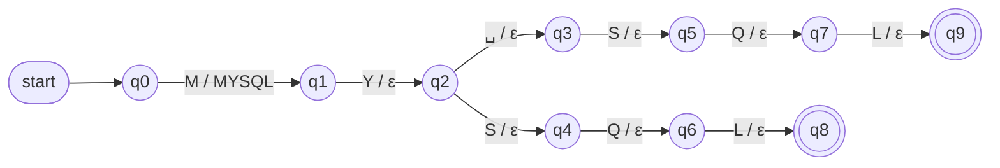

#### `MONGODB`

Accepted spellings: `MONGO`, `MONGODB`, `MONGO␣DB`.

$$M_{\text{MONGODB}} = (Q, \Sigma, \Gamma, \delta, \omega, q_0, F)$$

- **Q** (states): $\{q_0, q_1, \dots, q_{10}\}$, so $\lvert Q\rvert = 11$. Each state stands for a prefix of an accepted spelling (second column of the table below).
- **Σ** (input alphabet): {`␣`, `B`, `D`, `G`, `M`, `N`, `O`}, the 7 distinct characters of the spellings.
- **Γ** (output alphabet): {`MONGODB`}, a single symbol: the canonical token.
- **δ** (transition relation): one transition per edge of the prefix tree, given by the table below. It is functional (at most one next state per state and character); where a character is not listed, δ is undefined and the input is rejected.
- **ω** (output relation): ω(q₀, c) = `MONGODB` for every transition leaving q₀; ω(q, c) = ε for every other transition. Every accepted input therefore produces exactly one `MONGODB`.
- **q₀** (initial state): q0, the empty prefix.
- **F** (accepting states): {q5, q9, q10}, the states reached after reading a complete spelling.

| State | Prefix read | Transitions δ | Accepting |
|---|---|---|---|
| q0 (initial) | `ε` | `M` → q1 | no |
| q1 | `M` | `O` → q2 | no |
| q2 | `MO` | `N` → q3 | no |
| q3 | `MON` | `G` → q4 | no |
| q4 | `MONG` | `O` → q5 | no |
| q5 | `MONGO` | `␣` → q6, `D` → q7 | yes |
| q6 | `MONGO␣` | `D` → q8 | no |
| q7 | `MONGOD` | `B` → q9 | no |
| q8 | `MONGO␣D` | `B` → q10 | no |
| q9 | `MONGODB` | — | yes |
| q10 | `MONGO␣DB` | — | yes |

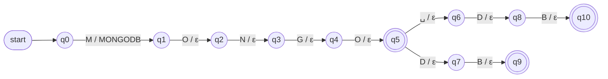

#### `ORACLE`

Accepted spellings: `ORACLE`, `ORACLEDB`, `ORACLE␣DB`.

$$M_{\text{ORACLE}} = (Q, \Sigma, \Gamma, \delta, \omega, q_0, F)$$

- **Q** (states): $\{q_0, q_1, \dots, q_{11}\}$, so $\lvert Q\rvert = 12$. Each state stands for a prefix of an accepted spelling (second column of the table below).
- **Σ** (input alphabet): {`␣`, `A`, `B`, `C`, `D`, `E`, `L`, `O`, `R`}, the 9 distinct characters of the spellings.
- **Γ** (output alphabet): {`ORACLE`}, a single symbol: the canonical token.
- **δ** (transition relation): one transition per edge of the prefix tree, given by the table below. It is functional (at most one next state per state and character); where a character is not listed, δ is undefined and the input is rejected.
- **ω** (output relation): ω(q₀, c) = `ORACLE` for every transition leaving q₀; ω(q, c) = ε for every other transition. Every accepted input therefore produces exactly one `ORACLE`.
- **q₀** (initial state): q0, the empty prefix.
- **F** (accepting states): {q6, q10, q11}, the states reached after reading a complete spelling.

| State | Prefix read | Transitions δ | Accepting |
|---|---|---|---|
| q0 (initial) | `ε` | `O` → q1 | no |
| q1 | `O` | `R` → q2 | no |
| q2 | `OR` | `A` → q3 | no |
| q3 | `ORA` | `C` → q4 | no |
| q4 | `ORAC` | `L` → q5 | no |
| q5 | `ORACL` | `E` → q6 | no |
| q6 | `ORACLE` | `␣` → q7, `D` → q8 | yes |
| q7 | `ORACLE␣` | `D` → q9 | no |
| q8 | `ORACLED` | `B` → q10 | no |
| q9 | `ORACLE␣D` | `B` → q11 | no |
| q10 | `ORACLEDB` | — | yes |
| q11 | `ORACLE␣DB` | — | yes |

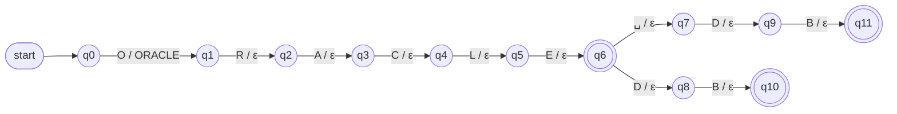

#### `REDIS`

Accepted spellings: `REDIS`.

$$M_{\text{REDIS}} = (Q, \Sigma, \Gamma, \delta, \omega, q_0, F)$$

- **Q** (states): $\{q_0, q_1, \dots, q_{5}\}$, so $\lvert Q\rvert = 6$. Each state stands for a prefix of an accepted spelling (second column of the table below).
- **Σ** (input alphabet): {`D`, `E`, `I`, `R`, `S`}, the 5 distinct characters of the spellings.
- **Γ** (output alphabet): {`REDIS`}, a single symbol: the canonical token.
- **δ** (transition relation): one transition per edge of the prefix tree, given by the table below. It is functional (at most one next state per state and character); where a character is not listed, δ is undefined and the input is rejected.
- **ω** (output relation): ω(q₀, c) = `REDIS` for every transition leaving q₀; ω(q, c) = ε for every other transition. Every accepted input therefore produces exactly one `REDIS`.
- **q₀** (initial state): q0, the empty prefix.
- **F** (accepting states): {q5}, the states reached after reading a complete spelling.

| State | Prefix read | Transitions δ | Accepting |
|---|---|---|---|
| q0 (initial) | `ε` | `R` → q1 | no |
| q1 | `R` | `E` → q2 | no |
| q2 | `RE` | `D` → q3 | no |
| q3 | `RED` | `I` → q4 | no |
| q4 | `REDI` | `S` → q5 | no |
| q5 | `REDIS` | — | yes |

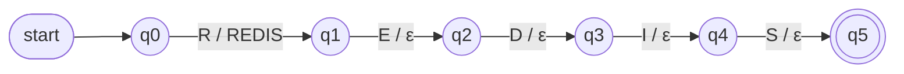

#### `CASSANDRA`

Accepted spellings: `CASSANDRA`, `CASANDRA`.

$$M_{\text{CASSANDRA}} = (Q, \Sigma, \Gamma, \delta, \omega, q_0, F)$$

- **Q** (states): $\{q_0, q_1, \dots, q_{14}\}$, so $\lvert Q\rvert = 15$. Each state stands for a prefix of an accepted spelling (second column of the table below).
- **Σ** (input alphabet): {`A`, `C`, `D`, `N`, `R`, `S`}, the 6 distinct characters of the spellings.
- **Γ** (output alphabet): {`CASSANDRA`}, a single symbol: the canonical token.
- **δ** (transition relation): one transition per edge of the prefix tree, given by the table below. It is functional (at most one next state per state and character); where a character is not listed, δ is undefined and the input is rejected.
- **ω** (output relation): ω(q₀, c) = `CASSANDRA` for every transition leaving q₀; ω(q, c) = ε for every other transition. Every accepted input therefore produces exactly one `CASSANDRA`.
- **q₀** (initial state): q0, the empty prefix.
- **F** (accepting states): {q12, q14}, the states reached after reading a complete spelling.

| State | Prefix read | Transitions δ | Accepting |
|---|---|---|---|
| q0 (initial) | `ε` | `C` → q1 | no |
| q1 | `C` | `A` → q2 | no |
| q2 | `CA` | `S` → q3 | no |
| q3 | `CAS` | `A` → q4, `S` → q5 | no |
| q4 | `CASA` | `N` → q6 | no |
| q5 | `CASS` | `A` → q7 | no |
| q6 | `CASAN` | `D` → q8 | no |
| q7 | `CASSA` | `N` → q9 | no |
| q8 | `CASAND` | `R` → q10 | no |
| q9 | `CASSAN` | `D` → q11 | no |
| q10 | `CASANDR` | `A` → q12 | no |
| q11 | `CASSAND` | `R` → q13 | no |
| q12 | `CASANDRA` | — | yes |
| q13 | `CASSANDR` | `A` → q14 | no |
| q14 | `CASSANDRA` | — | yes |

```mermaid
flowchart LR
    init(["start"]) --> q0
    q0((q0))
    q1((q1))
    q2((q2))
    q3((q3))
    q4((q4))
    q5((q5))
    q6((q6))
    q7((q7))
    q8((q8))
    q9((q9))
    q10((q10))
    q11((q11))
    q12(((q12)))
    q13((q13))
    q14(((q14)))
    q0 -->|"C / CASSANDRA"| q1
    q1 -->|"A / ε"| q2
    q2 -->|"S / ε"| q3
    q3 -->|"A / ε"| q4
    q3 -->|"S / ε"| q5
    q4 -->|"N / ε"| q6
    q5 -->|"A / ε"| q7
    q6 -->|"D / ε"| q8
    q7 -->|"N / ε"| q9
    q8 -->|"R / ε"| q10
    q9 -->|"D / ε"| q11
    q10 -->|"A / ε"| q12
    q11 -->|"R / ε"| q13
    q13 -->|"A / ε"| q14
```

### Data and machine learning

#### `PANDAS`

Accepted spellings: `PANDAS`.

$$M_{\text{PANDAS}} = (Q, \Sigma, \Gamma, \delta, \omega, q_0, F)$$

- **Q** (states): $\{q_0, q_1, \dots, q_{6}\}$, so $\lvert Q\rvert = 7$. Each state stands for a prefix of an accepted spelling (second column of the table below).
- **Σ** (input alphabet): {`A`, `D`, `N`, `P`, `S`}, the 5 distinct characters of the spellings.
- **Γ** (output alphabet): {`PANDAS`}, a single symbol: the canonical token.
- **δ** (transition relation): one transition per edge of the prefix tree, given by the table below. It is functional (at most one next state per state and character); where a character is not listed, δ is undefined and the input is rejected.
- **ω** (output relation): ω(q₀, c) = `PANDAS` for every transition leaving q₀; ω(q, c) = ε for every other transition. Every accepted input therefore produces exactly one `PANDAS`.
- **q₀** (initial state): q0, the empty prefix.
- **F** (accepting states): {q6}, the states reached after reading a complete spelling.

| State | Prefix read | Transitions δ | Accepting |
|---|---|---|---|
| q0 (initial) | `ε` | `P` → q1 | no |
| q1 | `P` | `A` → q2 | no |
| q2 | `PA` | `N` → q3 | no |
| q3 | `PAN` | `D` → q4 | no |
| q4 | `PAND` | `A` → q5 | no |
| q5 | `PANDA` | `S` → q6 | no |
| q6 | `PANDAS` | — | yes |

```mermaid
flowchart LR
    init(["start"]) --> q0
    q0((q0))
    q1((q1))
    q2((q2))
    q3((q3))
    q4((q4))
    q5((q5))
    q6(((q6)))
    q0 -->|"P / PANDAS"| q1
    q1 -->|"A / ε"| q2
    q2 -->|"N / ε"| q3
    q3 -->|"D / ε"| q4
    q4 -->|"A / ε"| q5
    q5 -->|"S / ε"| q6
```

#### `NUMPY`

Accepted spellings: `NUMPY`, `NUM␣PY`.

$$M_{\text{NUMPY}} = (Q, \Sigma, \Gamma, \delta, \omega, q_0, F)$$

- **Q** (states): $\{q_0, q_1, \dots, q_{8}\}$, so $\lvert Q\rvert = 9$. Each state stands for a prefix of an accepted spelling (second column of the table below).
- **Σ** (input alphabet): {`␣`, `M`, `N`, `P`, `U`, `Y`}, the 6 distinct characters of the spellings.
- **Γ** (output alphabet): {`NUMPY`}, a single symbol: the canonical token.
- **δ** (transition relation): one transition per edge of the prefix tree, given by the table below. It is functional (at most one next state per state and character); where a character is not listed, δ is undefined and the input is rejected.
- **ω** (output relation): ω(q₀, c) = `NUMPY` for every transition leaving q₀; ω(q, c) = ε for every other transition. Every accepted input therefore produces exactly one `NUMPY`.
- **q₀** (initial state): q0, the empty prefix.
- **F** (accepting states): {q7, q8}, the states reached after reading a complete spelling.

| State | Prefix read | Transitions δ | Accepting |
|---|---|---|---|
| q0 (initial) | `ε` | `N` → q1 | no |
| q1 | `N` | `U` → q2 | no |
| q2 | `NU` | `M` → q3 | no |
| q3 | `NUM` | `␣` → q4, `P` → q5 | no |
| q4 | `NUM␣` | `P` → q6 | no |
| q5 | `NUMP` | `Y` → q7 | no |
| q6 | `NUM␣P` | `Y` → q8 | no |
| q7 | `NUMPY` | — | yes |
| q8 | `NUM␣PY` | — | yes |

```mermaid
flowchart LR
    init(["start"]) --> q0
    q0((q0))
    q1((q1))
    q2((q2))
    q3((q3))
    q4((q4))
    q5((q5))
    q6((q6))
    q7(((q7)))
    q8(((q8)))
    q0 -->|"N / NUMPY"| q1
    q1 -->|"U / ε"| q2
    q2 -->|"M / ε"| q3
    q3 -->|"␣ / ε"| q4
    q3 -->|"P / ε"| q5
    q4 -->|"P / ε"| q6
    q5 -->|"Y / ε"| q7
    q6 -->|"Y / ε"| q8
```

#### `SCIKIT_LEARN`

Accepted spellings: `SCIKITLEARN`, `SCIKIT␣LEARN`, `SKLEARN`.

$$M_{\text{SCIKIT\_LEARN}} = (Q, \Sigma, \Gamma, \delta, \omega, q_0, F)$$

- **Q** (states): $\{q_0, q_1, \dots, q_{23}\}$, so $\lvert Q\rvert = 24$. Each state stands for a prefix of an accepted spelling (second column of the table below).
- **Σ** (input alphabet): {`␣`, `A`, `C`, `E`, `I`, `K`, `L`, `N`, `R`, `S`, `T`}, the 11 distinct characters of the spellings.
- **Γ** (output alphabet): {`SCIKIT_LEARN`}, a single symbol: the canonical token.
- **δ** (transition relation): one transition per edge of the prefix tree, given by the table below. It is functional (at most one next state per state and character); where a character is not listed, δ is undefined and the input is rejected.
- **ω** (output relation): ω(q₀, c) = `SCIKIT_LEARN` for every transition leaving q₀; ω(q, c) = ε for every other transition. Every accepted input therefore produces exactly one `SCIKIT_LEARN`.
- **q₀** (initial state): q0, the empty prefix.
- **F** (accepting states): {q14, q22, q23}, the states reached after reading a complete spelling.

| State | Prefix read | Transitions δ | Accepting |
|---|---|---|---|
| q0 (initial) | `ε` | `S` → q1 | no |
| q1 | `S` | `C` → q2, `K` → q3 | no |
| q2 | `SC` | `I` → q4 | no |
| q3 | `SK` | `L` → q5 | no |
| q4 | `SCI` | `K` → q6 | no |
| q5 | `SKL` | `E` → q7 | no |
| q6 | `SCIK` | `I` → q8 | no |
| q7 | `SKLE` | `A` → q9 | no |
| q8 | `SCIKI` | `T` → q10 | no |
| q9 | `SKLEA` | `R` → q11 | no |
| q10 | `SCIKIT` | `␣` → q12, `L` → q13 | no |
| q11 | `SKLEAR` | `N` → q14 | no |
| q12 | `SCIKIT␣` | `L` → q15 | no |
| q13 | `SCIKITL` | `E` → q16 | no |
| q14 | `SKLEARN` | — | yes |
| q15 | `SCIKIT␣L` | `E` → q17 | no |
| q16 | `SCIKITLE` | `A` → q18 | no |
| q17 | `SCIKIT␣LE` | `A` → q19 | no |
| q18 | `SCIKITLEA` | `R` → q20 | no |
| q19 | `SCIKIT␣LEA` | `R` → q21 | no |
| q20 | `SCIKITLEAR` | `N` → q22 | no |
| q21 | `SCIKIT␣LEAR` | `N` → q23 | no |
| q22 | `SCIKITLEARN` | — | yes |
| q23 | `SCIKIT␣LEARN` | — | yes |

```mermaid
flowchart LR
    init(["start"]) --> q0
    q0((q0))
    q1((q1))
    q2((q2))
    q3((q3))
    q4((q4))
    q5((q5))
    q6((q6))
    q7((q7))
    q8((q8))
    q9((q9))
    q10((q10))
    q11((q11))
    q12((q12))
    q13((q13))
    q14(((q14)))
    q15((q15))
    q16((q16))
    q17((q17))
    q18((q18))
    q19((q19))
    q20((q20))
    q21((q21))
    q22(((q22)))
    q23(((q23)))
    q0 -->|"S / SCIKIT_LEARN"| q1
    q1 -->|"C / ε"| q2
    q1 -->|"K / ε"| q3
    q2 -->|"I / ε"| q4
    q3 -->|"L / ε"| q5
    q4 -->|"K / ε"| q6
    q5 -->|"E / ε"| q7
    q6 -->|"I / ε"| q8
    q7 -->|"A / ε"| q9
    q8 -->|"T / ε"| q10
    q9 -->|"R / ε"| q11
    q10 -->|"␣ / ε"| q12
    q10 -->|"L / ε"| q13
    q11 -->|"N / ε"| q14
    q12 -->|"L / ε"| q15
    q13 -->|"E / ε"| q16
    q15 -->|"E / ε"| q17
    q16 -->|"A / ε"| q18
    q17 -->|"A / ε"| q19
    q18 -->|"R / ε"| q20
    q19 -->|"R / ε"| q21
    q20 -->|"N / ε"| q22
    q21 -->|"N / ε"| q23
```

#### `TENSORFLOW`

Accepted spellings: `TENSORFLOW`, `TENSOR␣FLOW`.

$$M_{\text{TENSORFLOW}} = (Q, \Sigma, \Gamma, \delta, \omega, q_0, F)$$

- **Q** (states): $\{q_0, q_1, \dots, q_{15}\}$, so $\lvert Q\rvert = 16$. Each state stands for a prefix of an accepted spelling (second column of the table below).
- **Σ** (input alphabet): {`␣`, `E`, `F`, `L`, `N`, `O`, `R`, `S`, `T`, `W`}, the 10 distinct characters of the spellings.
- **Γ** (output alphabet): {`TENSORFLOW`}, a single symbol: the canonical token.
- **δ** (transition relation): one transition per edge of the prefix tree, given by the table below. It is functional (at most one next state per state and character); where a character is not listed, δ is undefined and the input is rejected.
- **ω** (output relation): ω(q₀, c) = `TENSORFLOW` for every transition leaving q₀; ω(q, c) = ε for every other transition. Every accepted input therefore produces exactly one `TENSORFLOW`.
- **q₀** (initial state): q0, the empty prefix.
- **F** (accepting states): {q14, q15}, the states reached after reading a complete spelling.

| State | Prefix read | Transitions δ | Accepting |
|---|---|---|---|
| q0 (initial) | `ε` | `T` → q1 | no |
| q1 | `T` | `E` → q2 | no |
| q2 | `TE` | `N` → q3 | no |
| q3 | `TEN` | `S` → q4 | no |
| q4 | `TENS` | `O` → q5 | no |
| q5 | `TENSO` | `R` → q6 | no |
| q6 | `TENSOR` | `␣` → q7, `F` → q8 | no |
| q7 | `TENSOR␣` | `F` → q9 | no |
| q8 | `TENSORF` | `L` → q10 | no |
| q9 | `TENSOR␣F` | `L` → q11 | no |
| q10 | `TENSORFL` | `O` → q12 | no |
| q11 | `TENSOR␣FL` | `O` → q13 | no |
| q12 | `TENSORFLO` | `W` → q14 | no |
| q13 | `TENSOR␣FLO` | `W` → q15 | no |
| q14 | `TENSORFLOW` | — | yes |
| q15 | `TENSOR␣FLOW` | — | yes |

```mermaid
flowchart LR
    init(["start"]) --> q0
    q0((q0))
    q1((q1))
    q2((q2))
    q3((q3))
    q4((q4))
    q5((q5))
    q6((q6))
    q7((q7))
    q8((q8))
    q9((q9))
    q10((q10))
    q11((q11))
    q12((q12))
    q13((q13))
    q14(((q14)))
    q15(((q15)))
    q0 -->|"T / TENSORFLOW"| q1
    q1 -->|"E / ε"| q2
    q2 -->|"N / ε"| q3
    q3 -->|"S / ε"| q4
    q4 -->|"O / ε"| q5
    q5 -->|"R / ε"| q6
    q6 -->|"␣ / ε"| q7
    q6 -->|"F / ε"| q8
    q7 -->|"F / ε"| q9
    q8 -->|"L / ε"| q10
    q9 -->|"L / ε"| q11
    q10 -->|"O / ε"| q12
    q11 -->|"O / ε"| q13
    q12 -->|"W / ε"| q14
    q13 -->|"W / ε"| q15
```

#### `PYTORCH`

Accepted spellings: `PYTORCH`, `PY␣TORCH`.

$$M_{\text{PYTORCH}} = (Q, \Sigma, \Gamma, \delta, \omega, q_0, F)$$

- **Q** (states): $\{q_0, q_1, \dots, q_{13}\}$, so $\lvert Q\rvert = 14$. Each state stands for a prefix of an accepted spelling (second column of the table below).
- **Σ** (input alphabet): {`␣`, `C`, `H`, `O`, `P`, `R`, `T`, `Y`}, the 8 distinct characters of the spellings.
- **Γ** (output alphabet): {`PYTORCH`}, a single symbol: the canonical token.
- **δ** (transition relation): one transition per edge of the prefix tree, given by the table below. It is functional (at most one next state per state and character); where a character is not listed, δ is undefined and the input is rejected.
- **ω** (output relation): ω(q₀, c) = `PYTORCH` for every transition leaving q₀; ω(q, c) = ε for every other transition. Every accepted input therefore produces exactly one `PYTORCH`.
- **q₀** (initial state): q0, the empty prefix.
- **F** (accepting states): {q12, q13}, the states reached after reading a complete spelling.

| State | Prefix read | Transitions δ | Accepting |
|---|---|---|---|
| q0 (initial) | `ε` | `P` → q1 | no |
| q1 | `P` | `Y` → q2 | no |
| q2 | `PY` | `␣` → q3, `T` → q4 | no |
| q3 | `PY␣` | `T` → q5 | no |
| q4 | `PYT` | `O` → q6 | no |
| q5 | `PY␣T` | `O` → q7 | no |
| q6 | `PYTO` | `R` → q8 | no |
| q7 | `PY␣TO` | `R` → q9 | no |
| q8 | `PYTOR` | `C` → q10 | no |
| q9 | `PY␣TOR` | `C` → q11 | no |
| q10 | `PYTORC` | `H` → q12 | no |
| q11 | `PY␣TORC` | `H` → q13 | no |
| q12 | `PYTORCH` | — | yes |
| q13 | `PY␣TORCH` | — | yes |

```mermaid
flowchart LR
    init(["start"]) --> q0
    q0((q0))
    q1((q1))
    q2((q2))
    q3((q3))
    q4((q4))
    q5((q5))
    q6((q6))
    q7((q7))
    q8((q8))
    q9((q9))
    q10((q10))
    q11((q11))
    q12(((q12)))
    q13(((q13)))
    q0 -->|"P / PYTORCH"| q1
    q1 -->|"Y / ε"| q2
    q2 -->|"␣ / ε"| q3
    q2 -->|"T / ε"| q4
    q3 -->|"T / ε"| q5
    q4 -->|"O / ε"| q6
    q5 -->|"O / ε"| q7
    q6 -->|"R / ε"| q8
    q7 -->|"R / ε"| q9
    q8 -->|"C / ε"| q10
    q9 -->|"C / ε"| q11
    q10 -->|"H / ε"| q12
    q11 -->|"H / ε"| q13
```

#### `MACHINE_LEARNING`

Accepted spellings: `MACHINE␣LEARNING`, `ML`.

$$M_{\text{MACHINE\_LEARNING}} = (Q, \Sigma, \Gamma, \delta, \omega, q_0, F)$$

- **Q** (states): $\{q_0, q_1, \dots, q_{17}\}$, so $\lvert Q\rvert = 18$. Each state stands for a prefix of an accepted spelling (second column of the table below).
- **Σ** (input alphabet): {`␣`, `A`, `C`, `E`, `G`, `H`, `I`, `L`, `M`, `N`, `R`}, the 11 distinct characters of the spellings.
- **Γ** (output alphabet): {`MACHINE_LEARNING`}, a single symbol: the canonical token.
- **δ** (transition relation): one transition per edge of the prefix tree, given by the table below. It is functional (at most one next state per state and character); where a character is not listed, δ is undefined and the input is rejected.
- **ω** (output relation): ω(q₀, c) = `MACHINE_LEARNING` for every transition leaving q₀; ω(q, c) = ε for every other transition. Every accepted input therefore produces exactly one `MACHINE_LEARNING`.
- **q₀** (initial state): q0, the empty prefix.
- **F** (accepting states): {q3, q17}, the states reached after reading a complete spelling.

| State | Prefix read | Transitions δ | Accepting |
|---|---|---|---|
| q0 (initial) | `ε` | `M` → q1 | no |
| q1 | `M` | `A` → q2, `L` → q3 | no |
| q2 | `MA` | `C` → q4 | no |
| q3 | `ML` | — | yes |
| q4 | `MAC` | `H` → q5 | no |
| q5 | `MACH` | `I` → q6 | no |
| q6 | `MACHI` | `N` → q7 | no |
| q7 | `MACHIN` | `E` → q8 | no |
| q8 | `MACHINE` | `␣` → q9 | no |
| q9 | `MACHINE␣` | `L` → q10 | no |
| q10 | `MACHINE␣L` | `E` → q11 | no |
| q11 | `MACHINE␣LE` | `A` → q12 | no |
| q12 | `MACHINE␣LEA` | `R` → q13 | no |
| q13 | `MACHINE␣LEAR` | `N` → q14 | no |
| q14 | `MACHINE␣LEARN` | `I` → q15 | no |
| q15 | `MACHINE␣LEARNI` | `N` → q16 | no |
| q16 | `MACHINE␣LEARNIN` | `G` → q17 | no |
| q17 | `MACHINE␣LEARNING` | — | yes |

```mermaid
flowchart LR
    init(["start"]) --> q0
    q0((q0))
    q1((q1))
    q2((q2))
    q3(((q3)))
    q4((q4))
    q5((q5))
    q6((q6))
    q7((q7))
    q8((q8))
    q9((q9))
    q10((q10))
    q11((q11))
    q12((q12))
    q13((q13))
    q14((q14))
    q15((q15))
    q16((q16))
    q17(((q17)))
    q0 -->|"M / MACHINE_LEARNING"| q1
    q1 -->|"A / ε"| q2
    q1 -->|"L / ε"| q3
    q2 -->|"C / ε"| q4
    q4 -->|"H / ε"| q5
    q5 -->|"I / ε"| q6
    q6 -->|"N / ε"| q7
    q7 -->|"E / ε"| q8
    q8 -->|"␣ / ε"| q9
    q9 -->|"L / ε"| q10
    q10 -->|"E / ε"| q11
    q11 -->|"A / ε"| q12
    q12 -->|"R / ε"| q13
    q13 -->|"N / ε"| q14
    q14 -->|"I / ε"| q15
    q15 -->|"N / ε"| q16
    q16 -->|"G / ε"| q17
```

#### `STATISTICS`

Accepted spellings: `STATISTICS`, `STATISTICAL␣ANALYSIS`.

$$M_{\text{STATISTICS}} = (Q, \Sigma, \Gamma, \delta, \omega, q_0, F)$$

- **Q** (states): $\{q_0, q_1, \dots, q_{21}\}$, so $\lvert Q\rvert = 22$. Each state stands for a prefix of an accepted spelling (second column of the table below).
- **Σ** (input alphabet): {`␣`, `A`, `C`, `I`, `L`, `N`, `S`, `T`, `Y`}, the 9 distinct characters of the spellings.
- **Γ** (output alphabet): {`STATISTICS`}, a single symbol: the canonical token.
- **δ** (transition relation): one transition per edge of the prefix tree, given by the table below. It is functional (at most one next state per state and character); where a character is not listed, δ is undefined and the input is rejected.
- **ω** (output relation): ω(q₀, c) = `STATISTICS` for every transition leaving q₀; ω(q, c) = ε for every other transition. Every accepted input therefore produces exactly one `STATISTICS`.
- **q₀** (initial state): q0, the empty prefix.
- **F** (accepting states): {q11, q21}, the states reached after reading a complete spelling.

| State | Prefix read | Transitions δ | Accepting |
|---|---|---|---|
| q0 (initial) | `ε` | `S` → q1 | no |
| q1 | `S` | `T` → q2 | no |
| q2 | `ST` | `A` → q3 | no |
| q3 | `STA` | `T` → q4 | no |
| q4 | `STAT` | `I` → q5 | no |
| q5 | `STATI` | `S` → q6 | no |
| q6 | `STATIS` | `T` → q7 | no |
| q7 | `STATIST` | `I` → q8 | no |
| q8 | `STATISTI` | `C` → q9 | no |
| q9 | `STATISTIC` | `A` → q10, `S` → q11 | no |
| q10 | `STATISTICA` | `L` → q12 | no |
| q11 | `STATISTICS` | — | yes |
| q12 | `STATISTICAL` | `␣` → q13 | no |
| q13 | `STATISTICAL␣` | `A` → q14 | no |
| q14 | `STATISTICAL␣A` | `N` → q15 | no |
| q15 | `STATISTICAL␣AN` | `A` → q16 | no |
| q16 | `STATISTICAL␣ANA` | `L` → q17 | no |
| q17 | `STATISTICAL␣ANAL` | `Y` → q18 | no |
| q18 | `STATISTICAL␣ANALY` | `S` → q19 | no |
| q19 | `STATISTICAL␣ANALYS` | `I` → q20 | no |
| q20 | `STATISTICAL␣ANALYSI` | `S` → q21 | no |
| q21 | `STATISTICAL␣ANALYSIS` | — | yes |

```mermaid
flowchart LR
    init(["start"]) --> q0
    q0((q0))
    q1((q1))
    q2((q2))
    q3((q3))
    q4((q4))
    q5((q5))
    q6((q6))
    q7((q7))
    q8((q8))
    q9((q9))
    q10((q10))
    q11(((q11)))
    q12((q12))
    q13((q13))
    q14((q14))
    q15((q15))
    q16((q16))
    q17((q17))
    q18((q18))
    q19((q19))
    q20((q20))
    q21(((q21)))
    q0 -->|"S / STATISTICS"| q1
    q1 -->|"T / ε"| q2
    q2 -->|"A / ε"| q3
    q3 -->|"T / ε"| q4
    q4 -->|"I / ε"| q5
    q5 -->|"S / ε"| q6
    q6 -->|"T / ε"| q7
    q7 -->|"I / ε"| q8
    q8 -->|"C / ε"| q9
    q9 -->|"A / ε"| q10
    q9 -->|"S / ε"| q11
    q10 -->|"L / ε"| q12
    q12 -->|"␣ / ε"| q13
    q13 -->|"A / ε"| q14
    q14 -->|"N / ε"| q15
    q15 -->|"A / ε"| q16
    q16 -->|"L / ε"| q17
    q17 -->|"Y / ε"| q18
    q18 -->|"S / ε"| q19
    q19 -->|"I / ε"| q20
    q20 -->|"S / ε"| q21
```

### Cloud and DevOps

#### `AWS`

Accepted spellings: `AWS`, `AMAZON␣WEB␣SERVICES`.

$$M_{\text{AWS}} = (Q, \Sigma, \Gamma, \delta, \omega, q_0, F)$$

- **Q** (states): $\{q_0, q_1, \dots, q_{21}\}$, so $\lvert Q\rvert = 22$. Each state stands for a prefix of an accepted spelling (second column of the table below).
- **Σ** (input alphabet): {`␣`, `A`, `B`, `C`, `E`, `I`, `M`, `N`, `O`, `R`, `S`, `V`, `W`, `Z`}, the 14 distinct characters of the spellings.
- **Γ** (output alphabet): {`AWS`}, a single symbol: the canonical token.
- **δ** (transition relation): one transition per edge of the prefix tree, given by the table below. It is functional (at most one next state per state and character); where a character is not listed, δ is undefined and the input is rejected.
- **ω** (output relation): ω(q₀, c) = `AWS` for every transition leaving q₀; ω(q, c) = ε for every other transition. Every accepted input therefore produces exactly one `AWS`.
- **q₀** (initial state): q0, the empty prefix.
- **F** (accepting states): {q5, q21}, the states reached after reading a complete spelling.

| State | Prefix read | Transitions δ | Accepting |
|---|---|---|---|
| q0 (initial) | `ε` | `A` → q1 | no |
| q1 | `A` | `M` → q2, `W` → q3 | no |
| q2 | `AM` | `A` → q4 | no |
| q3 | `AW` | `S` → q5 | no |
| q4 | `AMA` | `Z` → q6 | no |
| q5 | `AWS` | — | yes |
| q6 | `AMAZ` | `O` → q7 | no |
| q7 | `AMAZO` | `N` → q8 | no |
| q8 | `AMAZON` | `␣` → q9 | no |
| q9 | `AMAZON␣` | `W` → q10 | no |
| q10 | `AMAZON␣W` | `E` → q11 | no |
| q11 | `AMAZON␣WE` | `B` → q12 | no |
| q12 | `AMAZON␣WEB` | `␣` → q13 | no |
| q13 | `AMAZON␣WEB␣` | `S` → q14 | no |
| q14 | `AMAZON␣WEB␣S` | `E` → q15 | no |
| q15 | `AMAZON␣WEB␣SE` | `R` → q16 | no |
| q16 | `AMAZON␣WEB␣SER` | `V` → q17 | no |
| q17 | `AMAZON␣WEB␣SERV` | `I` → q18 | no |
| q18 | `AMAZON␣WEB␣SERVI` | `C` → q19 | no |
| q19 | `AMAZON␣WEB␣SERVIC` | `E` → q20 | no |
| q20 | `AMAZON␣WEB␣SERVICE` | `S` → q21 | no |
| q21 | `AMAZON␣WEB␣SERVICES` | — | yes |

```mermaid
flowchart LR
    init(["start"]) --> q0
    q0((q0))
    q1((q1))
    q2((q2))
    q3((q3))
    q4((q4))
    q5(((q5)))
    q6((q6))
    q7((q7))
    q8((q8))
    q9((q9))
    q10((q10))
    q11((q11))
    q12((q12))
    q13((q13))
    q14((q14))
    q15((q15))
    q16((q16))
    q17((q17))
    q18((q18))
    q19((q19))
    q20((q20))
    q21(((q21)))
    q0 -->|"A / AWS"| q1
    q1 -->|"M / ε"| q2
    q1 -->|"W / ε"| q3
    q2 -->|"A / ε"| q4
    q3 -->|"S / ε"| q5
    q4 -->|"Z / ε"| q6
    q6 -->|"O / ε"| q7
    q7 -->|"N / ε"| q8
    q8 -->|"␣ / ε"| q9
    q9 -->|"W / ε"| q10
    q10 -->|"E / ε"| q11
    q11 -->|"B / ε"| q12
    q12 -->|"␣ / ε"| q13
    q13 -->|"S / ε"| q14
    q14 -->|"E / ε"| q15
    q15 -->|"R / ε"| q16
    q16 -->|"V / ε"| q17
    q17 -->|"I / ε"| q18
    q18 -->|"C / ε"| q19
    q19 -->|"E / ε"| q20
    q20 -->|"S / ε"| q21
```

#### `AZURE`

Accepted spellings: `AZURE`.

$$M_{\text{AZURE}} = (Q, \Sigma, \Gamma, \delta, \omega, q_0, F)$$

- **Q** (states): $\{q_0, q_1, \dots, q_{5}\}$, so $\lvert Q\rvert = 6$. Each state stands for a prefix of an accepted spelling (second column of the table below).
- **Σ** (input alphabet): {`A`, `E`, `R`, `U`, `Z`}, the 5 distinct characters of the spellings.
- **Γ** (output alphabet): {`AZURE`}, a single symbol: the canonical token.
- **δ** (transition relation): one transition per edge of the prefix tree, given by the table below. It is functional (at most one next state per state and character); where a character is not listed, δ is undefined and the input is rejected.
- **ω** (output relation): ω(q₀, c) = `AZURE` for every transition leaving q₀; ω(q, c) = ε for every other transition. Every accepted input therefore produces exactly one `AZURE`.
- **q₀** (initial state): q0, the empty prefix.
- **F** (accepting states): {q5}, the states reached after reading a complete spelling.

| State | Prefix read | Transitions δ | Accepting |
|---|---|---|---|
| q0 (initial) | `ε` | `A` → q1 | no |
| q1 | `A` | `Z` → q2 | no |
| q2 | `AZ` | `U` → q3 | no |
| q3 | `AZU` | `R` → q4 | no |
| q4 | `AZUR` | `E` → q5 | no |
| q5 | `AZURE` | — | yes |

```mermaid
flowchart LR
    init(["start"]) --> q0
    q0((q0))
    q1((q1))
    q2((q2))
    q3((q3))
    q4((q4))
    q5(((q5)))
    q0 -->|"A / AZURE"| q1
    q1 -->|"Z / ε"| q2
    q2 -->|"U / ε"| q3
    q3 -->|"R / ε"| q4
    q4 -->|"E / ε"| q5
```

#### `GCP`

Accepted spellings: `GCP`, `GOOGLE␣CLOUD`, `GOOGLE␣CLOUD␣PLATFORM`.

$$M_{\text{GCP}} = (Q, \Sigma, \Gamma, \delta, \omega, q_0, F)$$

- **Q** (states): $\{q_0, q_1, \dots, q_{23}\}$, so $\lvert Q\rvert = 24$. Each state stands for a prefix of an accepted spelling (second column of the table below).
- **Σ** (input alphabet): {`␣`, `A`, `C`, `D`, `E`, `F`, `G`, `L`, `M`, `O`, `P`, `R`, `T`, `U`}, the 14 distinct characters of the spellings.
- **Γ** (output alphabet): {`GCP`}, a single symbol: the canonical token.
- **δ** (transition relation): one transition per edge of the prefix tree, given by the table below. It is functional (at most one next state per state and character); where a character is not listed, δ is undefined and the input is rejected.
- **ω** (output relation): ω(q₀, c) = `GCP` for every transition leaving q₀; ω(q, c) = ε for every other transition. Every accepted input therefore produces exactly one `GCP`.
- **q₀** (initial state): q0, the empty prefix.
- **F** (accepting states): {q4, q14, q23}, the states reached after reading a complete spelling.

| State | Prefix read | Transitions δ | Accepting |
|---|---|---|---|
| q0 (initial) | `ε` | `G` → q1 | no |
| q1 | `G` | `C` → q2, `O` → q3 | no |
| q2 | `GC` | `P` → q4 | no |
| q3 | `GO` | `O` → q5 | no |
| q4 | `GCP` | — | yes |
| q5 | `GOO` | `G` → q6 | no |
| q6 | `GOOG` | `L` → q7 | no |
| q7 | `GOOGL` | `E` → q8 | no |
| q8 | `GOOGLE` | `␣` → q9 | no |
| q9 | `GOOGLE␣` | `C` → q10 | no |
| q10 | `GOOGLE␣C` | `L` → q11 | no |
| q11 | `GOOGLE␣CL` | `O` → q12 | no |
| q12 | `GOOGLE␣CLO` | `U` → q13 | no |
| q13 | `GOOGLE␣CLOU` | `D` → q14 | no |
| q14 | `GOOGLE␣CLOUD` | `␣` → q15 | yes |
| q15 | `GOOGLE␣CLOUD␣` | `P` → q16 | no |
| q16 | `GOOGLE␣CLOUD␣P` | `L` → q17 | no |
| q17 | `GOOGLE␣CLOUD␣PL` | `A` → q18 | no |
| q18 | `GOOGLE␣CLOUD␣PLA` | `T` → q19 | no |
| q19 | `GOOGLE␣CLOUD␣PLAT` | `F` → q20 | no |
| q20 | `GOOGLE␣CLOUD␣PLATF` | `O` → q21 | no |
| q21 | `GOOGLE␣CLOUD␣PLATFO` | `R` → q22 | no |
| q22 | `GOOGLE␣CLOUD␣PLATFOR` | `M` → q23 | no |
| q23 | `GOOGLE␣CLOUD␣PLATFORM` | — | yes |

```mermaid
flowchart LR
    init(["start"]) --> q0
    q0((q0))
    q1((q1))
    q2((q2))
    q3((q3))
    q4(((q4)))
    q5((q5))
    q6((q6))
    q7((q7))
    q8((q8))
    q9((q9))
    q10((q10))
    q11((q11))
    q12((q12))
    q13((q13))
    q14(((q14)))
    q15((q15))
    q16((q16))
    q17((q17))
    q18((q18))
    q19((q19))
    q20((q20))
    q21((q21))
    q22((q22))
    q23(((q23)))
    q0 -->|"G / GCP"| q1
    q1 -->|"C / ε"| q2
    q1 -->|"O / ε"| q3
    q2 -->|"P / ε"| q4
    q3 -->|"O / ε"| q5
    q5 -->|"G / ε"| q6
    q6 -->|"L / ε"| q7
    q7 -->|"E / ε"| q8
    q8 -->|"␣ / ε"| q9
    q9 -->|"C / ε"| q10
    q10 -->|"L / ε"| q11
    q11 -->|"O / ε"| q12
    q12 -->|"U / ε"| q13
    q13 -->|"D / ε"| q14
    q14 -->|"␣ / ε"| q15
    q15 -->|"P / ε"| q16
    q16 -->|"L / ε"| q17
    q17 -->|"A / ε"| q18
    q18 -->|"T / ε"| q19
    q19 -->|"F / ε"| q20
    q20 -->|"O / ε"| q21
    q21 -->|"R / ε"| q22
    q22 -->|"M / ε"| q23
```

#### `DOCKER`

Accepted spellings: `DOCKER`.

$$M_{\text{DOCKER}} = (Q, \Sigma, \Gamma, \delta, \omega, q_0, F)$$

- **Q** (states): $\{q_0, q_1, \dots, q_{6}\}$, so $\lvert Q\rvert = 7$. Each state stands for a prefix of an accepted spelling (second column of the table below).
- **Σ** (input alphabet): {`C`, `D`, `E`, `K`, `O`, `R`}, the 6 distinct characters of the spellings.
- **Γ** (output alphabet): {`DOCKER`}, a single symbol: the canonical token.
- **δ** (transition relation): one transition per edge of the prefix tree, given by the table below. It is functional (at most one next state per state and character); where a character is not listed, δ is undefined and the input is rejected.
- **ω** (output relation): ω(q₀, c) = `DOCKER` for every transition leaving q₀; ω(q, c) = ε for every other transition. Every accepted input therefore produces exactly one `DOCKER`.
- **q₀** (initial state): q0, the empty prefix.
- **F** (accepting states): {q6}, the states reached after reading a complete spelling.

| State | Prefix read | Transitions δ | Accepting |
|---|---|---|---|
| q0 (initial) | `ε` | `D` → q1 | no |
| q1 | `D` | `O` → q2 | no |
| q2 | `DO` | `C` → q3 | no |
| q3 | `DOC` | `K` → q4 | no |
| q4 | `DOCK` | `E` → q5 | no |
| q5 | `DOCKE` | `R` → q6 | no |
| q6 | `DOCKER` | — | yes |

```mermaid
flowchart LR
    init(["start"]) --> q0
    q0((q0))
    q1((q1))
    q2((q2))
    q3((q3))
    q4((q4))
    q5((q5))
    q6(((q6)))
    q0 -->|"D / DOCKER"| q1
    q1 -->|"O / ε"| q2
    q2 -->|"C / ε"| q3
    q3 -->|"K / ε"| q4
    q4 -->|"E / ε"| q5
    q5 -->|"R / ε"| q6
```

#### `KUBERNETES`

Accepted spellings: `KUBERNETES`, `K8S`.

$$M_{\text{KUBERNETES}} = (Q, \Sigma, \Gamma, \delta, \omega, q_0, F)$$

- **Q** (states): $\{q_0, q_1, \dots, q_{12}\}$, so $\lvert Q\rvert = 13$. Each state stands for a prefix of an accepted spelling (second column of the table below).
- **Σ** (input alphabet): {`8`, `B`, `E`, `K`, `N`, `R`, `S`, `T`, `U`}, the 9 distinct characters of the spellings.
- **Γ** (output alphabet): {`KUBERNETES`}, a single symbol: the canonical token.
- **δ** (transition relation): one transition per edge of the prefix tree, given by the table below. It is functional (at most one next state per state and character); where a character is not listed, δ is undefined and the input is rejected.
- **ω** (output relation): ω(q₀, c) = `KUBERNETES` for every transition leaving q₀; ω(q, c) = ε for every other transition. Every accepted input therefore produces exactly one `KUBERNETES`.
- **q₀** (initial state): q0, the empty prefix.
- **F** (accepting states): {q4, q12}, the states reached after reading a complete spelling.

| State | Prefix read | Transitions δ | Accepting |
|---|---|---|---|
| q0 (initial) | `ε` | `K` → q1 | no |
| q1 | `K` | `8` → q2, `U` → q3 | no |
| q2 | `K8` | `S` → q4 | no |
| q3 | `KU` | `B` → q5 | no |
| q4 | `K8S` | — | yes |
| q5 | `KUB` | `E` → q6 | no |
| q6 | `KUBE` | `R` → q7 | no |
| q7 | `KUBER` | `N` → q8 | no |
| q8 | `KUBERN` | `E` → q9 | no |
| q9 | `KUBERNE` | `T` → q10 | no |
| q10 | `KUBERNET` | `E` → q11 | no |
| q11 | `KUBERNETE` | `S` → q12 | no |
| q12 | `KUBERNETES` | — | yes |

```mermaid
flowchart LR
    init(["start"]) --> q0
    q0((q0))
    q1((q1))
    q2((q2))
    q3((q3))
    q4(((q4)))
    q5((q5))
    q6((q6))
    q7((q7))
    q8((q8))
    q9((q9))
    q10((q10))
    q11((q11))
    q12(((q12)))
    q0 -->|"K / KUBERNETES"| q1
    q1 -->|"8 / ε"| q2
    q1 -->|"U / ε"| q3
    q2 -->|"S / ε"| q4
    q3 -->|"B / ε"| q5
    q5 -->|"E / ε"| q6
    q6 -->|"R / ε"| q7
    q7 -->|"N / ε"| q8
    q8 -->|"E / ε"| q9
    q9 -->|"T / ε"| q10
    q10 -->|"E / ε"| q11
    q11 -->|"S / ε"| q12
```

#### `ANSIBLE`

Accepted spellings: `ANSIBLE`.

$$M_{\text{ANSIBLE}} = (Q, \Sigma, \Gamma, \delta, \omega, q_0, F)$$

- **Q** (states): $\{q_0, q_1, \dots, q_{7}\}$, so $\lvert Q\rvert = 8$. Each state stands for a prefix of an accepted spelling (second column of the table below).
- **Σ** (input alphabet): {`A`, `B`, `E`, `I`, `L`, `N`, `S`}, the 7 distinct characters of the spellings.
- **Γ** (output alphabet): {`ANSIBLE`}, a single symbol: the canonical token.
- **δ** (transition relation): one transition per edge of the prefix tree, given by the table below. It is functional (at most one next state per state and character); where a character is not listed, δ is undefined and the input is rejected.
- **ω** (output relation): ω(q₀, c) = `ANSIBLE` for every transition leaving q₀; ω(q, c) = ε for every other transition. Every accepted input therefore produces exactly one `ANSIBLE`.
- **q₀** (initial state): q0, the empty prefix.
- **F** (accepting states): {q7}, the states reached after reading a complete spelling.

| State | Prefix read | Transitions δ | Accepting |
|---|---|---|---|
| q0 (initial) | `ε` | `A` → q1 | no |
| q1 | `A` | `N` → q2 | no |
| q2 | `AN` | `S` → q3 | no |
| q3 | `ANS` | `I` → q4 | no |
| q4 | `ANSI` | `B` → q5 | no |
| q5 | `ANSIB` | `L` → q6 | no |
| q6 | `ANSIBL` | `E` → q7 | no |
| q7 | `ANSIBLE` | — | yes |

```mermaid
flowchart LR
    init(["start"]) --> q0
    q0((q0))
    q1((q1))
    q2((q2))
    q3((q3))
    q4((q4))
    q5((q5))
    q6((q6))
    q7(((q7)))
    q0 -->|"A / ANSIBLE"| q1
    q1 -->|"N / ε"| q2
    q2 -->|"S / ε"| q3
    q3 -->|"I / ε"| q4
    q4 -->|"B / ε"| q5
    q5 -->|"L / ε"| q6
    q6 -->|"E / ε"| q7
```

#### `TERRAFORM`

Accepted spellings: `TERRAFORM`.

$$M_{\text{TERRAFORM}} = (Q, \Sigma, \Gamma, \delta, \omega, q_0, F)$$

- **Q** (states): $\{q_0, q_1, \dots, q_{9}\}$, so $\lvert Q\rvert = 10$. Each state stands for a prefix of an accepted spelling (second column of the table below).
- **Σ** (input alphabet): {`A`, `E`, `F`, `M`, `O`, `R`, `T`}, the 7 distinct characters of the spellings.
- **Γ** (output alphabet): {`TERRAFORM`}, a single symbol: the canonical token.
- **δ** (transition relation): one transition per edge of the prefix tree, given by the table below. It is functional (at most one next state per state and character); where a character is not listed, δ is undefined and the input is rejected.
- **ω** (output relation): ω(q₀, c) = `TERRAFORM` for every transition leaving q₀; ω(q, c) = ε for every other transition. Every accepted input therefore produces exactly one `TERRAFORM`.
- **q₀** (initial state): q0, the empty prefix.
- **F** (accepting states): {q9}, the states reached after reading a complete spelling.

| State | Prefix read | Transitions δ | Accepting |
|---|---|---|---|
| q0 (initial) | `ε` | `T` → q1 | no |
| q1 | `T` | `E` → q2 | no |
| q2 | `TE` | `R` → q3 | no |
| q3 | `TER` | `R` → q4 | no |
| q4 | `TERR` | `A` → q5 | no |
| q5 | `TERRA` | `F` → q6 | no |
| q6 | `TERRAF` | `O` → q7 | no |
| q7 | `TERRAFO` | `R` → q8 | no |
| q8 | `TERRAFOR` | `M` → q9 | no |
| q9 | `TERRAFORM` | — | yes |

```mermaid
flowchart LR
    init(["start"]) --> q0
    q0((q0))
    q1((q1))
    q2((q2))
    q3((q3))
    q4((q4))
    q5((q5))
    q6((q6))
    q7((q7))
    q8((q8))
    q9(((q9)))
    q0 -->|"T / TERRAFORM"| q1
    q1 -->|"E / ε"| q2
    q2 -->|"R / ε"| q3
    q3 -->|"R / ε"| q4
    q4 -->|"A / ε"| q5
    q5 -->|"F / ε"| q6
    q6 -->|"O / ε"| q7
    q7 -->|"R / ε"| q8
    q8 -->|"M / ε"| q9
```

#### `CLOUDFORMATION`

Accepted spellings: `CLOUDFORMATION`, `CLOUD␣FORMATION`.

$$M_{\text{CLOUDFORMATION}} = (Q, \Sigma, \Gamma, \delta, \omega, q_0, F)$$

- **Q** (states): $\{q_0, q_1, \dots, q_{24}\}$, so $\lvert Q\rvert = 25$. Each state stands for a prefix of an accepted spelling (second column of the table below).
- **Σ** (input alphabet): {`␣`, `A`, `C`, `D`, `F`, `I`, `L`, `M`, `N`, `O`, `R`, `T`, `U`}, the 13 distinct characters of the spellings.
- **Γ** (output alphabet): {`CLOUDFORMATION`}, a single symbol: the canonical token.
- **δ** (transition relation): one transition per edge of the prefix tree, given by the table below. It is functional (at most one next state per state and character); where a character is not listed, δ is undefined and the input is rejected.
- **ω** (output relation): ω(q₀, c) = `CLOUDFORMATION` for every transition leaving q₀; ω(q, c) = ε for every other transition. Every accepted input therefore produces exactly one `CLOUDFORMATION`.
- **q₀** (initial state): q0, the empty prefix.
- **F** (accepting states): {q23, q24}, the states reached after reading a complete spelling.

| State | Prefix read | Transitions δ | Accepting |
|---|---|---|---|
| q0 (initial) | `ε` | `C` → q1 | no |
| q1 | `C` | `L` → q2 | no |
| q2 | `CL` | `O` → q3 | no |
| q3 | `CLO` | `U` → q4 | no |
| q4 | `CLOU` | `D` → q5 | no |
| q5 | `CLOUD` | `␣` → q6, `F` → q7 | no |
| q6 | `CLOUD␣` | `F` → q8 | no |
| q7 | `CLOUDF` | `O` → q9 | no |
| q8 | `CLOUD␣F` | `O` → q10 | no |
| q9 | `CLOUDFO` | `R` → q11 | no |
| q10 | `CLOUD␣FO` | `R` → q12 | no |
| q11 | `CLOUDFOR` | `M` → q13 | no |
| q12 | `CLOUD␣FOR` | `M` → q14 | no |
| q13 | `CLOUDFORM` | `A` → q15 | no |
| q14 | `CLOUD␣FORM` | `A` → q16 | no |
| q15 | `CLOUDFORMA` | `T` → q17 | no |
| q16 | `CLOUD␣FORMA` | `T` → q18 | no |
| q17 | `CLOUDFORMAT` | `I` → q19 | no |
| q18 | `CLOUD␣FORMAT` | `I` → q20 | no |
| q19 | `CLOUDFORMATI` | `O` → q21 | no |
| q20 | `CLOUD␣FORMATI` | `O` → q22 | no |
| q21 | `CLOUDFORMATIO` | `N` → q23 | no |
| q22 | `CLOUD␣FORMATIO` | `N` → q24 | no |
| q23 | `CLOUDFORMATION` | — | yes |
| q24 | `CLOUD␣FORMATION` | — | yes |

```mermaid
flowchart LR
    init(["start"]) --> q0
    q0((q0))
    q1((q1))
    q2((q2))
    q3((q3))
    q4((q4))
    q5((q5))
    q6((q6))
    q7((q7))
    q8((q8))
    q9((q9))
    q10((q10))
    q11((q11))
    q12((q12))
    q13((q13))
    q14((q14))
    q15((q15))
    q16((q16))
    q17((q17))
    q18((q18))
    q19((q19))
    q20((q20))
    q21((q21))
    q22((q22))
    q23(((q23)))
    q24(((q24)))
    q0 -->|"C / CLOUDFORMATION"| q1
    q1 -->|"L / ε"| q2
    q2 -->|"O / ε"| q3
    q3 -->|"U / ε"| q4
    q4 -->|"D / ε"| q5
    q5 -->|"␣ / ε"| q6
    q5 -->|"F / ε"| q7
    q6 -->|"F / ε"| q8
    q7 -->|"O / ε"| q9
    q8 -->|"O / ε"| q10
    q9 -->|"R / ε"| q11
    q10 -->|"R / ε"| q12
    q11 -->|"M / ε"| q13
    q12 -->|"M / ε"| q14
    q13 -->|"A / ε"| q15
    q14 -->|"A / ε"| q16
    q15 -->|"T / ε"| q17
    q16 -->|"T / ε"| q18
    q17 -->|"I / ε"| q19
    q18 -->|"I / ε"| q20
    q19 -->|"O / ε"| q21
    q20 -->|"O / ε"| q22
    q21 -->|"N / ε"| q23
    q22 -->|"N / ε"| q24
```

#### `JENKINS`

Accepted spellings: `JENKINS`.

$$M_{\text{JENKINS}} = (Q, \Sigma, \Gamma, \delta, \omega, q_0, F)$$

- **Q** (states): $\{q_0, q_1, \dots, q_{7}\}$, so $\lvert Q\rvert = 8$. Each state stands for a prefix of an accepted spelling (second column of the table below).
- **Σ** (input alphabet): {`E`, `I`, `J`, `K`, `N`, `S`}, the 6 distinct characters of the spellings.
- **Γ** (output alphabet): {`JENKINS`}, a single symbol: the canonical token.
- **δ** (transition relation): one transition per edge of the prefix tree, given by the table below. It is functional (at most one next state per state and character); where a character is not listed, δ is undefined and the input is rejected.
- **ω** (output relation): ω(q₀, c) = `JENKINS` for every transition leaving q₀; ω(q, c) = ε for every other transition. Every accepted input therefore produces exactly one `JENKINS`.
- **q₀** (initial state): q0, the empty prefix.
- **F** (accepting states): {q7}, the states reached after reading a complete spelling.

| State | Prefix read | Transitions δ | Accepting |
|---|---|---|---|
| q0 (initial) | `ε` | `J` → q1 | no |
| q1 | `J` | `E` → q2 | no |
| q2 | `JE` | `N` → q3 | no |
| q3 | `JEN` | `K` → q4 | no |
| q4 | `JENK` | `I` → q5 | no |
| q5 | `JENKI` | `N` → q6 | no |
| q6 | `JENKIN` | `S` → q7 | no |
| q7 | `JENKINS` | — | yes |

```mermaid
flowchart LR
    init(["start"]) --> q0
    q0((q0))
    q1((q1))
    q2((q2))
    q3((q3))
    q4((q4))
    q5((q5))
    q6((q6))
    q7(((q7)))
    q0 -->|"J / JENKINS"| q1
    q1 -->|"E / ε"| q2
    q2 -->|"N / ε"| q3
    q3 -->|"K / ε"| q4
    q4 -->|"I / ε"| q5
    q5 -->|"N / ε"| q6
    q6 -->|"S / ε"| q7
```

#### `GITHUB_ACTIONS`

Accepted spellings: `GITHUBACTIONS`, `GITHUB␣ACTIONS`.

$$M_{\text{GITHUB\_ACTIONS}} = (Q, \Sigma, \Gamma, \delta, \omega, q_0, F)$$

- **Q** (states): $\{q_0, q_1, \dots, q_{21}\}$, so $\lvert Q\rvert = 22$. Each state stands for a prefix of an accepted spelling (second column of the table below).
- **Σ** (input alphabet): {`␣`, `A`, `B`, `C`, `G`, `H`, `I`, `N`, `O`, `S`, `T`, `U`}, the 12 distinct characters of the spellings.
- **Γ** (output alphabet): {`GITHUB_ACTIONS`}, a single symbol: the canonical token.
- **δ** (transition relation): one transition per edge of the prefix tree, given by the table below. It is functional (at most one next state per state and character); where a character is not listed, δ is undefined and the input is rejected.
- **ω** (output relation): ω(q₀, c) = `GITHUB_ACTIONS` for every transition leaving q₀; ω(q, c) = ε for every other transition. Every accepted input therefore produces exactly one `GITHUB_ACTIONS`.
- **q₀** (initial state): q0, the empty prefix.
- **F** (accepting states): {q20, q21}, the states reached after reading a complete spelling.

| State | Prefix read | Transitions δ | Accepting |
|---|---|---|---|
| q0 (initial) | `ε` | `G` → q1 | no |
| q1 | `G` | `I` → q2 | no |
| q2 | `GI` | `T` → q3 | no |
| q3 | `GIT` | `H` → q4 | no |
| q4 | `GITH` | `U` → q5 | no |
| q5 | `GITHU` | `B` → q6 | no |
| q6 | `GITHUB` | `␣` → q7, `A` → q8 | no |
| q7 | `GITHUB␣` | `A` → q9 | no |
| q8 | `GITHUBA` | `C` → q10 | no |
| q9 | `GITHUB␣A` | `C` → q11 | no |
| q10 | `GITHUBAC` | `T` → q12 | no |
| q11 | `GITHUB␣AC` | `T` → q13 | no |
| q12 | `GITHUBACT` | `I` → q14 | no |
| q13 | `GITHUB␣ACT` | `I` → q15 | no |
| q14 | `GITHUBACTI` | `O` → q16 | no |
| q15 | `GITHUB␣ACTI` | `O` → q17 | no |
| q16 | `GITHUBACTIO` | `N` → q18 | no |
| q17 | `GITHUB␣ACTIO` | `N` → q19 | no |
| q18 | `GITHUBACTION` | `S` → q20 | no |
| q19 | `GITHUB␣ACTION` | `S` → q21 | no |
| q20 | `GITHUBACTIONS` | — | yes |
| q21 | `GITHUB␣ACTIONS` | — | yes |

```mermaid
flowchart LR
    init(["start"]) --> q0
    q0((q0))
    q1((q1))
    q2((q2))
    q3((q3))
    q4((q4))
    q5((q5))
    q6((q6))
    q7((q7))
    q8((q8))
    q9((q9))
    q10((q10))
    q11((q11))
    q12((q12))
    q13((q13))
    q14((q14))
    q15((q15))
    q16((q16))
    q17((q17))
    q18((q18))
    q19((q19))
    q20(((q20)))
    q21(((q21)))
    q0 -->|"G / GITHUB_ACTIONS"| q1
    q1 -->|"I / ε"| q2
    q2 -->|"T / ε"| q3
    q3 -->|"H / ε"| q4
    q4 -->|"U / ε"| q5
    q5 -->|"B / ε"| q6
    q6 -->|"␣ / ε"| q7
    q6 -->|"A / ε"| q8
    q7 -->|"A / ε"| q9
    q8 -->|"C / ε"| q10
    q9 -->|"C / ε"| q11
    q10 -->|"T / ε"| q12
    q11 -->|"T / ε"| q13
    q12 -->|"I / ε"| q14
    q13 -->|"I / ε"| q15
    q14 -->|"O / ε"| q16
    q15 -->|"O / ε"| q17
    q16 -->|"N / ε"| q18
    q17 -->|"N / ε"| q19
    q18 -->|"S / ε"| q20
    q19 -->|"S / ε"| q21
```

#### `GITLAB`

Accepted spellings: `GITLAB`, `GITLAB␣CI`, `GITLABCI`, `GITLAB␣CI␣CD`, `GITLABCI␣CD`.

$$M_{\text{GITLAB}} = (Q, \Sigma, \Gamma, \delta, \omega, q_0, F)$$

- **Q** (states): $\{q_0, q_1, \dots, q_{17}\}$, so $\lvert Q\rvert = 18$. Each state stands for a prefix of an accepted spelling (second column of the table below).
- **Σ** (input alphabet): {`␣`, `A`, `B`, `C`, `D`, `G`, `I`, `L`, `T`}, the 9 distinct characters of the spellings.
- **Γ** (output alphabet): {`GITLAB`}, a single symbol: the canonical token.
- **δ** (transition relation): one transition per edge of the prefix tree, given by the table below. It is functional (at most one next state per state and character); where a character is not listed, δ is undefined and the input is rejected.
- **ω** (output relation): ω(q₀, c) = `GITLAB` for every transition leaving q₀; ω(q, c) = ε for every other transition. Every accepted input therefore produces exactly one `GITLAB`.
- **q₀** (initial state): q0, the empty prefix.
- **F** (accepting states): {q6, q10, q11, q16, q17}, the states reached after reading a complete spelling.

| State | Prefix read | Transitions δ | Accepting |
|---|---|---|---|
| q0 (initial) | `ε` | `G` → q1 | no |
| q1 | `G` | `I` → q2 | no |
| q2 | `GI` | `T` → q3 | no |
| q3 | `GIT` | `L` → q4 | no |
| q4 | `GITL` | `A` → q5 | no |
| q5 | `GITLA` | `B` → q6 | no |
| q6 | `GITLAB` | `␣` → q7, `C` → q8 | yes |
| q7 | `GITLAB␣` | `C` → q9 | no |
| q8 | `GITLABC` | `I` → q10 | no |
| q9 | `GITLAB␣C` | `I` → q11 | no |
| q10 | `GITLABCI` | `␣` → q12 | yes |
| q11 | `GITLAB␣CI` | `␣` → q13 | yes |
| q12 | `GITLABCI␣` | `C` → q14 | no |
| q13 | `GITLAB␣CI␣` | `C` → q15 | no |
| q14 | `GITLABCI␣C` | `D` → q16 | no |
| q15 | `GITLAB␣CI␣C` | `D` → q17 | no |
| q16 | `GITLABCI␣CD` | — | yes |
| q17 | `GITLAB␣CI␣CD` | — | yes |

```mermaid
flowchart LR
    init(["start"]) --> q0
    q0((q0))
    q1((q1))
    q2((q2))
    q3((q3))
    q4((q4))
    q5((q5))
    q6(((q6)))
    q7((q7))
    q8((q8))
    q9((q9))
    q10(((q10)))
    q11(((q11)))
    q12((q12))
    q13((q13))
    q14((q14))
    q15((q15))
    q16(((q16)))
    q17(((q17)))
    q0 -->|"G / GITLAB"| q1
    q1 -->|"I / ε"| q2
    q2 -->|"T / ε"| q3
    q3 -->|"L / ε"| q4
    q4 -->|"A / ε"| q5
    q5 -->|"B / ε"| q6
    q6 -->|"␣ / ε"| q7
    q6 -->|"C / ε"| q8
    q7 -->|"C / ε"| q9
    q8 -->|"I / ε"| q10
    q9 -->|"I / ε"| q11
    q10 -->|"␣ / ε"| q12
    q11 -->|"␣ / ε"| q13
    q12 -->|"C / ε"| q14
    q13 -->|"C / ε"| q15
    q14 -->|"D / ε"| q16
    q15 -->|"D / ε"| q17
```

#### `LINUX`

Accepted spellings: `LINUX`.

$$M_{\text{LINUX}} = (Q, \Sigma, \Gamma, \delta, \omega, q_0, F)$$

- **Q** (states): $\{q_0, q_1, \dots, q_{5}\}$, so $\lvert Q\rvert = 6$. Each state stands for a prefix of an accepted spelling (second column of the table below).
- **Σ** (input alphabet): {`I`, `L`, `N`, `U`, `X`}, the 5 distinct characters of the spellings.
- **Γ** (output alphabet): {`LINUX`}, a single symbol: the canonical token.
- **δ** (transition relation): one transition per edge of the prefix tree, given by the table below. It is functional (at most one next state per state and character); where a character is not listed, δ is undefined and the input is rejected.
- **ω** (output relation): ω(q₀, c) = `LINUX` for every transition leaving q₀; ω(q, c) = ε for every other transition. Every accepted input therefore produces exactly one `LINUX`.
- **q₀** (initial state): q0, the empty prefix.
- **F** (accepting states): {q5}, the states reached after reading a complete spelling.

| State | Prefix read | Transitions δ | Accepting |
|---|---|---|---|
| q0 (initial) | `ε` | `L` → q1 | no |
| q1 | `L` | `I` → q2 | no |
| q2 | `LI` | `N` → q3 | no |
| q3 | `LIN` | `U` → q4 | no |
| q4 | `LINU` | `X` → q5 | no |
| q5 | `LINUX` | — | yes |

```mermaid
flowchart LR
    init(["start"]) --> q0
    q0((q0))
    q1((q1))
    q2((q2))
    q3((q3))
    q4((q4))
    q5(((q5)))
    q0 -->|"L / LINUX"| q1
    q1 -->|"I / ε"| q2
    q2 -->|"N / ε"| q3
    q3 -->|"U / ε"| q4
    q4 -->|"X / ε"| q5
```

#### `GIT`

Accepted spellings: `GIT`.

$$M_{\text{GIT}} = (Q, \Sigma, \Gamma, \delta, \omega, q_0, F)$$

- **Q** (states): $\{q_0, q_1, \dots, q_{3}\}$, so $\lvert Q\rvert = 4$. Each state stands for a prefix of an accepted spelling (second column of the table below).
- **Σ** (input alphabet): {`G`, `I`, `T`}, the 3 distinct characters of the spellings.
- **Γ** (output alphabet): {`GIT`}, a single symbol: the canonical token.
- **δ** (transition relation): one transition per edge of the prefix tree, given by the table below. It is functional (at most one next state per state and character); where a character is not listed, δ is undefined and the input is rejected.
- **ω** (output relation): ω(q₀, c) = `GIT` for every transition leaving q₀; ω(q, c) = ε for every other transition. Every accepted input therefore produces exactly one `GIT`.
- **q₀** (initial state): q0, the empty prefix.
- **F** (accepting states): {q3}, the states reached after reading a complete spelling.

| State | Prefix read | Transitions δ | Accepting |
|---|---|---|---|
| q0 (initial) | `ε` | `G` → q1 | no |
| q1 | `G` | `I` → q2 | no |
| q2 | `GI` | `T` → q3 | no |
| q3 | `GIT` | — | yes |

```mermaid
flowchart LR
    init(["start"]) --> q0
    q0((q0))
    q1((q1))
    q2((q2))
    q3(((q3)))
    q0 -->|"G / GIT"| q1
    q1 -->|"I / ε"| q2
    q2 -->|"T / ε"| q3
```

### BI and analysis tools

#### `EXCEL`

Accepted spellings: `EXCEL`, `MS␣EXCEL`, `MICROSOFT␣EXCEL`.

$$M_{\text{EXCEL}} = (Q, \Sigma, \Gamma, \delta, \omega, q_0, F)$$

- **Q** (states): $\{q_0, q_1, \dots, q_{27}\}$, so $\lvert Q\rvert = 28$. Each state stands for a prefix of an accepted spelling (second column of the table below).
- **Σ** (input alphabet): {`␣`, `C`, `E`, `F`, `I`, `L`, `M`, `O`, `R`, `S`, `T`, `X`}, the 12 distinct characters of the spellings.
- **Γ** (output alphabet): {`EXCEL`}, a single symbol: the canonical token.
- **δ** (transition relation): one transition per edge of the prefix tree, given by the table below. It is functional (at most one next state per state and character); where a character is not listed, δ is undefined and the input is rejected.
- **ω** (output relation): ω(q₀, c) = `EXCEL` for every transition leaving q₀; ω(q, c) = ε for every other transition. Every accepted input therefore produces exactly one `EXCEL`.
- **q₀** (initial state): q0, the empty prefix.
- **F** (accepting states): {q12, q20, q27}, the states reached after reading a complete spelling.

| State | Prefix read | Transitions δ | Accepting |
|---|---|---|---|
| q0 (initial) | `ε` | `E` → q1, `M` → q2 | no |
| q1 | `E` | `X` → q3 | no |
| q2 | `M` | `I` → q4, `S` → q5 | no |
| q3 | `EX` | `C` → q6 | no |
| q4 | `MI` | `C` → q7 | no |
| q5 | `MS` | `␣` → q8 | no |
| q6 | `EXC` | `E` → q9 | no |
| q7 | `MIC` | `R` → q10 | no |
| q8 | `MS␣` | `E` → q11 | no |
| q9 | `EXCE` | `L` → q12 | no |
| q10 | `MICR` | `O` → q13 | no |
| q11 | `MS␣E` | `X` → q14 | no |
| q12 | `EXCEL` | — | yes |
| q13 | `MICRO` | `S` → q15 | no |
| q14 | `MS␣EX` | `C` → q16 | no |
| q15 | `MICROS` | `O` → q17 | no |
| q16 | `MS␣EXC` | `E` → q18 | no |
| q17 | `MICROSO` | `F` → q19 | no |
| q18 | `MS␣EXCE` | `L` → q20 | no |
| q19 | `MICROSOF` | `T` → q21 | no |
| q20 | `MS␣EXCEL` | — | yes |
| q21 | `MICROSOFT` | `␣` → q22 | no |
| q22 | `MICROSOFT␣` | `E` → q23 | no |
| q23 | `MICROSOFT␣E` | `X` → q24 | no |
| q24 | `MICROSOFT␣EX` | `C` → q25 | no |
| q25 | `MICROSOFT␣EXC` | `E` → q26 | no |
| q26 | `MICROSOFT␣EXCE` | `L` → q27 | no |
| q27 | `MICROSOFT␣EXCEL` | — | yes |

```mermaid
flowchart LR
    init(["start"]) --> q0
    q0((q0))
    q1((q1))
    q2((q2))
    q3((q3))
    q4((q4))
    q5((q5))
    q6((q6))
    q7((q7))
    q8((q8))
    q9((q9))
    q10((q10))
    q11((q11))
    q12(((q12)))
    q13((q13))
    q14((q14))
    q15((q15))
    q16((q16))
    q17((q17))
    q18((q18))
    q19((q19))
    q20(((q20)))
    q21((q21))
    q22((q22))
    q23((q23))
    q24((q24))
    q25((q25))
    q26((q26))
    q27(((q27)))
    q0 -->|"E / EXCEL"| q1
    q0 -->|"M / EXCEL"| q2
    q1 -->|"X / ε"| q3
    q2 -->|"I / ε"| q4
    q2 -->|"S / ε"| q5
    q3 -->|"C / ε"| q6
    q4 -->|"C / ε"| q7
    q5 -->|"␣ / ε"| q8
    q6 -->|"E / ε"| q9
    q7 -->|"R / ε"| q10
    q8 -->|"E / ε"| q11
    q9 -->|"L / ε"| q12
    q10 -->|"O / ε"| q13
    q11 -->|"X / ε"| q14
    q13 -->|"S / ε"| q15
    q14 -->|"C / ε"| q16
    q15 -->|"O / ε"| q17
    q16 -->|"E / ε"| q18
    q17 -->|"F / ε"| q19
    q18 -->|"L / ε"| q20
    q19 -->|"T / ε"| q21
    q21 -->|"␣ / ε"| q22
    q22 -->|"E / ε"| q23
    q23 -->|"X / ε"| q24
    q24 -->|"C / ε"| q25
    q25 -->|"E / ε"| q26
    q26 -->|"L / ε"| q27
```

#### `POWER_BI`

Accepted spellings: `POWERBI`, `POWER␣BI`.

$$M_{\text{POWER\_BI}} = (Q, \Sigma, \Gamma, \delta, \omega, q_0, F)$$

- **Q** (states): $\{q_0, q_1, \dots, q_{10}\}$, so $\lvert Q\rvert = 11$. Each state stands for a prefix of an accepted spelling (second column of the table below).
- **Σ** (input alphabet): {`␣`, `B`, `E`, `I`, `O`, `P`, `R`, `W`}, the 8 distinct characters of the spellings.
- **Γ** (output alphabet): {`POWER_BI`}, a single symbol: the canonical token.
- **δ** (transition relation): one transition per edge of the prefix tree, given by the table below. It is functional (at most one next state per state and character); where a character is not listed, δ is undefined and the input is rejected.
- **ω** (output relation): ω(q₀, c) = `POWER_BI` for every transition leaving q₀; ω(q, c) = ε for every other transition. Every accepted input therefore produces exactly one `POWER_BI`.
- **q₀** (initial state): q0, the empty prefix.
- **F** (accepting states): {q9, q10}, the states reached after reading a complete spelling.

| State | Prefix read | Transitions δ | Accepting |
|---|---|---|---|
| q0 (initial) | `ε` | `P` → q1 | no |
| q1 | `P` | `O` → q2 | no |
| q2 | `PO` | `W` → q3 | no |
| q3 | `POW` | `E` → q4 | no |
| q4 | `POWE` | `R` → q5 | no |
| q5 | `POWER` | `␣` → q6, `B` → q7 | no |
| q6 | `POWER␣` | `B` → q8 | no |
| q7 | `POWERB` | `I` → q9 | no |
| q8 | `POWER␣B` | `I` → q10 | no |
| q9 | `POWERBI` | — | yes |
| q10 | `POWER␣BI` | — | yes |

```mermaid
flowchart LR
    init(["start"]) --> q0
    q0((q0))
    q1((q1))
    q2((q2))
    q3((q3))
    q4((q4))
    q5((q5))
    q6((q6))
    q7((q7))
    q8((q8))
    q9(((q9)))
    q10(((q10)))
    q0 -->|"P / POWER_BI"| q1
    q1 -->|"O / ε"| q2
    q2 -->|"W / ε"| q3
    q3 -->|"E / ε"| q4
    q4 -->|"R / ε"| q5
    q5 -->|"␣ / ε"| q6
    q5 -->|"B / ε"| q7
    q6 -->|"B / ε"| q8
    q7 -->|"I / ε"| q9
    q8 -->|"I / ε"| q10
```

#### `TABLEAU`

Accepted spellings: `TABLEAU`.

$$M_{\text{TABLEAU}} = (Q, \Sigma, \Gamma, \delta, \omega, q_0, F)$$

- **Q** (states): $\{q_0, q_1, \dots, q_{7}\}$, so $\lvert Q\rvert = 8$. Each state stands for a prefix of an accepted spelling (second column of the table below).
- **Σ** (input alphabet): {`A`, `B`, `E`, `L`, `T`, `U`}, the 6 distinct characters of the spellings.
- **Γ** (output alphabet): {`TABLEAU`}, a single symbol: the canonical token.
- **δ** (transition relation): one transition per edge of the prefix tree, given by the table below. It is functional (at most one next state per state and character); where a character is not listed, δ is undefined and the input is rejected.
- **ω** (output relation): ω(q₀, c) = `TABLEAU` for every transition leaving q₀; ω(q, c) = ε for every other transition. Every accepted input therefore produces exactly one `TABLEAU`.
- **q₀** (initial state): q0, the empty prefix.
- **F** (accepting states): {q7}, the states reached after reading a complete spelling.

| State | Prefix read | Transitions δ | Accepting |
|---|---|---|---|
| q0 (initial) | `ε` | `T` → q1 | no |
| q1 | `T` | `A` → q2 | no |
| q2 | `TA` | `B` → q3 | no |
| q3 | `TAB` | `L` → q4 | no |
| q4 | `TABL` | `E` → q5 | no |
| q5 | `TABLE` | `A` → q6 | no |
| q6 | `TABLEA` | `U` → q7 | no |
| q7 | `TABLEAU` | — | yes |

```mermaid
flowchart LR
    init(["start"]) --> q0
    q0((q0))
    q1((q1))
    q2((q2))
    q3((q3))
    q4((q4))
    q5((q5))
    q6((q6))
    q7(((q7)))
    q0 -->|"T / TABLEAU"| q1
    q1 -->|"A / ε"| q2
    q2 -->|"B / ε"| q3
    q3 -->|"L / ε"| q4
    q4 -->|"E / ε"| q5
    q5 -->|"A / ε"| q6
    q6 -->|"U / ε"| q7
```

#### `LOOKER`

Accepted spellings: `LOOKER`.

$$M_{\text{LOOKER}} = (Q, \Sigma, \Gamma, \delta, \omega, q_0, F)$$

- **Q** (states): $\{q_0, q_1, \dots, q_{6}\}$, so $\lvert Q\rvert = 7$. Each state stands for a prefix of an accepted spelling (second column of the table below).
- **Σ** (input alphabet): {`E`, `K`, `L`, `O`, `R`}, the 5 distinct characters of the spellings.
- **Γ** (output alphabet): {`LOOKER`}, a single symbol: the canonical token.
- **δ** (transition relation): one transition per edge of the prefix tree, given by the table below. It is functional (at most one next state per state and character); where a character is not listed, δ is undefined and the input is rejected.
- **ω** (output relation): ω(q₀, c) = `LOOKER` for every transition leaving q₀; ω(q, c) = ε for every other transition. Every accepted input therefore produces exactly one `LOOKER`.
- **q₀** (initial state): q0, the empty prefix.
- **F** (accepting states): {q6}, the states reached after reading a complete spelling.

| State | Prefix read | Transitions δ | Accepting |
|---|---|---|---|
| q0 (initial) | `ε` | `L` → q1 | no |
| q1 | `L` | `O` → q2 | no |
| q2 | `LO` | `O` → q3 | no |
| q3 | `LOO` | `K` → q4 | no |
| q4 | `LOOK` | `E` → q5 | no |
| q5 | `LOOKE` | `R` → q6 | no |
| q6 | `LOOKER` | — | yes |

```mermaid
flowchart LR
    init(["start"]) --> q0
    q0((q0))
    q1((q1))
    q2((q2))
    q3((q3))
    q4((q4))
    q5((q5))
    q6(((q6)))
    q0 -->|"L / LOOKER"| q1
    q1 -->|"O / ε"| q2
    q2 -->|"O / ε"| q3
    q3 -->|"K / ε"| q4
    q4 -->|"E / ε"| q5
    q5 -->|"R / ε"| q6
```

#### `R`

Accepted spellings: `R`.

$$M_{\text{R}} = (Q, \Sigma, \Gamma, \delta, \omega, q_0, F)$$

- **Q** (states): $\{q_0, q_1, \dots, q_{1}\}$, so $\lvert Q\rvert = 2$. Each state stands for a prefix of an accepted spelling (second column of the table below).
- **Σ** (input alphabet): {`R`}, the 1 distinct characters of the spellings.
- **Γ** (output alphabet): {`R`}, a single symbol: the canonical token.
- **δ** (transition relation): one transition per edge of the prefix tree, given by the table below. It is functional (at most one next state per state and character); where a character is not listed, δ is undefined and the input is rejected.
- **ω** (output relation): ω(q₀, c) = `R` for every transition leaving q₀; ω(q, c) = ε for every other transition. Every accepted input therefore produces exactly one `R`.
- **q₀** (initial state): q0, the empty prefix.
- **F** (accepting states): {q1}, the states reached after reading a complete spelling.

| State | Prefix read | Transitions δ | Accepting |
|---|---|---|---|
| q0 (initial) | `ε` | `R` → q1 | no |
| q1 | `R` | — | yes |

```mermaid
flowchart LR
    init(["start"]) --> q0
    q0((q0))
    q1(((q1)))
    q0 -->|"R / R"| q1
```

## 7. Global alphabet summary

Across every Tier-2 transducer of §6, the combined input alphabet is:

$$\Sigma_{\text{tokens}} = \{A, \dots, Z\} \cup \{8\} \cup \{\text{space}\}$$

All 26 letters occur. The digit `8` appears only in `K8S`.
The space appears in the multi-word spellings (`AMAZON␣WEB␣SERVICES`, `REACT␣JS`, …).
This is exactly the set of characters that the output of Tiers 0 and 1 can contain,
so every string those tiers produce is a candidate input for Tier 2.

The combined output alphabet is $\Gamma_{\text{tokens}}$ = the 43 canonical
tokens. They are the same tokens that make up the alphabet of the profile automata
(see `2-automata_formalization.md`).

## 8. Known limitations

- Tier 0 treats `.`, `-`, `_`, `/` and space as the same separator, so `Node.js`,
  `Node-js` and `Node js` cannot be told apart. This is intended.
- Characters outside the alphabets of Tiers 0 and 1 (`+`, `#`, `&`, `@`, non-ASCII
  letters) make those transducers undefined. `C++` and `C#` are therefore reported as
  unrecognized, never normalized.
- The specification of `PYTHON` covers only the bare word `PYTHON`. The implementation
  also accepts spellings with a version number (`PYTHON3`, `PYTHON 3.11`), which are not
  specified here.
- Ambiguous words (`ORACLE`, `REACT`, `PANDAS`) and the single letter `R` are valid
  spellings here. Telling the skill from the ordinary word is the job of the
  extraction stage, not of the transducers.
- The character-level machines of §§5–6 are a specification. The program builds the
  two-state form of §2.2; both define the same relation (§2.5), except for `PYTHON`.
