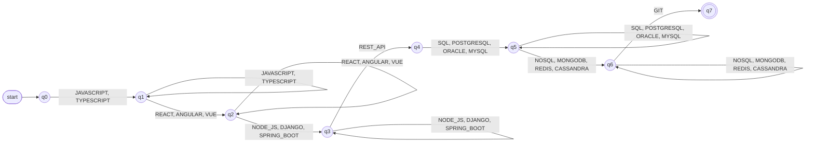
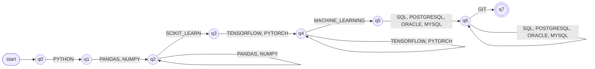
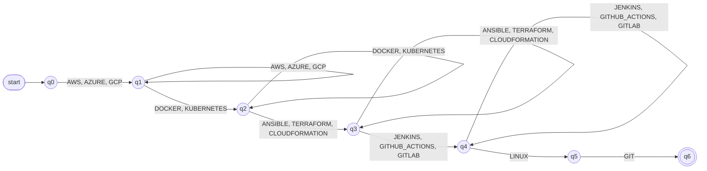
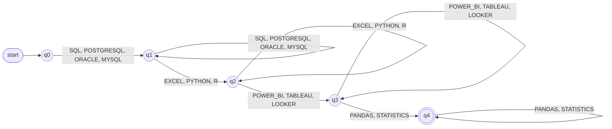

# Finite Automata — Formal Design

The classifier of Stage 3 decides, for each profile, whether a candidate satisfies
the qualification pattern of that profile. Each profile gets its own finite
automaton, formally a 5-tuple:

$$M = (Q, \Sigma, \delta, q_0, F)$$

- $Q$ is the finite set of **states**.
- $\Sigma$ is the **alphabet**: the skill tokens of the profile.
- $\delta$ is the **transition function** (a partial function $Q \times \Sigma \rightharpoonup Q$
  for the automata of this document).
- $q_0 \in Q$ is the **initial state** and $F \subseteq Q$ the set of **accepting states**.

The implementation uses `pyformlang.finite_automaton.DeterministicFiniteAutomaton`.

## 1. Input: the projected word

The automaton does not read the candidate's skills in the order they were written.
The projection step (`ProfileProjector`) turns them into a **word** over the
profile's tokens: only tokens of the profile, each at most once, sorted by their
position in the profile. Let $\text{rank}(t)$ be the 1-based position of token $t$
in the flattened vocabulary of the profile (group order first, then token order
inside each group). A projected word is a word whose letters have **strictly
increasing rank**.

Because the order is canonical, the condition "the candidate has the required
qualifications" becomes a property of a *sequence of groups* and can be checked by
a machine that only moves forward.

## 2. Group rules

A profile is a sequence of groups $G_0, \dots, G_{n-1}$. Group $G_g$ has a rule $r_g$
and a list of tokens $(t_{g,1}, \dots, t_{g,k_g})$.

| Rule | A word satisfies the group when |
|---|---|
| `REQUIRED` | every token of the group appears |
| `ANY_OF` | at least one token of the group appears |
| `OPTIONAL` | always (the group imposes no condition) |

A word is accepted when it is a projected word and satisfies **every** group. Hence

$$L(M) = \{\, w \in \Sigma^{*} \;:\; w \text{ has strictly increasing rank and } w \text{ satisfies } G_g \text{ for every } g \,\}.$$

A token must belong to at most one group of a profile; building the automaton fails
with `ValueError` otherwise.

## 3. General construction

Let $\text{sat}(g, p)$ say that group $g$ is satisfied once its tokens up to position
$p$ have been read:

$$\text{sat}(g,p) = \begin{cases} p = k_g & r_g = \text{REQUIRED} \\ p \ge 1 & r_g = \text{ANY\_OF} \\ \text{true} & r_g = \text{OPTIONAL} \end{cases}$$

and let $\text{skip}(a, b)$ say that every group strictly between $a$ and $b$ is `OPTIONAL`.

- $Q = \{q_{0,0}\} \cup \{\, q_{g,p} : 0 \le g < n,\ 1 \le p \le k_g \,\}$. The state $q_{g,p}$
  means "the last token read is token $p$ of group $g$"; $q_{0,0}$ means "nothing
  read yet".
- $\Sigma$ is the vocabulary of the profile.
- $q_0 = q_{0,0}$.
- $F = \{\, q_{g,p} \in Q : \text{sat}(g,p) \ \wedge\ \text{skip}(g, n) \,\}$: the current
  group is satisfied and every later group is `OPTIONAL`.
- For a state $q_{g,p}$ and a token $t = t_{h,q}$:

$$\delta(q_{g,p}, t) = \begin{cases}
q_{g,q} & h = g,\ q > p,\ \text{and } q = p+1 \text{ if } r_g = \text{REQUIRED} \\
q_{h,q} & h > g,\ \text{sat}(g,p),\ \text{skip}(g,h),\ \text{and } q = 1 \text{ if } r_h = \text{REQUIRED} \\
\text{undefined} & \text{otherwise}
\end{cases}$$

The first case stays inside the group and moves forward. In a `REQUIRED` group the
next token must be the very next one, because a skipped token could never be read
later (the order only goes forward). The second case leaves the group: it is allowed
only if the group is satisfied and every group in between can be skipped, and it
enters a `REQUIRED` group at its first token.

### 3.1 Type of automaton: DFA

All the automata of this document are **deterministic finite automata (DFA)**. Using
the 5-tuple above, a DFA is an automaton where:

1. there is exactly one initial state: $q_0 = q_{0,0}$;
2. every transition consumes exactly one symbol: there are no $\varepsilon$-transitions;
3. for each state and symbol there is **at most one** next state: $\delta$ is a
   function $Q \times \Sigma \rightharpoonup Q$, not a relation into subsets of $Q$.

Point 3 holds by construction: in the definition above, the two cases of $\delta$
cannot both apply to the same token $t_{h,q}$, because they require $h = g$ and
$h > g$ respectively, and in each case the target $q_{h,q}$ is determined by $t$
alone. The group-level automata of §7 are checked the same way: no row of their tables lists a token twice.

It is **not an NFA** because no choice between several successors is ever needed
(an NFA has $\delta: Q \times \Sigma \to \mathcal{P}(Q)$), and it is **not an
$\varepsilon$-NFA** because it never moves without reading a token. The reason is the
projection step: since the word arrives in canonical order, the automaton only has to
remember the position of the last token read. If words could arrive in any order, it
would instead have to remember *which groups are already satisfied*, which needs
$2^{n}$ states for a profile with $n$ groups instead of $1 + \lvert\Sigma\rvert$.

The DFA is **partial**: a missing transition means rejection. Adding a trap state
would make it complete without changing the language. Its number of states is
$1 + \lvert\Sigma\rvert$, and acceptance of a word $w$ takes $O(\lvert w\rvert)$ steps.

**Why it is correct.** After reading a prefix, the state records the group and
position of the last token. Because ranks only grow, nothing before that token can
still change, so the state is enough to know which groups are already satisfied (all
those before $g$ were checked when leaving them, and $g$ itself by $\text{sat}$) and
which tokens may still come. The test suite checks this claim directly: the DFA is
compared with a direct reading of the group rules on every subset of the vocabulary
(a seeded sample for Full Stack Developer).

## 4. How the automata are built in code

The automata are not written down as tables in the program. `ProfileClassifier`
builds the automaton of a profile the first time it is needed and keeps it in a cache
(`get_automaton`). The construction is `build_dfa(profile)` in
`src/core/classification/automaton.py`, which follows §3 literally:

```python
rules = [group.rule for group in groups]
sizes = [len(group.tokens) for group in groups]
states = [(0, 0)] + [(g, p) for g in range(n) for p in range(1, sizes[g] + 1)]

dfa = DeterministicFiniteAutomaton()
dfa.add_start_state(_state(0, 0))                    # q0 = q(0,0)
for g, p in states:
    if sat(g, p) and only_optional(g + 1, n):        # F
        dfa.add_final_state(_state(g, p))
    for token, (h, q) in owner.items():              # delta
        if h == g and q > p and (rules[g] is not REQUIRED or q == p + 1):
            dfa.add_transition(_state(g, p), token, _state(h, q))
        elif h > g and sat(g, p) and only_optional(g + 1, h) \
                and (rules[h] is not REQUIRED or q == 1):
            dfa.add_transition(_state(g, p), token, _state(h, q))
```

| Formal element | In the code |
|---|---|
| Group $G_g$, token $t_{g,p}$ | `profile.groups[g].tokens[p - 1]` |
| State $q_{g,p}$ | the string `f"q{g}_{p}"` (so $q_{2,1}$ is `q2_1`) |
| $\Sigma$ | `profile.vocabulary`, exposed as `Automaton.alphabet` |
| $\text{sat}(g,p)$, $\text{skip}(a,b)$ | the local functions `sat` and `only_optional` |
| $q_0$, $F$, $\delta$ | `add_start_state`, `add_final_state`, `add_transition` |
| Rejection by a missing transition | `Automaton.accepts` returns `False` |

`Automaton.accepts(sequence)` first rejects any token outside the alphabet, then
runs the DFA. `ProfileClassifier.classify` wraps the verdict and the evaluated
sequence in a `ClassificationResult`. Section 7 presents the profile automata in a simpler group-level form (§6), which gives the
same verdict as the automaton built by this code on every word the classifier receives.

## 5. Worked example

Profile with three groups: $G_0$ = `ANY_OF` $\{A, B\}$, $G_1$ = `REQUIRED` $\{C\}$,
$G_2$ = `OPTIONAL` $\{D\}$. Its alphabet is $\{A, B, C, D\}$ and its states are
$q_{0,0}$ (start), $q_{0,1}$ ($A$), $q_{0,2}$ ($B$), $q_{1,1}$ ($C$) and $q_{2,1}$ ($D$).
Accepting states: $q_{1,1}$ and $q_{2,1}$ (reading $C$ satisfies $G_1$ and $G_2$ is
optional).

| State | $A$ | $B$ | $C$ | $D$ |
|---|---|---|---|---|
| $q_{0,0}$ (start) | $q_{0,1}$ | $q_{0,2}$ | — | — |
| $q_{0,1}$ | — | $q_{0,2}$ | $q_{1,1}$ | — |
| $q_{0,2}$ | — | — | $q_{1,1}$ | — |
| $q_{1,1}$ (final) | — | — | — | $q_{2,1}$ |
| $q_{2,1}$ (final) | — | — | — | — |

Accepted: `A C`, `B C`, `A B C D`, `B C D`. Rejected: `C` (no token of $G_0$), `A` (no
$C$), `C A` (not in canonical order), `A A C` (repeated token).

## 6. Group-level presentation of the profile automata

The automaton of §3 has one state per token. That is what the program builds, but it
makes the diagrams large. The per-profile specifications of §7 use a smaller automaton
with one state per **group**, in which the alternatives of an `ANY_OF` group appear
together on one label.

**Notation.** A label `t1, t2, t3` is shorthand for three transitions with the same
source and the same target, one per token; read it as "`t1` **or** `t2` **or** `t3`".
$\delta$ is still a function on single tokens: the comma list only compresses the
tables and the diagrams.

**Construction.** Let the profile have groups $G_0, \dots, G_{n-1}$, each either `ANY_OF`
or `REQUIRED` with a single token (the only kinds the four default profiles use). The
group-level automaton is $M = (Q, \Sigma, \delta, q_0, F)$ with:

- $Q = \{q_0, \dots, q_n\}$. State $q_g$ means "groups $G_0, \dots, G_{g-1}$ are satisfied and
  the automaton is waiting for $G_g$"; $q_n$ means "every group is satisfied".
- $\Sigma$ is the vocabulary of the profile.
- $\delta(q_g, t) = q_{g+1}$ for every token $t$ of $G_g$ (**advance** to the next group).
- $\delta(q_{g+1}, t) = q_{g+1}$ for every token $t$ of $G_g$ when $G_g$ is `ANY_OF` with at
  least two tokens (**stay**: another alternative of the group already satisfied).
- $\delta$ is undefined in every other case.
- $q_0$ is the initial state and $F = \{q_n\}$.

The *stay* transitions are needed because `ANY_OF` means "at least one": a candidate may
show React **and** Angular. In the diagrams a stay transition is a loop that repeats the
label of the edge entering the state.

**Type: DFA.** Each state has at most one transition per token, because the token sets of
different groups are disjoint and the advance and stay transitions of a state use
the tokens of two different groups. There is one initial state and no $\varepsilon$-transitions.
It is partial: a missing transition means rejection.

**Relation with the automaton of §3.** Both give the **same verdict on every projected word**,
which is the only kind of word the classifier receives (tokens of the profile, no
repeats, in canonical order). In a projected word the tokens of $G_0$ come first, then
those of $G_1$, and so on. The group-level automaton therefore visits $q_0, q_1, \dots$ in
order and reaches $q_n$ exactly when every group contributed at least one token, which
for these two kinds of group is the condition of §2. This was checked exhaustively: on every
subset of the vocabulary of each of the four profiles, after projection, the group-level
automaton, the automaton built by the code and a direct reading of the group rules agree.

They differ only on words the projector never produces: the group-level automaton does not
check order or repetition *inside* a group (it accepts `VUE REACT` or `REACT REACT`
where the group is satisfied), and it has $n + 1$ states instead of $1 + \lvert\Sigma\rvert$.
`OPTIONAL` groups and `REQUIRED` groups with several tokens are not drawn this way; the
construction of §3 covers them.

## 7. The four profile automata

Summary:

| Profile | Groups | $\lvert\Sigma\rvert$ | $\lvert Q\rvert$ | Labelled edges | Transitions (one per token) | $\lvert Q\rvert$ in the code (§3) |
|---|---|---|---|---|---|---|
| Full Stack Developer | 7 | 18 | 8 | 12 | 34 | 19 |
| Machine Learning Engineer | 7 | 12 | 8 | 10 | 20 | 13 |
| Cloud Engineer | 6 | 13 | 7 | 10 | 24 | 14 |
| Data Analyst | 4 | 12 | 5 | 8 | 24 | 13 |

Each section below gives the profile pattern, the complete 5-tuple of the group-level
automaton, its type, its transition diagram and examples. Notation: in the regular
expression, `a b` is concatenation, `a?` is "optional" and `a | b` is alternation. In the
transition tables and the diagrams, a comma-separated list of tokens is an "or" (§6): `A, B → q1`
means that reading `A` or `B` moves to `q1`. A token that is not listed has no transition
(rejection). A double circle is an accepting state, and the arrow from `start` marks the
initial state.

### 7.1 Full Stack Developer

#### Profile pattern

The candidate must show, in this order: a programming language, a front-end framework, a back-end framework, REST API experience, a relational database, a non-relational database and Git. It has 5 `ANY_OF` groups, 2 `REQUIRED` groups and 0 `OPTIONAL` groups.

| Group | Label | Rule | Tokens (in order) | A word satisfies it when |
|---|---|---|---|---|
| G0 | Language | `ANY_OF` | `JAVASCRIPT`, `TYPESCRIPT` | at least one appears |
| G1 | Frontend framework | `ANY_OF` | `REACT`, `ANGULAR`, `VUE` | at least one appears |
| G2 | Backend framework | `ANY_OF` | `NODE_JS`, `DJANGO`, `SPRING_BOOT` | at least one appears |
| G3 | REST APIs | `REQUIRED` | `REST_API` | all of them appear |
| G4 | Relational database | `ANY_OF` | `SQL`, `POSTGRESQL`, `ORACLE`, `MYSQL` | at least one appears |
| G5 | Non-relational database | `ANY_OF` | `NOSQL`, `MONGODB`, `REDIS`, `CASSANDRA` | at least one appears |
| G6 | Version control | `REQUIRED` | `GIT` | all of them appear |

Over projected words, the language of the automaton is the concatenation of one regular expression per group:

```text
G0 = JAVASCRIPT TYPESCRIPT? | TYPESCRIPT
G1 = REACT ANGULAR? VUE? | ANGULAR VUE? | VUE
G2 = NODE_JS DJANGO? SPRING_BOOT? | DJANGO SPRING_BOOT? | SPRING_BOOT
G3 = REST_API
G4 = SQL POSTGRESQL? ORACLE? MYSQL? | POSTGRESQL ORACLE? MYSQL? | ORACLE MYSQL? | MYSQL
G5 = NOSQL MONGODB? REDIS? CASSANDRA? | MONGODB REDIS? CASSANDRA? | REDIS CASSANDRA? | CASSANDRA
G6 = GIT
L  = G0 G1 G2 G3 G4 G5 G6
```

#### Formal definition

$$M_{\text{Full Stack Developer}} = (Q, \Sigma, \delta, q_0, F)$$

- **Q** (states): $\lvert Q\rvert = 8$, one state per group boundary: Q = {`q0`, `q1`, `q2`, `q3`, `q4`, `q5`, `q6`, `q7`}. State `qg` means "groups G0 to G(g−1) are satisfied and the automaton is waiting for Gg"; `q7` means "every group is satisfied".
- **Σ** (alphabet): the 18 tokens of the profile: `JAVASCRIPT`, `TYPESCRIPT`, `REACT`, `ANGULAR`, `VUE`, `NODE_JS`, `DJANGO`, `SPRING_BOOT`, `REST_API`, `SQL`, `POSTGRESQL`, `ORACLE`, `MYSQL`, `NOSQL`, `MONGODB`, `REDIS`, `CASSANDRA`, `GIT`.
- **δ** (transition function): a partial function $Q \times \Sigma \rightharpoonup Q$ with 34 transitions, written in the table below as 12 labelled edges. A comma-separated label is an "or": `A, B → q1` stands for the two transitions δ(q0, A) = q1 and δ(q0, B) = q1.
- **q₀** (initial state): `q0`.
- **F** (accepting states): {`q7`}.

| State | Meaning | Transitions δ (token list → next state) | Accepting |
|---|---|---|---|
| `q0` (initial) | nothing read; waiting for G0 (Language) | `JAVASCRIPT, TYPESCRIPT` → `q1` (next group) | no |
| `q1` | G0 (Language) satisfied; waiting for G1 (Frontend framework) | `JAVASCRIPT, TYPESCRIPT` → `q1` (same group again); `REACT, ANGULAR, VUE` → `q2` (next group) | no |
| `q2` | G1 (Frontend framework) satisfied; waiting for G2 (Backend framework) | `REACT, ANGULAR, VUE` → `q2` (same group again); `NODE_JS, DJANGO, SPRING_BOOT` → `q3` (next group) | no |
| `q3` | G2 (Backend framework) satisfied; waiting for G3 (REST APIs) | `NODE_JS, DJANGO, SPRING_BOOT` → `q3` (same group again); `REST_API` → `q4` (next group) | no |
| `q4` | G3 (REST APIs) satisfied; waiting for G4 (Relational database) | `SQL, POSTGRESQL, ORACLE, MYSQL` → `q5` (next group) | no |
| `q5` | G4 (Relational database) satisfied; waiting for G5 (Non-relational database) | `SQL, POSTGRESQL, ORACLE, MYSQL` → `q5` (same group again); `NOSQL, MONGODB, REDIS, CASSANDRA` → `q6` (next group) | no |
| `q6` | G5 (Non-relational database) satisfied; waiting for G6 (Version control) | `NOSQL, MONGODB, REDIS, CASSANDRA` → `q6` (same group again); `GIT` → `q7` (next group) | no |
| `q7` | G6 (Version control) satisfied; every group is satisfied | — | yes |

#### Type of automaton

**DFA** (partial). Checked against the definition of §3.1 on this automaton: it has one initial state (`q0`); all 34 transitions consume exactly one token, so there are no ε-transitions; and no state has two transitions on the same token, because the token lists in each row of the table belong to different groups and are therefore disjoint (a state has between 0 and 8 outgoing transitions). A comma-separated label does not make it an NFA: it is shorthand for one transition per token, each with a single target. It is not an ε-NFA, because it never changes state without reading a token. It is partial: for example, from `q0` the token `GIT` has no transition, which means rejection.

#### Transition diagram



Each box-to-box edge is an "or" over the listed tokens. A loop on a state repeats the label of the edge that enters it: another alternative of the group that has just been satisfied.

#### Examples

| Word | Verdict |
|---|---|
| Accepted: one token per `ANY_OF` group and every `REQUIRED` token (the shortest accepted word): `JAVASCRIPT REACT NODE_JS REST_API SQL NOSQL GIT` | accepted |
| Accepted: every token of the profile (all the alternatives of each group, through the loops): `JAVASCRIPT TYPESCRIPT REACT ANGULAR VUE NODE_JS DJANGO SPRING_BOOT REST_API SQL POSTGRESQL ORACLE MYSQL NOSQL MONGODB REDIS CASSANDRA GIT` | accepted |
| Rejected: the shortest word without group G0 (Language): `REACT NODE_JS REST_API SQL NOSQL GIT` | rejected |
| Rejected: the shortest accepted word in reverse order (its first token belongs to the last group): `GIT NOSQL SQL REST_API NODE_JS REACT JAVASCRIPT` | rejected |
| Rejected: the empty word: `ε` | rejected |

### 7.2 Machine Learning Engineer

#### Profile pattern

The candidate must know Python, a data-processing library (Pandas or NumPy), scikit-learn, a deep-learning framework (TensorFlow or PyTorch), machine-learning model development, a relational database and Git. It has 3 `ANY_OF` groups, 4 `REQUIRED` groups and 0 `OPTIONAL` groups.

| Group | Label | Rule | Tokens (in order) | A word satisfies it when |
|---|---|---|---|---|
| G0 | Language | `REQUIRED` | `PYTHON` | all of them appear |
| G1 | Data processing | `ANY_OF` | `PANDAS`, `NUMPY` | at least one appears |
| G2 | Classical ML | `REQUIRED` | `SCIKIT_LEARN` | all of them appear |
| G3 | Deep learning | `ANY_OF` | `TENSORFLOW`, `PYTORCH` | at least one appears |
| G4 | Model development | `REQUIRED` | `MACHINE_LEARNING` | all of them appear |
| G5 | Relational database | `ANY_OF` | `SQL`, `POSTGRESQL`, `ORACLE`, `MYSQL` | at least one appears |
| G6 | Version control | `REQUIRED` | `GIT` | all of them appear |

Over projected words, the language of the automaton is the concatenation of one regular expression per group:

```text
G0 = PYTHON
G1 = PANDAS NUMPY? | NUMPY
G2 = SCIKIT_LEARN
G3 = TENSORFLOW PYTORCH? | PYTORCH
G4 = MACHINE_LEARNING
G5 = SQL POSTGRESQL? ORACLE? MYSQL? | POSTGRESQL ORACLE? MYSQL? | ORACLE MYSQL? | MYSQL
G6 = GIT
L  = G0 G1 G2 G3 G4 G5 G6
```

#### Formal definition

$$M_{\text{Machine Learning Engineer}} = (Q, \Sigma, \delta, q_0, F)$$

- **Q** (states): $\lvert Q\rvert = 8$, one state per group boundary: Q = {`q0`, `q1`, `q2`, `q3`, `q4`, `q5`, `q6`, `q7`}. State `qg` means "groups G0 to G(g−1) are satisfied and the automaton is waiting for Gg"; `q7` means "every group is satisfied".
- **Σ** (alphabet): the 12 tokens of the profile: `PYTHON`, `PANDAS`, `NUMPY`, `SCIKIT_LEARN`, `TENSORFLOW`, `PYTORCH`, `MACHINE_LEARNING`, `SQL`, `POSTGRESQL`, `ORACLE`, `MYSQL`, `GIT`.
- **δ** (transition function): a partial function $Q \times \Sigma \rightharpoonup Q$ with 20 transitions, written in the table below as 10 labelled edges. A comma-separated label is an "or": `A, B → q1` stands for the two transitions δ(q0, A) = q1 and δ(q0, B) = q1.
- **q₀** (initial state): `q0`.
- **F** (accepting states): {`q7`}.

| State | Meaning | Transitions δ (token list → next state) | Accepting |
|---|---|---|---|
| `q0` (initial) | nothing read; waiting for G0 (Language) | `PYTHON` → `q1` (next group) | no |
| `q1` | G0 (Language) satisfied; waiting for G1 (Data processing) | `PANDAS, NUMPY` → `q2` (next group) | no |
| `q2` | G1 (Data processing) satisfied; waiting for G2 (Classical ML) | `PANDAS, NUMPY` → `q2` (same group again); `SCIKIT_LEARN` → `q3` (next group) | no |
| `q3` | G2 (Classical ML) satisfied; waiting for G3 (Deep learning) | `TENSORFLOW, PYTORCH` → `q4` (next group) | no |
| `q4` | G3 (Deep learning) satisfied; waiting for G4 (Model development) | `TENSORFLOW, PYTORCH` → `q4` (same group again); `MACHINE_LEARNING` → `q5` (next group) | no |
| `q5` | G4 (Model development) satisfied; waiting for G5 (Relational database) | `SQL, POSTGRESQL, ORACLE, MYSQL` → `q6` (next group) | no |
| `q6` | G5 (Relational database) satisfied; waiting for G6 (Version control) | `SQL, POSTGRESQL, ORACLE, MYSQL` → `q6` (same group again); `GIT` → `q7` (next group) | no |
| `q7` | G6 (Version control) satisfied; every group is satisfied | — | yes |

#### Type of automaton

**DFA** (partial). Checked against the definition of §3.1 on this automaton: it has one initial state (`q0`); all 20 transitions consume exactly one token, so there are no ε-transitions; and no state has two transitions on the same token, because the token lists in each row of the table belong to different groups and are therefore disjoint (a state has between 0 and 5 outgoing transitions). A comma-separated label does not make it an NFA: it is shorthand for one transition per token, each with a single target. It is not an ε-NFA, because it never changes state without reading a token. It is partial: for example, from `q0` the token `GIT` has no transition, which means rejection.

#### Transition diagram



Each box-to-box edge is an "or" over the listed tokens. A loop on a state repeats the label of the edge that enters it: another alternative of the group that has just been satisfied.

#### Examples

| Word | Verdict |
|---|---|
| Accepted: one token per `ANY_OF` group and every `REQUIRED` token (the shortest accepted word): `PYTHON PANDAS SCIKIT_LEARN TENSORFLOW MACHINE_LEARNING SQL GIT` | accepted |
| Accepted: every token of the profile (all the alternatives of each group, through the loops): `PYTHON PANDAS NUMPY SCIKIT_LEARN TENSORFLOW PYTORCH MACHINE_LEARNING SQL POSTGRESQL ORACLE MYSQL GIT` | accepted |
| Rejected: the shortest word without group G0 (Language): `PANDAS SCIKIT_LEARN TENSORFLOW MACHINE_LEARNING SQL GIT` | rejected |
| Rejected: the shortest accepted word in reverse order (its first token belongs to the last group): `GIT SQL MACHINE_LEARNING TENSORFLOW SCIKIT_LEARN PANDAS PYTHON` | rejected |
| Rejected: the empty word: `ε` | rejected |

### 7.3 Cloud Engineer

#### Profile pattern

The candidate must know a cloud provider, a container technology, an infrastructure-as-code tool, a CI/CD tool, Linux and Git. It has 4 `ANY_OF` groups, 2 `REQUIRED` groups and 0 `OPTIONAL` groups.

| Group | Label | Rule | Tokens (in order) | A word satisfies it when |
|---|---|---|---|---|
| G0 | Cloud provider | `ANY_OF` | `AWS`, `AZURE`, `GCP` | at least one appears |
| G1 | Containers | `ANY_OF` | `DOCKER`, `KUBERNETES` | at least one appears |
| G2 | Infrastructure as code | `ANY_OF` | `ANSIBLE`, `TERRAFORM`, `CLOUDFORMATION` | at least one appears |
| G3 | CI/CD | `ANY_OF` | `JENKINS`, `GITHUB_ACTIONS`, `GITLAB` | at least one appears |
| G4 | Operating system | `REQUIRED` | `LINUX` | all of them appear |
| G5 | Version control | `REQUIRED` | `GIT` | all of them appear |

Over projected words, the language of the automaton is the concatenation of one regular expression per group:

```text
G0 = AWS AZURE? GCP? | AZURE GCP? | GCP
G1 = DOCKER KUBERNETES? | KUBERNETES
G2 = ANSIBLE TERRAFORM? CLOUDFORMATION? | TERRAFORM CLOUDFORMATION? | CLOUDFORMATION
G3 = JENKINS GITHUB_ACTIONS? GITLAB? | GITHUB_ACTIONS GITLAB? | GITLAB
G4 = LINUX
G5 = GIT
L  = G0 G1 G2 G3 G4 G5
```

#### Formal definition

$$M_{\text{Cloud Engineer}} = (Q, \Sigma, \delta, q_0, F)$$

- **Q** (states): $\lvert Q\rvert = 7$, one state per group boundary: Q = {`q0`, `q1`, `q2`, `q3`, `q4`, `q5`, `q6`}. State `qg` means "groups G0 to G(g−1) are satisfied and the automaton is waiting for Gg"; `q6` means "every group is satisfied".
- **Σ** (alphabet): the 13 tokens of the profile: `AWS`, `AZURE`, `GCP`, `DOCKER`, `KUBERNETES`, `ANSIBLE`, `TERRAFORM`, `CLOUDFORMATION`, `JENKINS`, `GITHUB_ACTIONS`, `GITLAB`, `LINUX`, `GIT`.
- **δ** (transition function): a partial function $Q \times \Sigma \rightharpoonup Q$ with 24 transitions, written in the table below as 10 labelled edges. A comma-separated label is an "or": `A, B → q1` stands for the two transitions δ(q0, A) = q1 and δ(q0, B) = q1.
- **q₀** (initial state): `q0`.
- **F** (accepting states): {`q6`}.

| State | Meaning | Transitions δ (token list → next state) | Accepting |
|---|---|---|---|
| `q0` (initial) | nothing read; waiting for G0 (Cloud provider) | `AWS, AZURE, GCP` → `q1` (next group) | no |
| `q1` | G0 (Cloud provider) satisfied; waiting for G1 (Containers) | `AWS, AZURE, GCP` → `q1` (same group again); `DOCKER, KUBERNETES` → `q2` (next group) | no |
| `q2` | G1 (Containers) satisfied; waiting for G2 (Infrastructure as code) | `DOCKER, KUBERNETES` → `q2` (same group again); `ANSIBLE, TERRAFORM, CLOUDFORMATION` → `q3` (next group) | no |
| `q3` | G2 (Infrastructure as code) satisfied; waiting for G3 (CI/CD) | `ANSIBLE, TERRAFORM, CLOUDFORMATION` → `q3` (same group again); `JENKINS, GITHUB_ACTIONS, GITLAB` → `q4` (next group) | no |
| `q4` | G3 (CI/CD) satisfied; waiting for G4 (Operating system) | `JENKINS, GITHUB_ACTIONS, GITLAB` → `q4` (same group again); `LINUX` → `q5` (next group) | no |
| `q5` | G4 (Operating system) satisfied; waiting for G5 (Version control) | `GIT` → `q6` (next group) | no |
| `q6` | G5 (Version control) satisfied; every group is satisfied | — | yes |

#### Type of automaton

**DFA** (partial). Checked against the definition of §3.1 on this automaton: it has one initial state (`q0`); all 24 transitions consume exactly one token, so there are no ε-transitions; and no state has two transitions on the same token, because the token lists in each row of the table belong to different groups and are therefore disjoint (a state has between 0 and 6 outgoing transitions). A comma-separated label does not make it an NFA: it is shorthand for one transition per token, each with a single target. It is not an ε-NFA, because it never changes state without reading a token. It is partial: for example, from `q0` the token `GIT` has no transition, which means rejection.

#### Transition diagram



Each box-to-box edge is an "or" over the listed tokens. A loop on a state repeats the label of the edge that enters it: another alternative of the group that has just been satisfied.

#### Examples

| Word | Verdict |
|---|---|
| Accepted: one token per `ANY_OF` group and every `REQUIRED` token (the shortest accepted word): `AWS DOCKER ANSIBLE JENKINS LINUX GIT` | accepted |
| Accepted: every token of the profile (all the alternatives of each group, through the loops): `AWS AZURE GCP DOCKER KUBERNETES ANSIBLE TERRAFORM CLOUDFORMATION JENKINS GITHUB_ACTIONS GITLAB LINUX GIT` | accepted |
| Rejected: the shortest word without group G0 (Cloud provider): `DOCKER ANSIBLE JENKINS LINUX GIT` | rejected |
| Rejected: the shortest accepted word in reverse order (its first token belongs to the last group): `GIT LINUX JENKINS ANSIBLE DOCKER AWS` | rejected |
| Rejected: the empty word: `ε` | rejected |

### 7.4 Data Analyst

#### Profile pattern

The candidate must know a relational database, an analysis tool, a visualization tool and an analysis library. Every group accepts alternatives; no single technology is mandatory. It has 4 `ANY_OF` groups, 0 `REQUIRED` groups and 0 `OPTIONAL` groups.

| Group | Label | Rule | Tokens (in order) | A word satisfies it when |
|---|---|---|---|---|
| G0 | Relational database | `ANY_OF` | `SQL`, `POSTGRESQL`, `ORACLE`, `MYSQL` | at least one appears |
| G1 | Analysis tool | `ANY_OF` | `EXCEL`, `PYTHON`, `R` | at least one appears |
| G2 | Visualization | `ANY_OF` | `POWER_BI`, `TABLEAU`, `LOOKER` | at least one appears |
| G3 | Analysis library | `ANY_OF` | `PANDAS`, `STATISTICS` | at least one appears |

Over projected words, the language of the automaton is the concatenation of one regular expression per group:

```text
G0 = SQL POSTGRESQL? ORACLE? MYSQL? | POSTGRESQL ORACLE? MYSQL? | ORACLE MYSQL? | MYSQL
G1 = EXCEL PYTHON? R? | PYTHON R? | R
G2 = POWER_BI TABLEAU? LOOKER? | TABLEAU LOOKER? | LOOKER
G3 = PANDAS STATISTICS? | STATISTICS
L  = G0 G1 G2 G3
```

#### Formal definition

$$M_{\text{Data Analyst}} = (Q, \Sigma, \delta, q_0, F)$$

- **Q** (states): $\lvert Q\rvert = 5$, one state per group boundary: Q = {`q0`, `q1`, `q2`, `q3`, `q4`}. State `qg` means "groups G0 to G(g−1) are satisfied and the automaton is waiting for Gg"; `q4` means "every group is satisfied".
- **Σ** (alphabet): the 12 tokens of the profile: `SQL`, `POSTGRESQL`, `ORACLE`, `MYSQL`, `EXCEL`, `PYTHON`, `R`, `POWER_BI`, `TABLEAU`, `LOOKER`, `PANDAS`, `STATISTICS`.
- **δ** (transition function): a partial function $Q \times \Sigma \rightharpoonup Q$ with 24 transitions, written in the table below as 8 labelled edges. A comma-separated label is an "or": `A, B → q1` stands for the two transitions δ(q0, A) = q1 and δ(q0, B) = q1.
- **q₀** (initial state): `q0`.
- **F** (accepting states): {`q4`}.

| State | Meaning | Transitions δ (token list → next state) | Accepting |
|---|---|---|---|
| `q0` (initial) | nothing read; waiting for G0 (Relational database) | `SQL, POSTGRESQL, ORACLE, MYSQL` → `q1` (next group) | no |
| `q1` | G0 (Relational database) satisfied; waiting for G1 (Analysis tool) | `SQL, POSTGRESQL, ORACLE, MYSQL` → `q1` (same group again); `EXCEL, PYTHON, R` → `q2` (next group) | no |
| `q2` | G1 (Analysis tool) satisfied; waiting for G2 (Visualization) | `EXCEL, PYTHON, R` → `q2` (same group again); `POWER_BI, TABLEAU, LOOKER` → `q3` (next group) | no |
| `q3` | G2 (Visualization) satisfied; waiting for G3 (Analysis library) | `POWER_BI, TABLEAU, LOOKER` → `q3` (same group again); `PANDAS, STATISTICS` → `q4` (next group) | no |
| `q4` | G3 (Analysis library) satisfied; every group is satisfied | `PANDAS, STATISTICS` → `q4` (same group again) | yes |

#### Type of automaton

**DFA** (partial). Checked against the definition of §3.1 on this automaton: it has one initial state (`q0`); all 24 transitions consume exactly one token, so there are no ε-transitions; and no state has two transitions on the same token, because the token lists in each row of the table belong to different groups and are therefore disjoint (a state has between 2 and 7 outgoing transitions). A comma-separated label does not make it an NFA: it is shorthand for one transition per token, each with a single target. It is not an ε-NFA, because it never changes state without reading a token. It is partial: for example, from `q0` the token `STATISTICS` has no transition, which means rejection.

#### Transition diagram



Each box-to-box edge is an "or" over the listed tokens. A loop on a state repeats the label of the edge that enters it: another alternative of the group that has just been satisfied.

#### Examples

| Word | Verdict |
|---|---|
| Accepted: one token per `ANY_OF` group and every `REQUIRED` token (the shortest accepted word): `SQL EXCEL POWER_BI PANDAS` | accepted |
| Accepted: every token of the profile (all the alternatives of each group, through the loops): `SQL POSTGRESQL ORACLE MYSQL EXCEL PYTHON R POWER_BI TABLEAU LOOKER PANDAS STATISTICS` | accepted |
| Rejected: the shortest word without group G0 (Relational database): `EXCEL POWER_BI PANDAS` | rejected |
| Rejected: the shortest accepted word in reverse order (its first token belongs to the last group): `PANDAS POWER_BI EXCEL SQL` | rejected |
| Rejected: the empty word: `ε` | rejected |

## 8. Known limitations

- The automaton built by the code (§3) accepts only projected words. The same set of tokens
  in another order, with a repeat, or with a token of another profile is rejected. The
  classifier relies on the projection step for that.
- A token cannot appear in two groups of the same profile.
- `REQUIRED` with several tokens means *all* of them. The default profiles use it only
  with single-token groups.
- The group-level automaton of §6 accepts some words that are not projected (for example a
  repeated token inside an `ANY_OF` group). They never reach it, because the classifier
  receives the output of the projection step.
- The classification is binary (`ACCEPTED` / `REJECTED`). It does not say which group
  was missing.
- The automata are rebuilt from the profile definitions. If a profile in
  `src/core/profiles/definitions.py` changes, the tables and diagrams of §7 must be
  regenerated.
