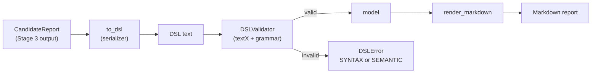
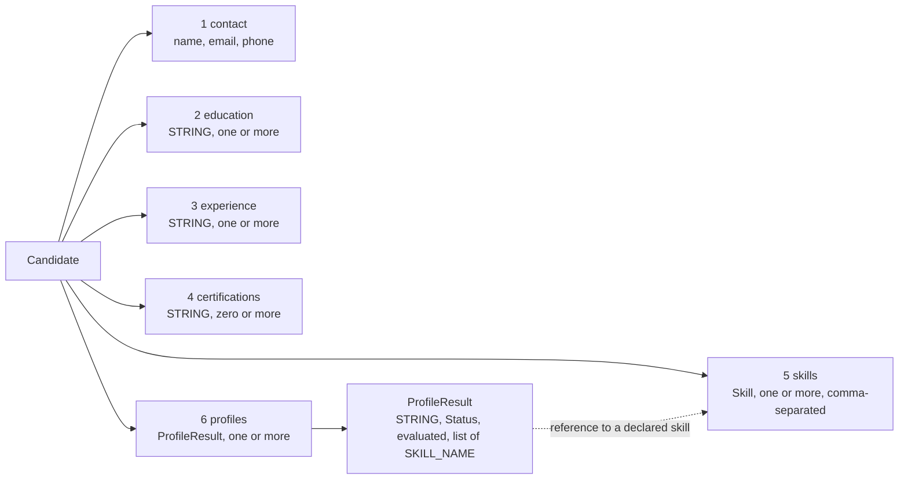
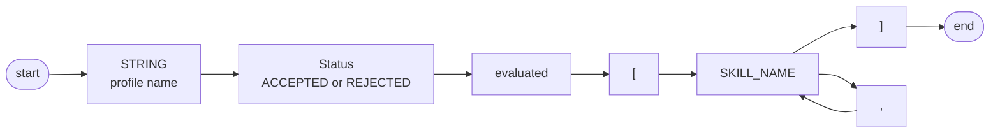
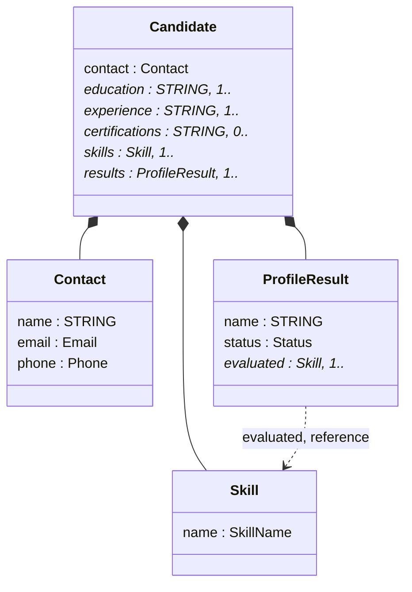

# Domain-Specific Language — Formal Grammar Design (Stage 4)

The last component of ResumeLens represents, in a single textual document, everything the pipeline knows about a candidate: contact data, academic qualifications, experience,
certifications, the recognized skills and the verdict for each profile. This representation is a **domain-specific language (DSL)** defined by a **context-free grammar** written in
EBNF and processed with `textX` (`src/core/dsl/candidate.tx`). This document defines the grammar, identifies its terminals and non-terminals, and explains the structure of the language.

## 1. Purpose and position in the pipeline



The DSL has three roles. It is the **formal interface** between the classification stage and the presentation of results. It is **validated independently of its producer**: any document, whether
written by the serializer or by hand, is accepted or rejected by the same grammar. And it makes the structure of a report explicit (nested blocks, lists, fields) so that the renderer works on a checked model,
not on loose strings.

## 2. Formal background

### 2.1 Context-free grammars

A **context-free grammar** is a 4-tuple

$$G = (V, \Sigma, P, S)$$

where $V$ is a finite set of **non-terminals** (syntactic categories), $\Sigma$ a finite set of **terminals** (the symbols of the language, disjoint from $V$), $P \subseteq V \times (V \cup \Sigma)^{*}$ a finite
set of **productions** $A \to \alpha$ (one non-terminal on the left, which is what "context-free" means), and $S \in V$ the **start symbol**. The relation $\Rightarrow$ rewrites one non-terminal using a
production; the language of the grammar is

$$L(G) = \{\, w \in \Sigma^{*} \;:\; S \Rightarrow^{*} w \,\}.$$

A **derivation tree** (parse tree) has the start symbol at the root, a production at each inner node and terminals at the leaves. A grammar is **ambiguous** if some word has two different derivation trees.
$G$ is **LL(1)** if, for every non-terminal with several productions, the next input symbol decides which one applies. This is checked with the sets $\mathrm{FIRST}$ (terminals that can begin a derivation)
and $\mathrm{FOLLOW}$ (terminals that can come right after a non-terminal), see §5.

### 2.2 EBNF notation

The grammar is written in EBNF (ISO/IEC 14977 style). EBNF is a compact notation for context-free grammars: every rule can be rewritten as ordinary productions with helper non-terminals (§5.1).

| Symbol | Meaning |
|---|---|
| `=` and `;` | a rule defines the non-terminal on its left; `;` ends it |
| `,` | concatenation |
| `\|` | alternative |
| `{ x }` | zero or more repetitions of `x` |
| `[ x ]` | optional `x` |
| `"text"` | terminal written literally |
| `Name` (CamelCase) | non-terminal |
| `NAME` (upper case) | lexical terminal, defined by a regular expression |

### 2.3 textX

`textX` reads a grammar file and builds a parser and a **metamodel**: for every rule that assigns attributes it creates a class, and parsing a document yields an object graph (the *model*). Its grammar language adds three things to
EBNF that this document keeps explicit: attribute assignments (`name=...`, `list+=...`), **cross-references** (`[Skill|SkillName]`) resolved after parsing, and **object processors**, functions called when an object is built.
`textX` interprets its rules as a parsing expression grammar (PEG), whose choice is *ordered*. For an LL(1) grammar, as this one is (§5.3), at most one alternative can start with the next token, so ordered choice and
context-free choice select the same production and describe the same language.

## 3. The grammar

### 3.1 Source in `candidate.tx`

```text
Candidate:
    'candidate' '{'
        contact=Contact
        'education' '{' education+=STRING '}'
        'experience' '{' experience+=STRING '}'
        'certifications' '{' certifications*=STRING '}'
        'skills' '{' skills+=Skill[','] '}'
        'profiles' '{' results+=ProfileResult '}'
    '}'
;

Contact:
    'contact' '{'
        'name' ':' name=STRING
        'email' ':' email=Email
        'phone' ':' phone=Phone
    '}'
;

Skill:
    name=SkillName
;

ProfileResult:
    name=STRING status=Status 'evaluated' '[' evaluated+=[Skill|SkillName][','] ']'
;

Status: 'ACCEPTED' | 'REJECTED';

// --- terminals (match rules) ---
SkillName: /[A-Z][A-Z0-9]*(_[A-Z0-9]+)*/;
Email: /[A-Za-z0-9._%+-]+@[A-Za-z0-9.-]+\.[A-Za-z]{2,}/;
Phone: /\+?[0-9()\-.\s]{6,19}[0-9]/;
```

The validator loads it with the option `autokwd=True`: a keyword made of letters is only matched as a whole word.

### 3.2 The grammar in EBNF

Non-terminals are written in CamelCase and are the five rules of the file that have structure. Terminals are the quoted strings and the four lexical terminals `STRING`, `SKILL_NAME`, `EMAIL` and `PHONE`
(the rules `SkillName`, `Email` and `Phone` of the file, which are regular expressions, and the built-in `STRING`).

```text
Candidate     = "candidate" , "{" ,
                  Contact ,
                  "education"      , "{" , STRING , { STRING } , "}" ,
                  "experience"     , "{" , STRING , { STRING } , "}" ,
                  "certifications" , "{" ,          { STRING } , "}" ,
                  "skills"         , "{" , Skill , { "," , Skill } , "}" ,
                  "profiles"       , "{" , ProfileResult , { ProfileResult } , "}" ,
                "}" ;

Contact       = "contact" , "{" , "name" , ":" , STRING ,
                                  "email" , ":" , EMAIL ,
                                  "phone" , ":" , PHONE , "}" ;

Skill         = SKILL_NAME ;

ProfileResult = STRING , Status , "evaluated" , "[" , SKILL_NAME , { "," , SKILL_NAME } , "]" ;

Status        = "ACCEPTED" | "REJECTED" ;
```

Lexical terminals (regular expressions, as in the file):

```text
SKILL_NAME = [A-Z][A-Z0-9]*(_[A-Z0-9]+)*
EMAIL      = [A-Za-z0-9._%+-]+@[A-Za-z0-9.-]+\.[A-Za-z]{2,}
PHONE      = \+?[0-9()\-.\s]{6,19}[0-9]
STRING     = text between double quotes (built-in of textX; single quotes are also accepted)
```

Start symbol: `Candidate`. The tokens may be separated by any amount of whitespace, which `textX` skips.

### 3.3 Non-terminals

| Non-terminal | Role | Appears in |
|---|---|---|
| `Candidate` | **start symbol**; the whole document: one candidate with all its sections | — |
| `Contact` | personal data block: name, e-mail, phone | `Candidate` |
| `Skill` | one recognized skill, identified by its canonical token | `Candidate` (`skills`) |
| `ProfileResult` | verdict for one profile and the skills that were evaluated | `Candidate` (`profiles`) |
| `Status` | the verdict: `ACCEPTED` or `REJECTED` | `ProfileResult` |

### 3.4 Terminals

There are 23 terminal symbols.

| Group | Terminal | Spelling | Role |
|---|---|---|---|
| Keywords (11) | `candidate` | literal | opens the document |
| | `contact`, `name`, `email`, `phone` | literal | contact block and its three fields |
| | `education`, `experience`, `certifications` | literal | qualification blocks |
| | `skills`, `profiles` | literal | skills block and results block |
| | `evaluated` | literal | introduces the list of skills that were evaluated for a profile |
| Status (2) | `ACCEPTED`, `REJECTED` | literal, upper case | the verdict |
| Punctuation (6) | `{` `}` | literal | open and close a block |
| | `[` `]` | literal | open and close the list of evaluated skills |
| | `,` | literal | separator in lists of skills |
| | `:` | literal | separates a field name from its value |
| Lexical (4) | `STRING` | quoted text | name, education, experience and certification entries, profile names |
| | `SKILL_NAME` | `[A-Z][A-Z0-9]*(_[A-Z0-9]+)*` | canonical skill token (`NODE_JS`, `R`, `GIT`) |
| | `EMAIL` | `[A-Za-z0-9._%+-]+@[A-Za-z0-9.-]+\.[A-Za-z]{2,}` | e-mail address |
| | `PHONE` | `\+?[0-9()\-.\s]{6,19}[0-9]` | phone number |

### 3.5 From the `textX` notation to EBNF

| `textX` | EBNF | Meaning |
|---|---|---|
| `name=X` | `X` | the matched `X` is stored in the attribute `name` |
| `list+=X` | `X , { X }` | one or more |
| `list*=X` | `{ X }` | zero or more |
| `list+=X[',']` | `X , { "," , X }` | one or more, separated by commas |
| `[Skill\|SkillName]` | `SKILL_NAME` | a skill name that must be the name of a declared `Skill` (§6) |
| `'A' \| 'B'` | `"A" \| "B"` | alternative |
| `Rule: /regex/;` | lexical terminal | a terminal defined by a regular expression |
| `// ...` | — | comment of the grammar file; the DSL itself has no comments |

## 4. Structural characteristics of the language

1. **Block-structured.** A document is one `candidate { ... }` block that contains sections, each one a `{ ... }` block or the `[ ... ]` list of a result. The maximum nesting depth of braces and brackets is **3**
   (`candidate`, `profiles`, `evaluated`).
2. **Fixed order of sections.** The six components appear in a fixed sequence: `contact`, `education`, `experience`, `certifications`, `skills`, `profiles`. The grammar is a concatenation, not a set of optional parts.
3. **Cardinalities.** `education`, `experience`, `skills`, `profiles` and each `evaluated` list need **at least one** element (`+`); `certifications` may be empty (`*`).
4. **Two kinds of lists.** Skills, and the skills of an `evaluated` list, are separated by commas. Education, experience and certification entries are only separated by whitespace, because every entry is delimited by its quotes.
5. **Fields in a fixed order.** The contact block is a sequence of three `key : value` pairs, always `name`, `email`, `phone`.
6. **Three kinds of value.** Free text (`STRING`), identifiers (`SKILL_NAME`) and two formatted values (`EMAIL`, `PHONE`), all defined at the lexical level by regular expressions.
7. **One cross-reference.** A skill name inside `evaluated` refers to a skill declared in `skills`.
8. **Whitespace-insensitive.** Layout carries no meaning: line breaks and indentation are free.
9. **No comments and a single root.** The grammar defines no comment syntax; the start symbol is `Candidate` and a document contains exactly one.
10. **Non-recursive.** No construct contains itself (§5.5); the language has a fixed shape.



The syntax diagram of `ProfileResult`, the only rule with a choice and a repetition at the same time, is:



The classes that `textX` derives from the grammar (the metamodel) are:



**Derivation tree of an example.** The document below is derived from `Candidate`; round boxes are keywords and punctuation, rectangles are non-terminals and rounded rectangles are lexical terminals.

```text
candidate {
    contact { name: "Ana Ruiz" email: ana@example.com phone: +57 300 123 4567 }
    education { "B.Sc. Computer Science" }
    experience { "Developer, ACME" }
    certifications { }
    skills { GIT, DOCKER }
    profiles { "Cloud Engineer" REJECTED evaluated [DOCKER, GIT] }
}
```



```mermaid
flowchart TD
    n0["Candidate"]
    n1("candidate")
    n0 --> n1
    n2("#123;")
    n0 --> n2
    n3["Contact"]
    n4("contact")
    n3 --> n4
    n5("#123;")
    n3 --> n5
    n6("name")
    n3 --> n6
    n7(":")
    n3 --> n7
    n8(["STRING: Ana Ruiz"])
    n3 --> n8
    n9("email")
    n3 --> n9
    n10(":")
    n3 --> n10
    n11(["Email: ana@example.com"])
    n3 --> n11
    n12("phone")
    n3 --> n12
    n13(":")
    n3 --> n13
    n14(["Phone: +57 300 123 4567"])
    n3 --> n14
    n15("#125;")
    n3 --> n15
    n0 --> n3
    n16("education")
    n0 --> n16
    n17("#123;")
    n0 --> n17
    n18(["STRING: B.Sc. Computer Science"])
    n0 --> n18
    n19("#125;")
    n0 --> n19
    n20("experience")
    n0 --> n20
    n21("#123;")
    n0 --> n21
    n22(["STRING: Developer, ACME"])
    n0 --> n22
    n23("#125;")
    n0 --> n23
    n24("certifications")
    n0 --> n24
    n25("#123;")
    n0 --> n25
    n26("#125;")
    n0 --> n26
    n27("skills")
    n0 --> n27
    n28("#123;")
    n0 --> n28
    n29["Skill"]
    n30(["SkillName: GIT"])
    n29 --> n30
    n0 --> n29
    n31(",")
    n0 --> n31
    n32["Skill"]
    n33(["SkillName: DOCKER"])
    n32 --> n33
    n0 --> n32
    n34("#125;")
    n0 --> n34
    n35("profiles")
    n0 --> n35
    n36("#123;")
    n0 --> n36
    n37["ProfileResult"]
    n38(["STRING: Cloud Engineer"])
    n37 --> n38
    n39["Status"]
    n40("REJECTED")
    n39 --> n40
    n37 --> n39
    n41("evaluated")
    n37 --> n41
    n42("#91;")
    n37 --> n42
    n43(["SkillName: DOCKER"])
    n37 --> n43
    n44(",")
    n37 --> n44
    n45(["SkillName: GIT"])
    n37 --> n45
    n46("#93;")
    n37 --> n46
    n0 --> n37
    n47("#125;")
    n0 --> n47
    n48("#125;")
    n0 --> n48
```

## 5. Properties of the grammar

### 5.1 Productions in plain BNF

The repetitions `{ ... }` of §3.2 become right-linear rules with four helper non-terminals. The result has **9 non-terminals**, **23 terminals** and **14 productions**; $S$ = `Candidate`.

```text
Candidate     ::= "candidate" "{" Contact "education" "{" STRING StrList "}" "experience" "{" STRING StrList "}" "certifications" "{" StrList "}" "skills" "{" Skill SkillList "}" "profiles" "{" ProfileResult PRList "}" "}"
Contact       ::= "contact" "{" "name" ":" STRING "email" ":" EMAIL "phone" ":" PHONE "}"
Skill         ::= SKILL_NAME
ProfileResult ::= STRING Status "evaluated" "[" SKILL_NAME NameList "]"
Status        ::= "ACCEPTED" | "REJECTED"
StrList       ::= STRING StrList | ε
SkillList     ::= "," Skill SkillList | ε
PRList        ::= ProfileResult PRList | ε
NameList      ::= "," SKILL_NAME NameList | ε
```

### 5.2 FIRST and FOLLOW

$\varepsilon$ marks the empty production, and `$` the end of the document.

| Non-terminal | Derives ε | FIRST | FOLLOW |
|---|---|---|---|
| `Candidate` | no | {`candidate`} | {`$`} |
| `Contact` | no | {`contact`} | {`education`} |
| `Skill` | no | {`SKILL_NAME`} | {`,`, `}`} |
| `ProfileResult` | no | {`STRING`} | {`STRING`, `}`} |
| `Status` | no | {`ACCEPTED`, `REJECTED`} | {`evaluated`} |
| `StrList` | yes | {`STRING`} | {`}`} |
| `SkillList` | yes | {`,`} | {`}`} |
| `PRList` | yes | {`STRING`} | {`}`} |
| `NameList` | yes | {`,`} | {`]`} |

### 5.3 LL(1) check

The only places where the parser must choose are the non-terminals with several productions. For each one, the sets of terminals that select each alternative must be disjoint (the set of an empty alternative is the FOLLOW of its non-terminal).

| Non-terminal | Alternative | Selected by | Disjoint |
|---|---|---|---|
| `Status` | `"ACCEPTED"` | {`ACCEPTED`} | yes |
| `Status` | `"REJECTED"` | {`REJECTED`} | yes |
| `StrList` | `STRING StrList` | {`STRING`} | yes |
| `StrList` | `ε` | {`}`} | yes |
| `SkillList` | `"," Skill SkillList` | {`,`} | yes |
| `SkillList` | `ε` | {`}`} | yes |
| `PRList` | `ProfileResult PRList` | {`STRING`} | yes |
| `PRList` | `ε` | {`}`} | yes |
| `NameList` | `"," SKILL_NAME NameList` | {`,`} | yes |
| `NameList` | `ε` | {`]`} | yes |

There are **no conflicts**, so the grammar is **LL(1)**: it is unambiguous, a deterministic parser needs one token of lookahead, and a document of $n$ tokens is recognized in time linear in $n$.

### 5.4 Lexical layer

The four lexical terminals are regular expressions. Two of them overlap with literal terminals: `ACCEPTED` and `REJECTED` also match `SKILL_NAME`. This is harmless to the parse, because the two kinds of token are never expected at the same position
(`Status` is expected after a profile name, `SKILL_NAME` inside the lists), but it means that a skill could be called `ACCEPTED`.

### 5.5 Recursion and class of the language

No non-terminal of the EBNF grammar derives itself: the dependency graph is `Candidate` → `Contact`, `Skill`, `ProfileResult`, and `ProfileResult` → `Status`, with no cycle. The only repetition comes from `{ ... }`, which in BNF is a
right-linear helper rule. A grammar built only from concatenation, alternation and right-linear repetition defines a **regular** language, so over the alphabet of tokens $L(G)$ is regular, with nesting depth at most 3.

The grammar is still written and processed as a context-free grammar. It is the standard formalism for the structure of a DSL, it absorbs future nested constructs without changing the tools, and `textX` provides on top of it the parser,
the model and the cross-reference mechanism. The documents that are *valid* are a subset of $L(G)$, because of the constraints of §6.

## 6. Beyond the context-free grammar

Two conditions cannot be expressed by the productions and are checked after parsing.

| Constraint | Why it is not in the productions | Where it is checked | Error kind |
|---|---|---|---|
| The profile name of a `ProfileResult` must belong to the registry of profiles | it depends on external data, the list of profiles | an object processor of `DSLValidator` on the rule `ProfileResult` | `SEMANTIC` |
| Every skill in an `evaluated` list must be declared in `skills` | it relates two distant positions of the document, like a copy of a name | the cross-reference `[Skill\|SkillName]`, resolved by `textX` | `SEMANTIC` |

`DSLValidator` turns every failure into a `DSLError` with a kind (`SYNTAX` for a `textX` syntax error, `SEMANTIC` for the two constraints above), a message, and the line and column where it was detected.

### 6.1 Real validator output

Output of the validator (textX 4.4.0) on the document of Appendix B of `poster_specification.md`, with the single edit shown in each case. Line and column are 1-based.

| Case | Edit to the document | Result | Line:col | Message | Rule involved |
|---|---|---|---|---|---|
| V1 | complete document | valid | — | — | — |
| V2 | profile name replaced by "Astronaut" | `SEMANTIC` | 13:9 | `Unknown profile name: 'Astronaut'` | object processor on `ProfileResult` |
| V3 | closing } of profiles removed | `SYNTAX` | 16:2 | `Expected '}'` | `"}"` that closes `Candidate` |
| V4 | empty education block | `SYNTAX` | 7:17 | `Expected STRING` | `STRING` after `education {` |
| V5 | evaluated token not declared in skills | `SEMANTIC` | 13:82 | `Unknown object "UNDECLARED" of class "Skill"` | reference `[Skill\|SkillName]` |
| V6 | empty evaluated list | `SYNTAX` | 13:57 | `Expected SkillName` | `SKILL_NAME` after `evaluated [` |
| V7 | empty certifications block | valid | — | — | `certifications` uses `{ STRING }` |
| V8 | malformed e-mail | `SYNTAX` | 4:16 | `Expected Email` | terminal `EMAIL` |

The cases show that the grammar enforces three different things: **syntax** (V3, V4, V6, V8), **semantics by name** (V2) and **semantics by reference** (V5); and that `certifications` is the only list that may be empty (V7).

## 7. How the DSL is built in code

| Piece | File | Role |
|---|---|---|
| Grammar | `src/core/dsl/candidate.tx` | the grammar of §3.1 |
| Serializer | `src/core/dsl/serializer.py` (`to_dsl`) | `CandidateReport` → DSL text |
| Validator | `src/core/dsl/validator.py` (`DSLValidator`) | DSL text → model, or `DSLError` |
| Renderer | `src/core/dsl/renderer.py` (`render_markdown`) | model → Markdown |
| Errors | `src/core/models/models.py` (`DSLError`, `DSLErrorKind`) | kind, message, line, column |

The validator builds the metamodel once and registers the object processor of `ProfileResult`:

```python
self._metamodel = metamodel_from_file(str(grammar_path), autokwd=True)
self._metamodel.register_obj_processors({"ProfileResult": self._check_profile_name})
```

`validate(text)` returns the model, or raises `DSLError(kind=SYNTAX, ...)` for a `TextXSyntaxError` and `DSLError(kind=SEMANTIC, ...)` for a `TextXSemanticError`. The set of valid profile names is a constructor
argument, so a new profile needs **no change in the grammar**; a new section would.

**What the serializer writes.**

| DSL element | Source in `CandidateReport` | Written as |
|---|---|---|
| `name` | `contact.name` | quoted text, `"` escaped as `\"` |
| `email`, `phone` | `contact.email`, `contact.phone` | as they are, without quotes |
| `education`, `experience`, `certifications` | the three tuples of entries | each entry quoted, separated by one space |
| `skills` | `skills` (canonical tokens) | tokens separated by `, ` |
| one line per profile | `classifications` | `"<profile>" ACCEPTED or REJECTED evaluated [<sequence>]` |
| *(nothing)* | `unrecognized_skills` | **not represented**: the grammar has no construct for them |

**Conditions for a report to produce a valid document.** (1) education, experience and skills are not empty; (2) every projected sequence is not empty; (3) the e-mail and the phone match the terminals `EMAIL` and `PHONE`;
(4) the profile names belong to the registry; (5) every sequence is made of skills that appear in `skills` (always true, because the sequences are projections of the recognized skills); (6) the canonical tokens match `SKILL_NAME`
(true for the 43 tokens of the vocabulary).

**What the renderer writes.** A Markdown document with a title (`# name`), the e-mail and phone, the sections *Education*, *Experience*, *Certifications* (only if there are entries) and *Skills*, and *Profile Matches*, a list with one
line per profile marked ✅ or ❌ and the evaluated skills.

## 8. Verification

| Check | Result |
|---|---|
| FIRST and FOLLOW sets computed for the 9 non-terminals of the BNF form; the lookahead sets of the 5 choice points are pairwise disjoint | 0 LL(1) conflicts |
| Dependency graph of the 5 non-terminals of the EBNF | 0 recursive non-terminals |
| A recursive-descent parser written from the EBNF of §3.2 (independent of `textX`) against the 8 cases of §6.1 | **8 of 8 identical** to the output of the real validator: kind, line, column and message |
| DSL document produced by the project's `to_dsl` for the sample résumé | accepted; nesting depth 3 |
| The 43 canonical tokens of the vocabulary against `SKILL_NAME` | 43 of 43 match |

The independent parser reproduces the position and the kind of every error by itself; the wording of the two semantic messages is the one of the validator. The examples of §9 were computed with this parser, which
agrees with `textX` on the 8 real cases; they were not run with `textX` itself.

## 9. Consistency with Stage 1 and known limitations

### 9.1 Terminals that are stricter than Stage 1

Stage 1 and the grammar define the same values with different expressions (`3-regex_formalization.md`, §4). When the extractor accepts a value that the grammar rejects, the serializer produces a document that the validator refuses.

| Value | Stage 1 returns | Validation of the document |
|---|---|---|
| e-mail `josé@correo.co` | `josé@correo.co` | `SYNTAX` at 4:16, `Expected Email` |
| e-mail `a@b.c1` | `a@b.c1` | `SYNTAX` at 4:16, `Expected Email` |
| e-mail `x@y.c` | `x@y.c` | `SYNTAX` at 4:16, `Expected Email` |
| phone `+57 3 0 0 1 2 3 4 5 6 7 8` (25 characters) | `+57 3 0 0 1 2 3 4 5 6 7 8` | `SYNTAX` at 5:38, `Expected '}'` |

The extractor accepts any Unicode word character in an e-mail and any last label; the terminal `EMAIL` accepts ASCII only and a last label of two or more letters. The extractor accepts phone numbers with any number of separators between
9 and 15 digits; the terminal `PHONE` matches at most 21 characters (an optional `+`, between 6 and 19 characters of the class, and a final digit).

### 9.2 Known limitations

- **Empty lists.** `education`, `experience`, `skills`, `profiles` and every `evaluated` list must have at least one element (V4, V6). A résumé without one of those sections, or a profile whose projected sequence is empty, yields a document
  that the validator rejects.
- **Information that the language cannot carry.** `unrecognized_skills` has no construct, so it is lost in the DSL and in the Markdown report.
- **Fixed structure.** The sections have a fixed order and no optional section exists. A new section needs a change in the grammar, the serializer and the renderer; a new profile or a new skill does not.
- **Constraints outside the grammar.** The registry check and the cross-reference depend on `textX` and on the validator, not on the productions (§6).
- **Free text.** `STRING` accepts any quoted text, so a profile name or an entry is not checked beyond its quotes.
- **No comments, and a single candidate per document.**
- **Formalism.** The language is regular (§5.5) although it is specified as context-free; `textX` interprets the grammar as a PEG, which coincides with the context-free reading here because the grammar is LL(1).
